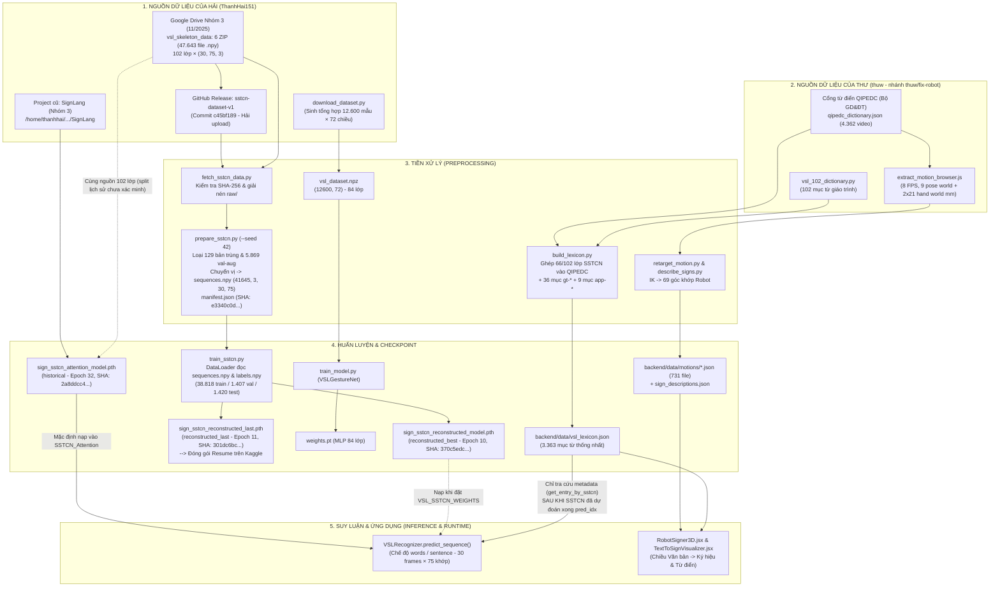

**PROMPT ID:** PROMPT 01
**PROMPT NAME:** DATASET PROVENANCE AUDIT

# BÁO CÁO KIỂM TOÁN NGUỒN GỐC DỮ LIỆU (DATASET PROVENANCE AUDIT)

- **Dự án:** Hệ thống Giao tiếp Hai chiều Ngôn ngữ Ký hiệu Việt Nam (`VSL Connect AI`)
- **Đường dẫn Repository:** `E:\NAM4\SEMINAR\SIGN_LANGUAGE` (`https://github.com/ThanhHai151/SIGN_LANGUAGE.git`)
- **Ngày kiểm toán:** `2026-11-08`
- **Phạm vi kiểm toán:** Toàn bộ lịch sử Git (28 commits trên mọi nhánh và tag), cấu trúc thư mục dữ liệu, mã nguồn tiền xử lý, kịch bản huấn luyện, siêu dữ liệu (metadata/manifest), và trọng số mô hình (`checkpoints`).
- **Trạng thái can thiệp:** **Chỉ đọc (Read-only Audit)** — Không sửa mã nguồn, không thay đổi dataset, không ghi đè checkpoint, không huấn luyện lại mô hình.

---

## NHIỆM VỤ 1 — TRUY VẾT DATASET CỦA THƯ VÀ HẢI

### 1.1. Tổng quan lịch sử đóng góp và nhánh Git

Qua kiểm tra toàn bộ lịch sử Git (`git log --all --graph`, `git shortlog -sne --all`, `git branch -a`, `git tag -l`), dự án có các thành viên và nhánh liên quan trực tiếp đến dữ liệu như sau:

| Thành viên | Định danh Git (`Author <Email>`) | Số commit | Nhánh / Tag liên quan | Vai trò dữ liệu trong dự án |
| :--- | :--- | :---: | :--- | :--- |
| **Hải** | `ThanhHai151 <thanhhai1512005@gmail.com>` | 3 | `main`, tag `sstcn-dataset-v1` | Đưa lên (1) dataset tổng hợp tĩnh `vsl_dataset.npz` (84 lớp) + checkpoint `historical` (`sign_sstcn_attention_model.pth`) ở commit đầu tiên (`89e00618`); và (2) khôi phục, chuẩn hóa, phân phối bộ dữ liệu chuỗi khung xương **SSTCN 102 lớp** (47.643 file gốc $\rightarrow$ 41.645 mẫu sau xử lý) cùng 2 checkpoint `reconstructed_best` và `reconstructed_last` (`4e000717`, `c45bf189`). |
| **Thư** | `thuw <minhthww2005@gmail.com>` | 2 | `origin/thuw/fix-robot` (merge vào `main` tại PR #1 `ffb7dd5a`) | Đưa lên bộ từ điển đa phương tiện **QIPEDC** (`qipedc_dictionary.json`), bảng tần suất âm tiết (`vi_syllable_freq.tsv`), bộ từ vựng hợp nhất (`vsl_lexicon.json`, 3.363 mục), **731 file chuyển động góc khớp Robot 3D** (`backend/data/motions/*.json`), và **731 mô tả ký hiệu tự động** (`sign_descriptions.json`) tại commit `c0a76c07`. |
| **Hằng** *(Bổ sung để hoàn chỉnh bức tranh repo)* | `ThanhHang2503` / `Bùi Thị Thanh Hằng <thanhhang250305@gmail.com>` | 13 | `origin/feature/backend-diagnostics`, `origin/fix/live-mode-switching` | Thêm các tập fixture mốc bàn tay tĩnh 21 khớp (`backend/tests/fixtures/real_digit_*.json`, `real_alphabet_landmarks.json`) trích xuất từ video QIPEDC cục bộ để hiệu chỉnh bộ phân loại hình học cho chế độ `letters` và `digits` (`551d0dd0`, `c3874d6a`, `4b9d084f`). |

> [!IMPORTANT]
> **Nguyên tắc phân biệt Người Upload và Người Tạo Dataset Gốc:**
> Trong cả hai trường hợp của **Thư** và **Hải**, người commit/upload dữ liệu lên repository hiện tại **không phải là tác giả quay các video ngôn ngữ ký hiệu gốc**:
> - **Thư** viết công cụ trích xuất landmark trình duyệt (`extract_motion_browser.js`) và thuật toán động học ngược (`retarget_motion.py`) trên nền **kho video công khai của Dự án QIPEDC (Bộ GD&ĐT)**.
> - **Hải** khôi phục bộ 6 file ZIP dữ liệu khung xương (`data_01.zip`..`data_05.zip`, `test_set.zip`) từ liên kết Google Drive nằm trong báo cáo cũ `test_set_result_report_nhom3.docx` (thuộc dự án tiền nhiệm `/home/thanhhai/Documents/UNIVERSITY/TOOL/SignLang` — "Nhóm 3", tạo ngày `22/11/2025`, dựa trên hệ thống 102 bài giảng ký hiệu lưu trên Supabase `gajsffqnyujwyllfcmny.supabase.co`).

---

### 1.2. Hồ sơ chi tiết các Dataset của THƯ (`thuw <minhthww2005@gmail.com>`)

Toàn bộ dữ liệu của Thư được đưa vào nhánh `origin/thuw/fix-robot` tại commit [`c0a76c07d4035a047e5f7da18661699e4810ead0`](file:///e:/NAM4/SEMINAR/SIGN_LANGUAGE/backend/training/build_lexicon.py) (*"Robot học ký hiệu từ video QIPEDC, từ vựng thống nhất, diễn tả ký hiệu, video Từ điển mượt"*, ngày `2026-10-16 09:15:41 +0000`) và được hợp nhất vào `main` qua Merge PR #1 (`ffb7dd5a214e230f8ad61eb4d9f6c11db27e7a45`, ngày `2026-10-28 19:24:46 +0700`).

#### (1) Danh mục từ điển gốc QIPEDC & Tần suất âm tiết
1. **Tên & Đường dẫn chính xác:**
   - [backend/data/sources/qipedc_dictionary.json](file:///e:/NAM4/SEMINAR/SIGN_LANGUAGE/backend/data/sources/qipedc_dictionary.json) (`SHA-256: a1a20e0a65aa330ef3041a1abc23855c7a5a100b204a2ae7794256bc8d94ca2d`)
   - [backend/data/sources/vi_syllable_freq.tsv](file:///e:/NAM4/SEMINAR/SIGN_LANGUAGE/backend/data/sources/vi_syllable_freq.tsv) (3.891 dòng)
   - Tài liệu mô tả: [backend/data/sources/README.md](file:///e:/NAM4/SEMINAR/SIGN_LANGUAGE/backend/data/sources/README.md)
2. **Người upload:** Thư (`thuw <minhthww2005@gmail.com>`).
3. **Bằng chứng Git:** Commit `c0a76c07d4035a047e5f7da18661699e4810ead0` (`2026-10-16`).
4. **Nguồn dữ liệu ban đầu:**
   - `qipedc_dictionary.json`: Thu thập từ cổng dữ liệu công khai của **Dự án Nâng cao chất lượng giáo dục học sinh khiếm thính (QIPEDC) — Bộ Giáo dục và Đào tạo** (`https://qipedc.moet.gov.vn/dictionary`).
   - `vi_syllable_freq.tsv`: Nguồn công khai `FrequencyWords` (Hermit Dave, trích từ phụ đề OpenSubtitles 2018, giấy phép CC BY-SA 4.0).
5. **Số lượng mẫu, lớp, định dạng & cấu trúc:**
   - `qipedc_dictionary.json`: Mảng JSON gồm **4.362 dòng video** đại diện cho **3.318 mục từ vựng** (nhiều từ có biến thể 3 miền Bắc `B`, Trung `T`, Nam `N`). Mỗi phần tử có cấu trúc 6 trường: `[mã_video, từ, từ_loại, giải_nghĩa, type, có_ảnh_minh_họa]`.
6. **Bản chất (Gốc hay qua xử lý):** Metadata danh mục gốc thu thập từ API `/dictionary/getAll` của cổng QIPEDC (chỉ lưu siêu dữ liệu và liên kết URL, không lưu4.362 file video MP4 trong Git).

#### (2) Bộ từ vựng VSL thống nhất (`vsl_lexicon.json`)
1. **Tên & Đường dẫn chính xác:** [backend/data/vsl_lexicon.json](file:///e:/NAM4/SEMINAR/SIGN_LANGUAGE/backend/data/vsl_lexicon.json) (`2.122.573 bytes`, `SHA-256: 30e353102f6950a5093b560a9b2afe5327d3c7eff3023369d763cbef6eba53fd`).
2. **Người tạo & upload:** Thư (`thuw`), sinh tự động từ kịch bản [backend/training/build_lexicon.py](file:///e:/NAM4/SEMINAR/SIGN_LANGUAGE/backend/training/build_lexicon.py).
3. **Bằng chứng Git:** Commit `c0a76c07d4035a047e5f7da18661699e4810ead0`.
4. **Nguồn dữ liệu & Quan hệ kế thừa:**
   Là sản phẩm **tích hợp siêu dữ liệu (metadata fusion)** từ 3 nguồn trong repo ([build_lexicon.py](file:///e:/NAM4/SEMINAR/SIGN_LANGUAGE/backend/training/build_lexicon.py#L9-L18)):
   - `3.318` mục từ từ `qipedc_dictionary.json` (nguồn `"QIPEDC"`).
   - `102` lớp ký hiệu giáo trình từ [backend/models/vsl_102_dictionary.py](file:///e:/NAM4/SEMINAR/SIGN_LANGUAGE/backend/models/vsl_102_dictionary.py) (vốn do Hải commit từ `89e00618`): Kịch bản ghép thành công **66/102** lớp SSTCN vào mục từ QIPEDC tương ứng (gán trường `sstcn_index` và thêm biến thể video `"Giáo trình 102"`), còn **36/102** lớp không khớp từ khóa QIPEDC được tạo thành mục riêng có tiền tố `gt-*` (nguồn `"Giáo trình VSL (102 từ)"`).
   - `50` tư thế robot tĩnh từ [backend/models/vsl_dictionary.py](file:///e:/NAM4/SEMINAR/SIGN_LANGUAGE/backend/models/vsl_dictionary.py) và `src/utils/handPoses.js` (trong đó 41 tư thế ghép vào mục QIPEDC, 9 tư thế tạo mục riêng `app-*` với nguồn `"Robot 3D (ứng dụng)"`).
5. **Số lượng mẫu & Cấu trúc:** Tổng cộng **3.363 mục từ** (`3318 + 36 + 9`), quản lý **4.464 liên kết video**, **804 từ thông dụng (`common`)**, **102 mục gắn `sstcn_index` (`0..101`)**.
6. **Vai trò:** Chỉ dùng để **tra cứu từ điển hai chiều** (`Text → Sign` và hiển thị thông tin hậu xử lý sau khi `SSTCN_Attention` đã dự đoán ra chỉ số lớp `pred_idx`). **Hoàn toàn không chứa dữ liệu chuỗi khung xương để huấn luyện SSTCN.**

#### (3) Bộ dữ liệu chuyển động góc khớp Robot 3D (`backend/data/motions/*.json`) & Mô tả ký hiệu (`sign_descriptions.json`)
1. **Tên & Đường dẫn chính xác:**
   - [backend/data/motions/](file:///e:/NAM4/SEMINAR/SIGN_LANGUAGE/backend/data/motions/_layout.json): Gồm **731 file `<mã_video>.json`** (ví dụ `D0001B.json` .. `W04071.json`) + 1 file định nghĩa kênh [_layout.json](file:///e:/NAM4/SEMINAR/SIGN_LANGUAGE/backend/data/motions/_layout.json) (tổng 732 file).
   - Mẫu dữ liệu thô kiểm thử: [backend/tests/fixtures/raw_W03990.json](file:///e:/NAM4/SEMINAR/SIGN_LANGUAGE/backend/tests/fixtures/raw_W03990.json).
   - File mô tả động tác: [backend/data/sign_descriptions.json](file:///e:/NAM4/SEMINAR/SIGN_LANGUAGE/backend/data/sign_descriptions.json) (`748.090 bytes`, 731 mục, `SHA-256: 447899f5dc7923a5f2338e42005308165de3826d8c0d392de8549acada7f39e0`).
2. **Người tạo & upload:** Thư (`thuw`),commit `c0a76c07d4035a047e5f7da18661699e4810ead0`.
3. **Quy trình trích xuất & Tiền xử lý:**
   - **Bước 1 (Trích xuất thô trong trình duyệt):** Chạy [backend/training/extract_motion_browser.js](file:///e:/NAM4/SEMINAR/SIGN_LANGUAGE/backend/training/extract_motion_browser.js#L20-L69) trực tiếp trên trang `https://qipedc.moet.gov.vn/dictionary` bằng `@mediapipe/tasks-vision@0.10.14` (`HolisticLandmarker`) ở tốc độ **8 FPS**. Mỗi khung hình chỉ trích xuất **9 khớp Pose World** (`[0, 11, 12, 13, 14, 15, 16, 23, 24]` — mũi, 2 vai, 2 khuỷu, 2 cổ tay, 2 hông, đơn vị **milimét** trong hệ tọa độ thực `poseWorldLandmarks`) + **21 khớp bàn tay trái** (`leftHandWorldLandmarks`, mm) + **21 khớp bàn tay phải** (`rightHandWorldLandmarks`, mm) $\rightarrow$ đóng gói thành `qipedc_motion_raw.json.gz` (nằm ngoài Git, trừ 1 mẫu `raw_W03990.json`).
   - **Bước 2 (Chuyển đổi Retargeting sang góc khớp Robot):** Chạy [backend/training/batch_retarget.py](file:///e:/NAM4/SEMINAR/SIGN_LANGUAGE/backend/training/batch_retarget.py) và [backend/training/retarget_motion.py](file:///e:/NAM4/SEMINAR/SIGN_LANGUAGE/backend/training/retarget_motion.py) để giải bài toán Động học ngược (Inverse Kinematics 2 đoạn cánh tay, tách swing–twist cổ tay, góc gập/xòe ngón tay, nội suy khoảng trống, làm mượt bộ lọc `[0.25, 0.5, 0.25]`), lọc bỏ các video có `hand_coverage < 0.15`.
4. **Định dạng & Cấu trúc:**
   - Mỗi file `backend/data/motions/<id>.json` lưu chuỗi khung hình thời lượng biến thiên (8 FPS), mỗi khung hình là mảng phẳng gồm **69 kênh góc quay Euler (radian)** (`3 torso + 33 right arm/hand + 33 left arm/hand` theo [_layout.json](file:///e:/NAM4/SEMINAR/SIGN_LANGUAGE/backend/data/motions/_layout.json)).
5. **Khả năng tương thích với SSTCN:** **Hoàn toàn KHÔNG tương thích và KHÔNG liên quan đến huấn luyện SSTCN.** Dữ liệu này chỉ có 9 khớp pose (thay vì 33 khớp), dùng hệ tọa độ World (mm) đã biến đổi sang 69 góc khớp Euler của Robot Three.js (`RobotSigner3D.jsx`), tốc độ 8 FPS, số frame thay đổi theo độ dài video.

---

### 1.3. Hồ sơ chi tiết các Dataset của HẢI (`ThanhHai151 <thanhhai1512005@gmail.com>`)

Kiểm tra lịch sử Git cho thấy **Hải** đã đưa lên repository **2 bộ dữ liệu hoàn toàn khác nhau** ở hai giai đoạn phát triển:

#### (1) Dataset Hải #1 — Tập dữ liệu Bàn tay Tĩnh Tổng hợp (`vsl_dataset.npz` — 84 lớp)
1. **Tên & Đường dẫn chính xác:**
   - [backend/data/vsl_dataset.npz](file:///e:/NAM4/SEMINAR/SIGN_LANGUAGE/backend/data/vsl_dataset.npz) (`3.043.079 bytes`, `SHA-256: 7273bbff38b3dee7e760177c308a8824c101a3fd061d683b1689fc1b8309523f`)
   - [backend/data/dataset_metadata.json](file:///e:/NAM4/SEMINAR/SIGN_LANGUAGE/backend/data/dataset_metadata.json) (`1.935 bytes`)
2. **Người upload:** Hải (`ThanhHai151 <thanhhai1512005@gmail.com>`).
3. **Bằng chứng Git:** Commit khởi tạo dự án `89e00618748bc9ba46dc23b02816bfb20261e51d` (*"first commit"*, ngày `2026-09-23 13:22:42 +0700`).
4. **Nguồn dữ liệu ban đầu (Phát hiện kiểm toán quan trọng):**
   - Mặc dù [backend/data/dataset_metadata.json](file:///e:/NAM4/SEMINAR/SIGN_LANGUAGE/backend/data/dataset_metadata.json#L92-L105) ghi trường `"sources"` tham chiếu tới 3 URL (`huggingface.co/datasets/namwu/ViSignLanguage-Video`, `kaggle.com/datasets/namwu/vi-sign-languages`, `github.com/dxli96/WLASL`), kiểm tra mã nguồn tạo file tại [backend/training/download_dataset.py](file:///e:/NAM4/SEMINAR/SIGN_LANGUAGE/backend/training/download_dataset.py#L38-L236) chứng minh **100% dữ liệu trong `vsl_dataset.npz` là dữ liệu giả lập sinh tự động bằng thuật toán (procedural synthetic data)**:
     - Hàm `generate_base_hand_landmarks(sign_class)` ([download_dataset.py](file:///e:/NAM4/SEMINAR/SIGN_LANGUAGE/backend/training/download_dataset.py#L38-L168)) gán cứng tọa độ 21 điểm bàn tay theo một số nhóm cơ bản (`flat_open_classes`, `fist_classes`, `index_classes`), sau đó cộng độ lệch giả tạo theo chỉ số lớp `cls_idx`:
       `thumb_shift = ((cls_idx % 9) - 4) * 0.025`, `index_shift = (((cls_idx // 3) % 9) - 4) * 0.025`, `pinky_shift = (((cls_idx // 9) % 9) - 4) * 0.025`.
     - Hàm `build_augmented_dataset(samples_per_class=150)` ([download_dataset.py](file:///e:/NAM4/SEMINAR/SIGN_LANGUAGE/backend/training/download_dataset.py#L176-L236)) cộng nhiễu Gauss $\mathcal{N}(0, 0.015)$, xoay ngẫu nhiên $\pm 15^\circ$, co giãn $0.9\text{--}1.1$, và rút trích vector đặc trưng 72 chiều qua `normalize_hand_landmarks()`.
5. **Số lượng mẫu, lớp, định dạng & cấu trúc:**
   - **12.600 mẫu** (`84 lớp × 150 mẫu/lớp`), gồm `X` shape `(12600, 72)` (`float32`) và `y` shape `(12600,)` (`int64`).
   - 84 lớp gồm 27 chữ cái + 56 từ vựng dạng mã `XIN_CHAO`, `CAM_ON`, ... + `NEUTRAL` ([backend/models/sign_model.py](file:///e:/NAM4/SEMINAR/SIGN_LANGUAGE/backend/models/sign_model.py#L13-L25)).
6. **Liên quan đến mô hình nào:** Dùng bởi [backend/training/train_model.py](file:///e:/NAM4/SEMINAR/SIGN_LANGUAGE/backend/training/train_model.py) để huấn luyện mạng MLP tĩnh 3 lớp `VSLGestureNet` (`input_dim=72, num_classes=84`), xuất ra trọng số [backend/models/weights.pt](file:///e:/NAM4/SEMINAR/SIGN_LANGUAGE/backend/models/weights.pt) (`SHA-256: 6965b4ffd9eed45c10317f0cc4eff4552c081f18ea997d74365907be`). **Không liên quan đến mô hình chuỗi `SSTCN_Attention` (102 lớp).**

#### (2) Dataset Hải #2 — Tập dữ liệu Chuỗi Khung xương 75 khớp SSTCN 102 lớp (`vsl_skeleton_data` / `sstcn-dataset-v1`)
1. **Tên & Đường dẫn chính xác:**
   - **Cấu hình nguồn & Checksum:** [backend/data/sstcn/sources.json](file:///e:/NAM4/SEMINAR/SIGN_LANGUAGE/backend/data/sstcn/sources.json), [backend/data/sstcn/SHA256SUMS.txt](file:///e:/NAM4/SEMINAR/SIGN_LANGUAGE/backend/data/sstcn/SHA256SUMS.txt), [backend/data/sstcn/download_receipt.json](file:///e:/NAM4/SEMINAR/SIGN_LANGUAGE/backend/data/sstcn/download_receipt.json).
   - **Metadata & Phân chia tập dữ liệu:** [backend/data/sstcn/classes.json](file:///e:/NAM4/SEMINAR/SIGN_LANGUAGE/backend/data/sstcn/classes.json), [backend/data/sstcn/dataset_summary.json](file:///e:/NAM4/SEMINAR/SIGN_LANGUAGE/backend/data/sstcn/dataset_summary.json), [backend/data/sstcn/splits.csv](file:///e:/NAM4/SEMINAR/SIGN_LANGUAGE/backend/data/sstcn/splits.csv) (`41.646 dòng`), và bản nén toàn bộ manifest [docs/sstcn/evaluation/sstcn_reconstructed_full/dataset_manifest.json.gz](file:///e:/NAM4/SEMINAR/SIGN_LANGUAGE/docs/sstcn/evaluation/sstcn_reconstructed_full/dataset_manifest.json.gz) (giải nén ra `manifest.json` có `SHA-256: e3340c0d55b27dce703a1575d721c339c73609dc19ad730d616f027099fb3920`).
   - **Tài liệu lịch sử đi kèm:** [docs/sstcn/legacy/test_set_result_report_nhom3.docx](file:///e:/NAM4/SEMINAR/SIGN_LANGUAGE/docs/sstcn/legacy/test_set_result_report_nhom3.docx), [docs/sstcn/legacy/training_log.png](file:///e:/NAM4/SEMINAR/SIGN_LANGUAGE/docs/sstcn/legacy/training_log.png), [docs/sstcn/legacy/provenance.json](file:///e:/NAM4/SEMINAR/SIGN_LANGUAGE/docs/sstcn/legacy/provenance.json).
   - **6 file nén dữ liệu thô (1,67 GiB — lưu ngoài Git, phân phối qua GitHub Releases & Google Drive):**
     - `data_01.zip` (`328.402.029 bytes`, `SHA-256: df04d686836d1e2bbf8b476af3ea4282c7cd7a5e909bacac1fb61ce9185a9e14`) — 8.362 file `.npy`
     - `data_02.zip` (`644.227.415 bytes`, `SHA-256: 565370f2d1230d7d68add63a1e6b06ef36b06d4a84e25f8cda45868ca759b6c8`) — 16.376 file `.npy`
     - `data_03.zip` (`351.923.502 bytes`, `SHA-256: 3133bbfe3ebe477e877ee6f09549e4319e9a187e46135efbd5b0da7613de1500`) — 8.256 file `.npy`
     - `data_04.zip` (`414.055.634 bytes`, `SHA-256: 432d958a40d1d487a4bc9c1bbc3a5e521890087259ea8756f97aeb93715917a6`) — 12.429 file `.npy`
     - `data_05.zip` (`26.902.565 bytes`, `SHA-256: 842789c73ad8cd42f077d8159910a5ada78ed2f29e5f0d77e2c697984bb3b91d`) — 800 file `.npy`
     - `test_set.zip` (`28.366.679 bytes`, `SHA-256: f44df240c9bf4d2a09c00b065501eafb4b5d8e7a68611d07366c5a1566b1ddfe`) — 1.420 file `.npy`
2. **Người upload & khôi phục:** Hải (`ThanhHai151 <thanhhai1512005@gmail.com>`).
3. **Bằng chứng Git:**
   - Commit [`89e00618748bc9ba46dc23b02816bfb20261e51d`](file:///e:/NAM4/SEMINAR/SIGN_LANGUAGE/backend/models/vsl_102_dictionary.py) (`2026-09-23`): Thêm từ điển 102 lớp `vsl_102_dictionary.py`, mô hình `sstcn_model.py`, và checkpoint lịch sử `sign_sstcn_attention_model.pth`.
   - Commit [`4e0007176a7cd2e61bc90787517e5b38385b13a7`](file:///e:/NAM4/SEMINAR/SIGN_LANGUAGE/docs/sstcn/STATUS.md) (`2026-10-30 19:30:53 +0700`): Thêm toàn bộ pipeline huấn luyện SSTCN, metadata khôi phục dataset, báo cáo legacy DOCX, và 2 checkpoint `sign_sstcn_reconstructed_model.pth`, `sign_sstcn_reconstructed_last.pth`.
   - Commit [`c45bf189167a94f9aa1b22e07e0e7336f08fd889`](file:///e:/NAM4/SEMINAR/SIGN_LANGUAGE/backend/data/sstcn/sources.json) (`2026-10-30 19:36:52 +0700`, tag `sstcn-dataset-v1`): Phân phối 6 file ZIP qua GitHub Releases (`https://github.com/ThanhHai151/SIGN_LANGUAGE/releases/tag/sstcn-dataset-v1`).
4. **Truy nguyên nguồn gốc ban đầu (Ai tạo ra dataset gốc?):**
   - Theo [docs/sstcn/legacy/provenance.json](file:///e:/NAM4/SEMINAR/SIGN_LANGUAGE/docs/sstcn/legacy/provenance.json) và [backend/data/sstcn/sources.json](file:///e:/NAM4/SEMINAR/SIGN_LANGUAGE/backend/data/sstcn/sources.json#L2-L3), đường dẫn thư mục Google Drive gốc (`https://drive.google.com/drive/folders/132sA_E7PMwnuC_WZpFi50I--Ncbo9LwX?usp=sharing`) được Hải tìm thấy trong tài liệu báo cáo cũ `/home/thanhhai/Documents/UNIVERSITY/TOOL/SignLang/Test/test_set_result_report_nhom3.docx` (được sao lưu vào [docs/sstcn/legacy/test_set_result_report_nhom3.docx](file:///e:/NAM4/SEMINAR/SIGN_LANGUAGE/docs/sstcn/legacy/test_set_result_report_nhom3.docx)).
   - Giải nén cấu trúc XML bên trong `test_set_result_report_nhom3.docx` (`docProps/core.xml` và `word/document.xml`) cho thấy:
     - File báo cáo được tạo bởi `<dc:creator>DELL</dc:creator>` vào ngày **`2025-11-22T16:27:00Z`**, chỉnh sửa lần cuối **`2025-11-23T04:18:00Z`**, mang tên `test_set_result_report_nhom3.docx` (**Nhóm 3**).
     - Giải mã JWT token trong trường `image_url` của [backend/models/vsl_102_dictionary.py](file:///e:/NAM4/SEMINAR/SIGN_LANGUAGE/backend/models/vsl_102_dictionary.py#L122) (`"iat": 1761575054`) cho thấy kho ảnh/video bài giảng 102 lớp trên Supabase (`gajsffqnyujwyllfcmny.supabase.co` và `ffqmgqkauhwfxinatqol.supabase.co`) được khởi tạo vào ngày **`2025-10-27`**.
     - Báo cáo DOCX ghi rõ: *"Test set bao gồm 1420 videos, mỗi nhãn có từ 10 – 15 videos, mỗi video được trích xuất ra chuỗi skeleton để đưa vào mô hình dự đoán."* Số lượng mẫu (`Support`) của từng lớp trong Bảng 2 của báo cáo DOCX khớp **tuyệt đối 100%** với số lượng file của từng lớp trong `test_set.zip` (tổng 1.420 mẫu).
   - **Kết luận về nguồn gốc:** Bộ dữ liệu 47.643 file `.npy` là dữ liệu **khung xương đã qua tiền xử lý và tăng cường ngoại tuyến (pre-extracted & pre-augmented MediaPipe Holistic skeletons)** từ một bộ video quay người thực hiện 102 ký hiệu theo giáo trình 6 bài học (từ dự án trước đó của Nhóm 3 / `SignLang` tháng 10–11/2025). **Hải (`ThanhHai151`) là người thừa kế dự án cục bộ `/home/thanhhai/Documents/UNIVERSITY/TOOL/SignLang`, khôi phục 6 file ZIP từ Google Drive của báo cáo Nhóm 3, xây dựng lại quy trình chuẩn bị dữ liệu sạch (`prepare_sstcn.py`), và đăng tải lên GitHub Releases `sstcn-dataset-v1`.**
5. **Số lượng mẫu, lớp, định dạng & cấu trúc:**
   - **Số lớp:** **102 lớp** (`0..101`), chia thành 6 bài học:
     - Bài 1 — Bảng chữ cái: 29 lớp (`0..28`: `A` .. `Y`)
     - Bài 2 — Số đếm và Thời gian: 22 lớp (`29..38`: `Số 1` .. `Số 10`; `39..50`: `Thời gian` .. `Đêm`)
     - Bài 3 — Làm quen và Cảm xúc: 16 lớp (`51..66`: `Tôi` .. `Làm gì`)
     - Bài 4 — Hoạt động hằng ngày: 13 lớp (`67..79`: `Đi` .. `Cười`)
     - Bài 5 — Gia đình: 15 lớp (`80..94`: `Gia đình` .. `Yêu`)
     - Bài 6 — Nghề nghiệp: 7 lớp (`95..101`: `Cô giáo` .. `Bộ đội`)
     *(Tổng số lớp từ vựng là **63 lớp** từ `39..101`, cộng 29 chữ cái `0..28` và 10 chữ số `29..38` = 102 lớp).*
   - **Định dạng file thô (`.npy` trong 6 ZIP):** Tổng cộng **47.643 file** theo quy ước tên `sign_XXX/sign_XXX_vid_YY_ZZ.npy` (trong đó `ZZ=00` là bản gốc, `ZZ=01..09` là các bản tăng cường dữ liệu ngoại tuyến). Mỗi file `.npy` lưu một mảng vô hướng kiểu `object` chứa dictionary Python `{"keypoints": ndarray(30, 75, 3), "label": int}` ([sstcn_data.py](file:///e:/NAM4/SEMINAR/SIGN_LANGUAGE/backend/training/sstcn_data.py#L55-L73)).
   - **Định dạng sau tiền xử lý (`backend/data/sstcn/prepared/`):**
     - `sequences.npy`: Tensor `float32` kích thước **`(41645, 3, 30, 75)`** (`SHA-256: c6cf7cf6db048ffe13c3cdc0deb26c0c2b82798899809054fc20257282824db7`), gồm 3 kênh tọa độ `(x, y, z)` chuẩn hóa theo khung ảnh MediaPipe, 30 khung hình thời gian, 75 khớp (`0..32`: 33 khớp Pose, `33..53`: 21 khớp bàn tay trái, `54..74`: 21 khớp bàn tay phải).
     - `labels.npy`: Tensor `int64` kích thước **`(41645,)`** (`SHA-256: 2cdb36dfffc6c7c481b620fb7e3ae785cab8e587f6135d7d1e5f489bf0bc219e`).
     - Phân chia tập (`seed=42`, `val_fraction=0.15` theo nhóm video nguồn `sign_XXX_vid_YY`):
       - **`train`**: **38.818 mẫu** (giữ cả bản gốc `_00` và các bản tăng cường `_01.._09` của các nhóm video train sau khi loại 129 bản trùng lặp tuyệt đối).
       - **`val`**: **1.407 mẫu** (chỉ giữ bản gốc `_00` của 15% nhóm video validation; loại bỏ **5.869 bản tăng cường** thuộc các nhóm validation để tránh rò rỉ đánh giá).
       - **`test`**: **1.420 mẫu** (giữ nguyên toàn bộ 1.420 bản gốc `_00` từ `test_set.zip`).

---

## NHIỆM VỤ 2 — XÁC ĐỊNH DATASET THỰC SỰ ĐƯỢC DÙNG ĐỂ TRAIN

### 2.1. Truy vết đường đi dữ liệu đầu–cuối của mô hình `SSTCN_Attention`

```text
[6 ZIP Archives: data_01..05.zip + test_set.zip (47.643 file .npy)]
  ├── Nguồn gốc: Google Drive (132sA_E7PMwnuC_WZpFi50I--Ncbo9LwX) trong báo cáo Nhóm 3
  └── Bản sao phân phối: GitHub Release tag "sstcn-dataset-v1" (do Hải upload)
        │
        ▼ (1) Tải & Xác thực SHA-256: backend/training/fetch_sstcn_data.py
[backend/data/sstcn/raw/{data_01..data_05, test_set}/.../sign_XXX_vid_YY_ZZ.npy]
        │
        ▼ (2) Tiền xử lý & Chia tập: backend/training/prepare_sstcn.py (--seed 42 --val-fraction 0.15)
        │     • Đọc dict {"keypoints": (30,75,3), "label": int} qua _NumpyUnpickler an toàn
        │     • Chuyển vị (transpose) (30,75,3) -> (3,30,75) float32 (không chuẩn hóa lại cổ tay/vai)
        │     • Loại 129 sequence trùng SHA-256; gom nhóm theo sign_XXX_vid_YY
        │     • Tách 15% nhóm video làm val (loại 5.869 bản _01.._09 khỏi val)
[backend/data/sstcn/prepared/]
  ├── sequences.npy : shape (41645, 3, 30, 75), SHA-256: c6cf7cf6...
  ├── labels.npy    : shape (41645,),           SHA-256: 2cdb36df...
  └── manifest.json : 38.818 train / 1.407 val / 1.420 test, SHA-256: e3340c0d...
        │
        ▼ (3) Nạp dữ liệu: load_prepared() (sstcn_data.py) + SequenceDataset / DataLoader (train_sstcn.py)
[backend/training/train_sstcn.py]
  ├── Kiến trúc: SSTCN_Attention(num_classes=102, num_joints=75, in_channels=3, dropout=0.3)
  ├── Cấu hình: seed=42, batch_size=32, AdamW(lr=1e-3, wd=1e-4), ReduceLROnPlateau, AMP=True
  └── Chạy 12 epochs (0..11) trên RTX 3050 Ti Laptop GPU (ngày 2026-10-30)
        │
        ├──► Epoch 10 (best val acc 85.79%, test acc 88.66%):
        │    backend/models/weights/sign_sstcn_reconstructed_model.pth (SHA-256: 370c5edc...)
        │
        └──► Epoch 11 (last epoch, dùng trong vsl_kaggle_resume_bundle.zip):
             backend/models/weights/sign_sstcn_reconstructed_last.pth  (SHA-256: 301dc6bc...)
```

### 2.2. Trả lời chi tiết các câu hỏi kiểm tra trong Nhiệm vụ 2

1. **Script nào dùng để train mô hình SSTCN?**
   - Script huấn luyện hiện tại là [backend/training/train_sstcn.py](file:///e:/NAM4/SEMINAR/SIGN_LANGUAGE/backend/training/train_sstcn.py) (hàm `train(args)` tại dòng 77–213), gọi kiến trúc [`SSTCN_Attention`](file:///e:/NAM4/SEMINAR/SIGN_LANGUAGE/backend/models/sstcn_model.py#L30-L99).
   - *(Lưu ý: File [backend/training/train_model.py](file:///e:/NAM4/SEMINAR/SIGN_LANGUAGE/backend/training/train_model.py) **không** huấn luyện SSTCN mà chỉ huấn luyện mô hình MLP tĩnh 84 lớp `VSLGestureNet` trên `vsl_dataset.npz`).*

2. **Đường dẫn dataset được khai báo ở đâu?**
   - Trong [backend/training/sstcn_data.py](file:///e:/NAM4/SEMINAR/SIGN_LANGUAGE/backend/training/sstcn_data.py#L16): `DATA_ROOT = Path(__file__).resolve().parents[1] / "data" / "sstcn"` (`backend/data/sstcn`).
   - Trong [backend/training/fetch_sstcn_data.py](file:///e:/NAM4/SEMINAR/SIGN_LANGUAGE/backend/training/fetch_sstcn_data.py#L118-L119): Đọc danh sách URL/ID từ `backend/data/sstcn/sources.json`, tải ZIP vào `backend/data/sstcn/archives/` và giải nén vào `backend/data/sstcn/raw/`.
   - Trong [backend/training/prepare_sstcn.py](file:///e:/NAM4/SEMINAR/SIGN_LANGUAGE/backend/training/prepare_sstcn.py#L221-L222): Mặc định `--input backend/data/sstcn/raw` và `--output backend/data/sstcn/prepared`.
   - Trong [backend/training/train_sstcn.py](file:///e:/NAM4/SEMINAR/SIGN_LANGUAGE/backend/training/train_sstcn.py#L218): Mặc định `--data backend/data/sstcn/prepared`.

3. **DataLoader thực tế đọc file nào?**
   - Hàm [`load_prepared(directory)`](file:///e:/NAM4/SEMINAR/SIGN_LANGUAGE/backend/training/sstcn_data.py#L120-L136) trong `sstcn_data.py` kiểm tra đối chiếu SHA-256 rồi đọc trực tiếp 3 file trong `backend/data/sstcn/prepared/`:
     1. `manifest.json` (xác định danh sách chỉ số dòng `row` thuộc `train`, `val`, `test`).
     2. `sequences.npy` (mở ở chế độ memory-mapped `mmap_mode="r"`, shape `(41645, 3, 30, 75)`).
     3. `labels.npy` (mảng nhãn số nguyên `0..101`, shape `(41645,)`).
   - Sau đó, lớp [`SequenceDataset`](file:///e:/NAM4/SEMINAR/SIGN_LANGUAGE/backend/training/evaluate_sstcn.py#L22-L55) (trong `evaluate_sstcn.py`, được import vào `train_sstcn.py` dòng 20) bọc `sequences.npy` và `labels.npy` theo danh sách `ids["train"]` (38.818 mẫu) và `ids["val"]` (1.407 mẫu) để nạp vào PyTorch `DataLoader` ([train_sstcn.py](file:///e:/NAM4/SEMINAR/SIGN_LANGUAGE/backend/training/train_sstcn.py#L168-L178)).

4. **Dataset đang dùng để train SSTCN là của Thư, Hải hay kết hợp cả hai?**
   - **ĐÃ XÁC MINH 100%:** Dataset dùng để train `SSTCN_Attention` là **100% từ nguồn dữ liệu khung xương 102 lớp do Hải khôi phục và phân phối** (`vsl_skeleton_data` trên Google Drive / GitHub Release `sstcn-dataset-v1`), **hoàn toàn KHÔNG sử dụng bất kỳ dữ liệu nào của Thư** (`qipedc_dictionary.json`, `vsl_lexicon.json`, `backend/data/motions/*.json`), cũng **không phải bản kết hợp cả hai**.
   - Dữ liệu của Thư chỉ tham gia vào hệ thống ở hai nơi:
     1. Chiều `Text → Sign` (Robot 3D diễn hoạt ký hiệu từ `backend/data/motions/*.json` và hiển thị mô tả `sign_descriptions.json`).
     2. Chiều `Sign → Text` **sau khi mô hình SSTCN đã suy luận xong**: Trong [`VSLRecognizer.predict_sequence()`](file:///e:/NAM4/SEMINAR/SIGN_LANGUAGE/backend/vision/recognizer.py#L151-L160), sau khi `self.sstcn_model(tensor_input)` trả về chỉ số lớp `pred_idx` (`0..101`), hàm mới gọi `get_entry_by_sstcn(pred_idx)` (đọc `vsl_lexicon.json` của Thư) để lấy thêm `entry_id`, danh sách `variants` vùng miền và `image_url` trả về cho giao diện.

5. **Phân biệt dataset của từng phiên bản Checkpoint (`historical`, `reconstructed_best`, `reconstructed_last`, và `weights.pt`):**

| Phiên bản Checkpoint | Đường dẫn file & SHA-256 | Kiến trúc | Dataset huấn luyện thực tế | Mức độ xác minh |
| :--- | :--- | :--- | :--- | :---: |
| **`historical`** *(Mặc định đang chạy trong app khi không đặt biến môi trường `VSL_SSTCN_WEIGHTS`)* | [backend/models/weights/sign_sstcn_attention_model.pth](file:///e:/NAM4/SEMINAR/SIGN_LANGUAGE/backend/models/weights/sign_sstcn_attention_model.pth)<br>`SHA-256: 2a8ddcc4d06c4f23aa7910caf77371848034dcdf8f4749d134c5894764cf9697` | `SSTCN_Attention` (102 lớp, `epoch=32`) | Được lấy từ dự án cũ `/home/thanhhai/Documents/UNIVERSITY/TOOL/SignLang` (commit `89e00618` của Hải). Cùng hệ 102 lớp (`0..101`) và định dạng `(3, 30, 75)` của bộ dữ liệu Google Drive Nhóm 3 (`132sA_E7PMwnuC_WZpFi50I--Ncbo9LwX`). Tuy nhiên, vì script/notebook lúc train tháng 11/2025 không còn, **không biết chính xác cách chia train/val lịch sử** hay những file `.npy` cụ thể nào trong 6 archive đã được đưa vào train ([sources.json](file:///e:/NAM4/SEMINAR/SIGN_LANGUAGE/backend/data/sstcn/sources.json#L5): `"checkpoint_training_membership": "unverified"`). | **CÓ KHẢ NĂNG — CHƯA ĐỦ BẰNG CHỨNG** *(Cùng gốc dữ liệu 102 lớp Nhóm 3, nhưng chưa xác minh được split lịch sử)* |
| **`reconstructed_best`** | [backend/models/weights/sign_sstcn_reconstructed_model.pth](file:///e:/NAM4/SEMINAR/SIGN_LANGUAGE/backend/models/weights/sign_sstcn_reconstructed_model.pth)<br>`SHA-256: 370c5edcadfbc2b0b2476b6fb7dfe7ca3d53f68f3a2fcb13036e5b7ebabf9fad` | `SSTCN_Attention` (102 lớp, `epoch=10`, khởi tạo ngẫu nhiên) | Huấn luyện mới từ đầu (random init) bởi Hải ngày `2026-10-30` trên bộ **41.645 mẫu** (`38.818 train / 1.407 val / 1.420 test`) tạo bởi `prepare_sstcn.py --seed 42 --val-fraction 0.15` từ đủ 6 archive (`data_01..05.zip`, `test_set.zip`). Khớp tuyệt đối `dataset_manifest_sha256 = e3340c0d...`. | **ĐÃ XÁC MINH** |
| **`reconstructed_last`** *(Checkpoint đang đóng gói resume trên Kaggle)* | [backend/models/weights/sign_sstcn_reconstructed_last.pth](file:///e:/NAM4/SEMINAR/SIGN_LANGUAGE/backend/models/weights/sign_sstcn_reconstructed_last.pth)<br>`SHA-256: 301dc6bcf0d282acf029ad9c8c921766de6da51d5167f7becafbba630ae319ec` | `SSTCN_Attention` (102 lớp, `epoch=11`, khởi tạo ngẫu nhiên) | Cùng một lần chạy (`sstcn_reconstructed_full`) và **cùng chính xác bộ dữ liệu 41.645 mẫu** (`dataset_manifest_sha256 = e3340c0d...`) như `reconstructed_best`, được lưu ở cuối epoch thứ 12 (chỉ số 0-based là `11`). | **ĐÃ XÁC MINH** |
| **`reconstructed_baseline`** *(Chỉ còn báo cáo đánh giá)* | Thư mục báo cáo: [docs/sstcn/evaluation/sstcn_reconstructed_baseline/](file:///e:/NAM4/SEMINAR/SIGN_LANGUAGE/docs/sstcn/evaluation/sstcn_reconstructed_baseline/run_config.json) | `SSTCN_Attention` (102 lớp, 3 epochs) | Chạy thử nghiệm chỉ trên 2 archive `data_01.zip` và `test_set.zip` (`7.283 train / 156 val / 1.420 test`, manifest SHA `ccf7303b...`). | **ĐÃ XÁC MINH** |
| **`weights.pt`** *(Mô hình tĩnh đơn lẻ)* | [backend/models/weights.pt](file:///e:/NAM4/SEMINAR/SIGN_LANGUAGE/backend/models/weights.pt)<br>`SHA-256: 6965b4ffd9eed45c10317f0cc4eff4552c081f18ea997d74365907be` | `VSLGestureNet` (MLP 84 lớp, input 72 chiều) | Huấn luyện bởi `train_model.py` trên bộ dữ liệu giả lập `backend/data/vsl_dataset.npz` (12.600 mẫu do `download_dataset.py` của Hải sinh tự động). | **ĐÃ XÁC MINH** |

6. **Dataset 41.645 mẫu trên Kaggle có thể truy ngược về nguồn của Thư hoặc Hải không?**
   - **ĐÃ XÁC MINH 100%:** Tập dữ liệu `41.645 mẫu` với tensor shape `(41645, 3, 30, 75)` vừa được tái dựng trên Kaggle được truy ngược **trực tiếp và duy nhất về nguồn dữ liệu SSTCN của Hải** ([backend/data/sstcn/sources.json](file:///e:/NAM4/SEMINAR/SIGN_LANGUAGE/backend/data/sstcn/sources.json) $\rightarrow$ GitHub Release `sstcn-dataset-v1` / Google Drive `132sA_E7PMwnuC_WZpFi50I--Ncbo9LwX` từ báo cáo Nhóm 3):
     - Tổng số file `.npy` trong 6 archive gốc: $8.362 + 16.376 + 8.256 + 12.429 + 800 + 1.420 = 47.643\text{ file}$.
     - Trừ $129$ sequence trùng lặp hoàn toàn (`duplicate_sequences_removed = 129`) và trừ $5.869$ bản augmentation thuộc các nhóm validation (`excluded_eval_augmentations = 5869`):
       $$47.643 - 129 - 5.869 = 41.645\text{ mẫu } (38.818\text{ train} + 1.407\text{ val} + 1.420\text{ test})$$
     - Mã băm SHA-256 của `manifest.json` (`e3340c0d55b27dce703a1575d721c339c73609dc19ad730d616f027099fb3920`), `sequences.npy` (`c6cf7cf6db048ffe13c3cdc0deb26c0c2b82798899809054fc20257282824db7`), và `labels.npy` (`2cdb36dfffc6c7c481b620fb7e3ae785cab8e587f6135d7d1e5f489bf0bc219e`) khớp 100% giữa [backend/data/sstcn/dataset_summary.json](file:///e:/NAM4/SEMINAR/SIGN_LANGUAGE/backend/data/sstcn/dataset_summary.json#L450-L460), [docs/sstcn/evaluation/sstcn_reconstructed_full/dataset_manifest.json.gz](file:///e:/NAM4/SEMINAR/SIGN_LANGUAGE/docs/sstcn/evaluation/sstcn_reconstructed_full/dataset_manifest.json.gz), và trường `dataset_manifest_sha256` bên trong `sign_sstcn_reconstructed_last.pth`.

7. **Các nhánh Git có thay đổi nguồn dữ liệu training hay không?**
   - Kiểm tra tất cả 5 nhánh remote (`origin/main`, `origin/thuw/fix-robot`, `origin/feature/camera-sign-to-text-ui`, `origin/feature/backend-diagnostics`, `origin/fix/live-mode-switching`) xác nhận:
     - Nhánh `origin/thuw/fix-robot` chỉ thêm công cụ xây dựng từ điển `build_lexicon.py` và retarget chuyển động robot `retarget_motion.py`, `batch_retarget.py`, `describe_signs.py`; **không chạm vào `train_model.py` hay pipeline huấn luyện SSTCN**.
     - Nhánh `origin/feature/backend-diagnostics` và `origin/fix/live-mode-switching` thêm các công cụ trích xuất landmark chữ cái/chữ số tĩnh (`extract_video_landmarks.py`, `run_alphabet_extraction.py`) phục vụ bộ phân loại hình học; **không thay đổi nguồn dữ liệu huấn luyện SSTCN**.
     - Nguồn dữ liệu huấn luyện SSTCN (`backend/data/sstcn/sources.json`, `fetch_sstcn_data.py`, `prepare_sstcn.py`, `train_sstcn.py`) được Hải thêm trên nhánh `main` tại 2 commit `4e000717` và `c45bf189` ngày `2026-10-30` và giữ nguyên không đổi cho đến `HEAD` hiện tại (`8ee2ad63`).

---

## NHIỆM VỤ 3 — ĐỐI CHIẾU VÀ KIỂM TRA BẰNG CHỨNG

### 3.1. Phân loại bằng chứng trực tiếp vs. suy luận gián tiếp

| Khẳng định kiểm toán | Loại bằng chứng | Chi tiết bằng chứng xác thực (Commit / File / SHA-256) |
| :--- | :---: | :--- |
| **`vsl_dataset.npz` (12.600 mẫu) là dữ liệu giả lập tổng hợp (synthetic), không phải tải từ HuggingFace/Kaggle** | **Xác nhận trực tiếp** | Đọc mã nguồn [backend/training/download_dataset.py](file:///e:/NAM4/SEMINAR/SIGN_LANGUAGE/backend/training/download_dataset.py#L38-L236): hàm `generate_base_hand_landmarks()` khởi tạo mảng hằng số và cộng nhiễu Gauss; biến `DATASET_SOURCES` chỉ được ghi vào `dataset_metadata.json` mà không hề có lệnh `urllib` tải file nào. |
| **Dữ liệu của Thư (`qipedc_dictionary.json`, `motions/*.json`) bắt nguồn từ cổng QIPEDC (Bộ GD&ĐT) và chỉ dùng cho Robot 3D / Từ điển** | **Xác nhận trực tiếp** | Commit `c0a76c07d4035a047e5f7da18661699e4810ead0` của `thuw <minhthww2005@gmail.com>`; mã nguồn [extract_motion_browser.js](file:///e:/NAM4/SEMINAR/SIGN_LANGUAGE/backend/training/extract_motion_browser.js#L49-L68) lấy 9 khớp pose world (mm) ở 8 FPS; [retarget_motion.py](file:///e:/NAM4/SEMINAR/SIGN_LANGUAGE/backend/training/retarget_motion.py) xuất 69 kênh góc Euler vào `backend/data/motions/*.json`. |
| **`reconstructed_best` và `reconstructed_last` được train từ 41.645 mẫu thuộc 6 archive của Hải (`sstcn-dataset-v1`)** | **Xác nhận trực tiếp** | Trường `dataset_manifest_sha256` lưu trong cả 2 file `.pth` (`e3340c0d55b27dce703a1575d721c339c73609dc19ad730d616f027099fb3920`) khớp 100% với file [dataset_manifest.json.gz](file:///e:/NAM4/SEMINAR/SIGN_LANGUAGE/docs/sstcn/evaluation/sstcn_reconstructed_full/dataset_manifest.json.gz) và [dataset_summary.json](file:///e:/NAM4/SEMINAR/SIGN_LANGUAGE/backend/data/sstcn/dataset_summary.json#L459). |
| **6 archive dữ liệu SSTCN (`data_01..05.zip`, `test_set.zip`) bắt nguồn từ dự án Nhóm 3 (`SignLang`) tháng 11/2025** | **Xác nhận trực tiếp** | [docs/sstcn/legacy/provenance.json](file:///e:/NAM4/SEMINAR/SIGN_LANGUAGE/docs/sstcn/legacy/provenance.json) ghi rõ đường dẫn gốc `/home/thanhhai/Documents/UNIVERSITY/TOOL/SignLang/Test/test_set_result_report_nhom3.docx`; bên trong file DOCX (`word/document.xml`, `docProps/core.xml` tạo ngày `2025-11-22`) chứa link Google Drive `132sA_E7PMwnuC_WZpFi50I--Ncbo9LwX` và bảng 102 lớp có cột `Support` khớp từng lớp với 1.420 file trong `test_set.zip`. |
| **Quy ước hậu tố `_00` là bản gốc và `_01.._09` là bản augmentation ngoại tuyến trong 6 archive** | **Suy luận gián tiếp (có cơ sở thực nghiệm)** | Kịch bản tạo 6 archive gốc không còn trong repo. Tuy nhiên, trong `test_set.zip` (1.420 mẫu), 100% file đều có hậu tố `_00` (`sign_XXX_vid_YY_00.npy`), trong khi `data_01..05.zip` có các file cùng `sign_XXX_vid_YY` với hậu tố `_00` kèm `_01.._09` ([docs/sstcn/README.md](file:///e:/NAM4/SEMINAR/SIGN_LANGUAGE/docs/sstcn/README.md#L72-L74)). |
| **Tập dữ liệu chính xác và cách chia train/val đã tạo ra checkpoint `historical` (`sign_sstcn_attention_model.pth`)** | **Suy luận gián tiếp (chưa thể chứng minh tuyệt đối)** | Checkpoint `historical` có `epoch=32`, khớp với ảnh chụp màn hình [docs/sstcn/legacy/training_log.png](file:///e:/NAM4/SEMINAR/SIGN_LANGUAGE/docs/sstcn/legacy/training_log.png) (`Epoch 032 | Val Acc: 0.9102`) đính kèm trong báo cáo Nhóm 3, và đạt `86.62%` trên `test_set.zip`. Tuy nhiên, checkpoint này không lưu hash manifest nên không chứng minh được 100% không có sự chồng lấn giữa tập train cũ và `test_set.zip`. |

### 3.2. Các thành phần nằm ngoài Repository chưa thể kiểm chứng trực tiếp và yêu cầu bổ sung

1. **Tập video MP4 gốc đã dùng để trích xuất ra 47.643 file `.npy` trong 6 archive SSTCN:**
   - **Hiện trạng:** 6 file ZIP trên Google Drive / GitHub Releases chỉ chứa mảng tọa độ khung xương `.npy` đã trích xuất sẵn (`{"keypoints": (30, 75, 3), "label": int}`), không chứa file video `.mp4` gốc của người thực hiện.
   - **Liên kết video mẫu trong `vsl_102_dictionary.py`:** Trỏ tới `https://gajsffqnyujwyllfcmny.supabase.co/storage/v1/object/public/sign_videos/sign_000%20-%20LOOP%20-%20Videobolt.net.mp4` (mỗi lớp chỉ có 1 video bài giảng minh họa, và hiện tại tên miền Supabase này không phân giải được DNS — theo [docs/sstcn/source_access.json](file:///e:/NAM4/SEMINAR/SIGN_LANGUAGE/docs/sstcn/source_access.json)).
   - **Cần bổ sung gì nếu muốn kiểm chứng:** Cần quyền truy cập vào thư mục chứa video quay thô ban đầu hoặc kịch bản/notebook trích xuất MediaPipe + tạo augmentation `_01.._09` của Nhóm 3 (tháng 10–11/2025, máy `DELL`).
2. **Script/Notebook huấn luyện gốc của checkpoint `historical` (`sign_sstcn_attention_model.pth`):**
   - **Hiện trạng:** Trong `/home/thanhhai/Documents/UNIVERSITY/TOOL/SignLang` chỉ khôi phục được file trọng số `.pth`, báo cáo `.docx`, ảnh chụp log `training_log.png` và 3 file GIF demo (`b.gif`, `chao.gif`, `giadinh.gif`).
   - **Cần bổ sung gì nếu muốn kiểm chứng:** File `.ipynb` hoặc `.py` đã chạy 33 epoch (0..32) vào tháng 11/2025 để xác nhận chính xác hàm tiền xử lý video (frame stride, nội suy) và danh sách file train/val lúc đó.
3. **File gói dữ liệu thô `qipedc_motion_raw.json.gz` của Thư:**
   - **Hiện trạng:** Khi Thư chạy `extract_motion_browser.js` trên trình duyệt, dữ liệu thô được xuất ra `qipedc_motion_raw.json.gz` rồi chuyển hóa thành 731 file trong `backend/data/motions/*.json` và `sign_descriptions.json` (trong repo chỉ giữ lại 1 mẫu thô `backend/tests/fixtures/raw_W03990.json`). Tuy nhiên, vì toàn bộ 731 file đích đã có trong Git và mã nguồn `retarget_motion.py` có đầy đủ, phần này không ảnh hưởng đến mô hình nhận diện camera.

---

## NHIỆM VỤ 4 — BÁO CÁO TỔNG HỢP

### A. Bảng đối chiếu hai nguồn dữ liệu (Thư vs. Hải)

*(Vì Hải đưa lên 2 bộ dữ liệu khác nhau, cột của Hải được tách rõ thành **Dataset Hải #1 (MLP tĩnh)** và **Dataset Hải #2 (SSTCN 102 lớp)** để đảm bảo chính xác tuyệt đối).*

| Tiêu chí | Dataset Thư (`thuw`) | Dataset Hải #1 (`ThanhHai151` — Tĩnh) | Dataset Hải #2 (`ThanhHai151` — Chuỗi SSTCN) |
| :--- | :--- | :--- | :--- |
| **Đường dẫn** | • [backend/data/sources/qipedc_dictionary.json](file:///e:/NAM4/SEMINAR/SIGN_LANGUAGE/backend/data/sources/qipedc_dictionary.json)<br>• [backend/data/sources/vi_syllable_freq.tsv](file:///e:/NAM4/SEMINAR/SIGN_LANGUAGE/backend/data/sources/vi_syllable_freq.tsv)<br>• [backend/data/vsl_lexicon.json](file:///e:/NAM4/SEMINAR/SIGN_LANGUAGE/backend/data/vsl_lexicon.json)<br>• [backend/data/motions/*.json](file:///e:/NAM4/SEMINAR/SIGN_LANGUAGE/backend/data/motions/_layout.json) (731 file)<br>• [backend/data/sign_descriptions.json](file:///e:/NAM4/SEMINAR/SIGN_LANGUAGE/backend/data/sign_descriptions.json) | • [backend/data/vsl_dataset.npz](file:///e:/NAM4/SEMINAR/SIGN_LANGUAGE/backend/data/vsl_dataset.npz)<br>• [backend/data/dataset_metadata.json](file:///e:/NAM4/SEMINAR/SIGN_LANGUAGE/backend/data/dataset_metadata.json) | • Cấu hình: [backend/data/sstcn/sources.json](file:///e:/NAM4/SEMINAR/SIGN_LANGUAGE/backend/data/sstcn/sources.json), [splits.csv](file:///e:/NAM4/SEMINAR/SIGN_LANGUAGE/backend/data/sstcn/splits.csv), [dataset_summary.json](file:///e:/NAM4/SEMINAR/SIGN_LANGUAGE/backend/data/sstcn/dataset_summary.json)<br>• Manifest: [dataset_manifest.json.gz](file:///e:/NAM4/SEMINAR/SIGN_LANGUAGE/docs/sstcn/evaluation/sstcn_reconstructed_full/dataset_manifest.json.gz)<br>• 6 ZIP (`1,67 GiB`): GitHub Release `sstcn-dataset-v1` / Drive `132sA_E7PMwnuC_WZpFi50I--Ncbo9LwX`<br>• Sau xử lý: `backend/data/sstcn/prepared/{sequences.npy, labels.npy}` |
| **Người upload** | **Thư** (`thuw <minhthww2005@gmail.com>`) trên nhánh `origin/thuw/fix-robot` | **Hải** (`ThanhHai151 <thanhhai1512005@gmail.com>`) trên nhánh `main` | **Hải** (`ThanhHai151 <thanhhai1512005@gmail.com>`) trên nhánh `main` & GitHub Releases |
| **Nguồn gốc ban đầu** | ** Nguồn công khai (Bộ GD&ĐT):** Danh mục & video người Điếc 3 miền từ cổng QIPEDC (`https://qipedc.moet.gov.vn/dictionary`), kết hợp ghép khóa với 102 mục từ trong `vsl_102_dictionary.py`. | **Dữ liệu tổng hợp (Synthetic):** Sinh tự động bằng hàm toán học `generate_base_hand_landmarks()` trong [download_dataset.py](file:///e:/NAM4/SEMINAR/SIGN_LANGUAGE/backend/training/download_dataset.py) (không phải dữ liệu thật). | **Dữ liệu kế thừa từ dự án Nhóm 3 (`SignLang`, tháng 11/2025):** Khôi phục từ link Google Drive trong báo cáo [test_set_result_report_nhom3.docx](file:///e:/NAM4/SEMINAR/SIGN_LANGUAGE/docs/sstcn/legacy/test_set_result_report_nhom3.docx), trích xuất MediaPipe Holistic từ video người đóng theo giáo trình 6 bài (102 lớp). |
| **Số lượng mẫu** | • Từ điển QIPEDC: **4.362 video** (~3.318 từ)<br>• Từ điển hợp nhất `vsl_lexicon.json`: **3.363 mục từ** (4.464 video)<br>• Chuyển động Robot (`motions/*.json`): **731 mẫu ký hiệu** | **12.600 mẫu** (`150 mẫu × 84 lớp`) | • Thô (6 ZIP): **47.643 file `.npy`**<br>• Sau xử lý (`prepared/`): **41.645 mẫu** (`38.818 train` + `1.407 val` + `1.420 test`; đã loại 129 bản trùng & 5.869 bản aug của val) |
| **Số lớp** | 3.363 mục từ vựng (trong đó có gắn chỉ mục `sstcn_index` cho 102 lớp camera và `pose_key` cho 50 tư thế robot) | **84 lớp** (27 chữ cái + 56 từ vựng + `NEUTRAL`) | **102 lớp** (`0..101`: 29 chữ cái `0..28`, 10 số `29..38`, **63 từ vựng `39..101`**; mã `102` là `UNKNOWN`/`NEUTRAL` khi suy luận) |
| **Định dạng** | Văn bản `.json` và `.tsv`. Các file `motions/<id>.json` chứa mảng khung hình `[T, 69]` góc khớp Euler (radian) ở tốc độ **8 FPS**. | File nén NumPy `.npz` gồm `X: float32 (12600, 72)` và `y: int64 (12600,)`. | • Thô: `.npy` chứa dict `{"keypoints": float(30, 75, 3), "label": int}`<br>• Sau xử lý: `sequences.npy` kiểu `float32` shape **`(41645, 3, 30, 75)`** và `labels.npy` kiểu `int64` shape **`(41645,)`**. |
| **Preprocessing** | Trích xuất bằng `HolisticLandmarker` (`0.10.14`) ở **8 FPS**, chỉ lấy **9 khớp pose world (mm)** + 21 khớp mỗi bàn tay world (mm) $\rightarrow$ giải Động học ngược (IK) sang 69 góc khớp Robot ([retarget_motion.py](file:///e:/NAM4/SEMINAR/SIGN_LANGUAGE/backend/training/retarget_motion.py)). | Chuẩn hóa 21 khớp bàn tay đơn lẻ theo cổ tay & kích thước lòng bàn tay (`normalize_hand_landmarks`), trích vector 72 chiều. | Trích xuất bằng `mp.solutions.holistic` (75 khớp: **33 Pose + 21 Left Hand + 21 Right Hand**), tọa độ ảnh chuẩn hóa `[0, 1]`, thiếu khớp điền `0`, lấy mẫu/nội suy tuyến tính về **30 frames**, không chuẩn hóa lại theo cổ tay/vai ([sstcn_data.py](file:///e:/NAM4/SEMINAR/SIGN_LANGUAGE/backend/training/sstcn_data.py)). |
| **Liên quan checkpoint nào** | **KHÔNG dùng để train bất kỳ checkpoint nào.** Chỉ dùng để điều khiển Robot 3D (`Text → Sign`) và tra cứu thông tin từ điển hậu suy luận. | Dùng để train checkpoint MLP tĩnh [backend/models/weights.pt](file:///e:/NAM4/SEMINAR/SIGN_LANGUAGE/backend/models/weights.pt) (`SHA-256: 6965b4ff...`). | • **Trực tiếp train (100% xác minh):** `reconstructed_best` (`sign_sstcn_reconstructed_model.pth`, `370c5edc...`) và `reconstructed_last` (`sign_sstcn_reconstructed_last.pth`, `301dc6bc...`).<br>• **Cùng nguồn dữ liệu gốc:** `historical` (`sign_sstcn_attention_model.pth`, `2a8ddcc4...`). |
| **Bằng chứng** | Commit `c0a76c07d4035a047e5f7da18661699e4810ead0`, [build_lexicon.py](file:///e:/NAM4/SEMINAR/SIGN_LANGUAGE/backend/training/build_lexicon.py), [extract_motion_browser.js](file:///e:/NAM4/SEMINAR/SIGN_LANGUAGE/backend/training/extract_motion_browser.js), [retarget_motion.py](file:///e:/NAM4/SEMINAR/SIGN_LANGUAGE/backend/training/retarget_motion.py). | Commit `89e00618748bc9ba46dc23b02816bfb20261e51d`, [download_dataset.py](file:///e:/NAM4/SEMINAR/SIGN_LANGUAGE/backend/training/download_dataset.py), [train_model.py](file:///e:/NAM4/SEMINAR/SIGN_LANGUAGE/backend/training/train_model.py). | Commits `89e00618`, `4e000717`, `c45bf189`; [sources.json](file:///e:/NAM4/SEMINAR/SIGN_LANGUAGE/backend/data/sstcn/sources.json), [prepare_sstcn.py](file:///e:/NAM4/SEMINAR/SIGN_LANGUAGE/backend/training/prepare_sstcn.py), [train_sstcn.py](file:///e:/NAM4/SEMINAR/SIGN_LANGUAGE/backend/training/train_sstcn.py), [STATUS.md](file:///e:/NAM4/SEMINAR/SIGN_LANGUAGE/docs/sstcn/STATUS.md), [test_set_result_report_nhom3.docx](file:///e:/NAM4/SEMINAR/SIGN_LANGUAGE/docs/sstcn/legacy/test_set_result_report_nhom3.docx). |

---

### B. Sơ đồ luồng dữ liệu thực tế (Actual Data Flow Diagram)



---

### C. Kết luận kiểm toán (Trả lời trực tiếp 6 câu hỏi trọng tâm)

#### 1. Dataset của Thư có nguồn gốc từ đâu?
- **Trạng thái:** **ĐÃ XÁC MINH**
- **Trả lời:** Dataset của Thư (`thuw <minhthww2005@gmail.com>`, nhánh `origin/thuw/fix-robot`, commit [`c0a76c07d4035a047e5f7da18661699e4810ead0`](file:///e:/NAM4/SEMINAR/SIGN_LANGUAGE/backend/training/build_lexicon.py)) có nguồn gốc từ **Danh mục Ngôn ngữ Ký hiệu tiếng Việt của Dự án QIPEDC thuộc Bộ Giáo dục và Đào tạo** (`https://qipedc.moet.gov.vn/dictionary`).
  - Thư đã thu thập danh mục 4.362 video ([backend/data/sources/qipedc_dictionary.json](file:///e:/NAM4/SEMINAR/SIGN_LANGUAGE/backend/data/sources/qipedc_dictionary.json)), kết hợp với bảng tần suất âm tiết OpenSubtitles 2018 ([backend/data/sources/vi_syllable_freq.tsv](file:///e:/NAM4/SEMINAR/SIGN_LANGUAGE/backend/data/sources/vi_syllable_freq.tsv)) và danh mục 102 lớp sẵn có trong [backend/models/vsl_102_dictionary.py](file:///e:/NAM4/SEMINAR/SIGN_LANGUAGE/backend/models/vsl_102_dictionary.py) để xây dựng bộ từ điển hợp nhất [backend/data/vsl_lexicon.json](file:///e:/NAM4/SEMINAR/SIGN_LANGUAGE/backend/data/vsl_lexicon.json) (3.363 mục từ).
  - Đồng thời, Thư dùng kịch bản trình duyệt [backend/training/extract_motion_browser.js](file:///e:/NAM4/SEMINAR/SIGN_LANGUAGE/backend/training/extract_motion_browser.js) chạy MediaPipe Holistic (`0.10.14`) trên các video QIPEDC ở tốc độ 8 FPS và chuyển đổi qua [backend/training/retarget_motion.py](file:///e:/NAM4/SEMINAR/SIGN_LANGUAGE/backend/training/retarget_motion.py) để tạo ra **731 file chuyển động góc khớp Robot 3D** ([backend/data/motions/*.json](file:///e:/NAM4/SEMINAR/SIGN_LANGUAGE/backend/data/motions/_layout.json)) cùng **731 mô tả ký hiệu** ([backend/data/sign_descriptions.json](file:///e:/NAM4/SEMINAR/SIGN_LANGUAGE/backend/data/sign_descriptions.json)).

#### 2. Dataset của Hải có nguồn gốc từ đâu?
- **Trạng thái:** **ĐÃ XÁC MINH** *(với `vsl_dataset.npz` và nguồn khôi phục 6 archive SSTCN)* / **CÓ KHẢ NĂNG — CHƯA ĐỦ BẰNG CHỨNG** *(với tác giả quay video gốc của 6 archive SSTCN)*
- **Trả lời:** Hải (`ThanhHai151 <thanhhai1512005@gmail.com>`) đã đưa lên 2 bộ dữ liệu có nguồn gốc hoàn toàn khác nhau:
  1. **Tập dữ liệu tĩnh `backend/data/vsl_dataset.npz` (12.600 mẫu, 84 lớp, commit `89e00618`):** **ĐÃ XÁC MINH** là dữ liệu **giả lập sinh tự động bằng thuật toán** trong [backend/training/download_dataset.py](file:///e:/NAM4/SEMINAR/SIGN_LANGUAGE/backend/training/download_dataset.py#L38-L236) (dùng cho mô hình MLP tĩnh `weights.pt`).
  2. **Tập dữ liệu chuỗi khung xương SSTCN 102 lớp (6 file ZIP: `data_01..05.zip` + `test_set.zip`, 47.643 file `.npy` $\rightarrow$ 41.645 mẫu sau xử lý, commits `4e000717` và `c45bf189`):**
     - **ĐÃ XÁC MINH:** Được Hải khôi phục từ thư mục Google Drive `vsl_skeleton_data` (`https://drive.google.com/drive/folders/132sA_E7PMwnuC_WZpFi50I--Ncbo9LwX`) ghi trong báo cáo cũ [docs/sstcn/legacy/test_set_result_report_nhom3.docx](file:///e:/NAM4/SEMINAR/SIGN_LANGUAGE/docs/sstcn/legacy/test_set_result_report_nhom3.docx) (nằm trong thư mục máy cá nhân `/home/thanhhai/Documents/UNIVERSITY/TOOL/SignLang/Test/` theo [docs/sstcn/legacy/provenance.json](file:///e:/NAM4/SEMINAR/SIGN_LANGUAGE/docs/sstcn/legacy/provenance.json)), sau đó được Hải đăng tải lại lên GitHub Releases tại tag `sstcn-dataset-v1` ([backend/data/sstcn/sources.json](file:///e:/NAM4/SEMINAR/SIGN_LANGUAGE/backend/data/sstcn/sources.json)).
     - **CÓ KHẢ NĂNG — CHƯA ĐỦ BẰNG CHỨNG (về người tạo các file `.npy` gốc):** Siêu dữ liệu XML của `test_set_result_report_nhom3.docx` (`creator: DELL`, ngày `22/11/2025`) và JWT token trong `vsl_102_dictionary.py` (ngày `27/10/2025`) cho thấy bộ 47.643 file `.npy` được trích xuất từ một dự án nhóm trước đó ("Nhóm 3" / `SignLang`) dựa trên giáo trình 6 bài học (102 ký hiệu). Do các video MP4 quay người đóng gốc và kịch bản trích xuất/augmentation ban đầu không nằm trong 6 file ZIP, chưa thể xác minh danh tính từng người mẫu đóng video gốc.

#### 3. Hai dataset giống nhau, khác nhau hay có quan hệ kế thừa?
- **Trạng thái:** **ĐÃ XÁC MINH**
- **Trả lời:** Dataset của Thư và Dataset SSTCN của Hải là **hai bộ dữ liệu HOÀN TOÀN KHÁC NHAU** về nguồn video, mục đích sử dụng, số lượng khớp, hệ tọa độ và cấu trúc toán học; chúng **chỉ có quan hệ liên kết ánh xạ từ vựng (metadata linking)** ở tầng từ điển:
  - **Sự khác biệt cốt lõi:**
    - *Dataset SSTCN của Hải* gồm **41.645 chuỗi khung xương** kích thước `(3, 30, 75)` (33 khớp Pose + 21 khớp tay trái + 21 khớp tay phải, tọa độ ảnh chuẩn hóa `[0, 1]`, 30 frames cố định) thuộc **102 lớp**, dùng để **huấn luyện mô hình nhận diện camera `SSTCN_Attention` (`Sign → Text`)**.
    - *Dataset chuyển động của Thư (`backend/data/motions/*.json`)* gồm **731 chuỗi góc khớp Robot** kích thước `[T, 69]` (trích xuất từ 9 khớp Pose World mm + 2 bàn tay World mm ở 8 FPS từ video QIPEDC rồi giải IK sang góc Euler radian), dùng để **điều khiển Robot 3D diễn hoạt ký hiệu (`Text → Sign`)**.
  - **Quan hệ kế thừa duy nhất (ở tầng từ điển văn bản):** Khi Thư viết [backend/training/build_lexicon.py](file:///e:/NAM4/SEMINAR/SIGN_LANGUAGE/backend/training/build_lexicon.py#L265-L310) để tạo `vsl_lexicon.json`, Thư đã đọc danh sách 102 lớp trong `backend/models/vsl_102_dictionary.py` (do Hải commit từ `89e00618`) để gắn trường `sstcn_index` (`0..101`) vào 66 mục từ QIPEDC trùng nghĩa và tạo 36 mục từ `gt-*` cho các lớp còn lại. Không có bất kỳ sự sao chép hay kế thừa dữ liệu tensor khung xương nào giữa hai bộ dữ liệu.

#### 4. Mô hình đang sử dụng dataset của ai?
- **Trạng thái:** **ĐÃ XÁC MINH** *(với các checkpoint `reconstructed_*` và `weights.pt`)* / **CÓ KHẢ NĂNG — CHƯA ĐỦ BẰNG CHỨNG** *(với split cụ thể của checkpoint `historical`)*
- **Trả lời:**
  - **Mô hình chuỗi `SSTCN_Attention` (102 lớp) hoàn toàn sử dụng bộ dữ liệu khung xương 102 lớp thuộc nhánh công việc của Hải (`vsl_skeleton_data` / `sstcn-dataset-v1`), KHÔNG sử dụng dataset của Thư:**
    1. **Với `sign_sstcn_reconstructed_model.pth` (`reconstructed_best`) và `sign_sstcn_reconstructed_last.pth` (`reconstructed_last`):** **ĐÃ XÁC MINH 100%** được huấn luyện trên tập `backend/data/sstcn/prepared` (**41.645 mẫu**: 38.818 train, 1.407 val, 1.420 test) do Hải chuẩn bị từ 6 archive Google Drive / GitHub Release `sstcn-dataset-v1` (chứng minh qua `dataset_manifest_sha256: e3340c0d...` trong [model_card.json](file:///e:/NAM4/SEMINAR/SIGN_LANGUAGE/docs/sstcn/evaluation/sstcn_reconstructed_full/model_card.json) và [run_config.json](file:///e:/NAM4/SEMINAR/SIGN_LANGUAGE/docs/sstcn/evaluation/sstcn_reconstructed_full/run_config.json)).
    2. **Với `sign_sstcn_attention_model.pth` (`historical` — đang là checkpoint mặc định khi khởi động ứng dụng tại [sstcn_model.py](file:///e:/NAM4/SEMINAR/SIGN_LANGUAGE/backend/models/sstcn_model.py#L145-L147)):** **ĐÃ XÁC MINH** do Hải đưa vào repo từ dự án cũ `/home/thanhhai/Documents/UNIVERSITY/TOOL/SignLang` (commit `89e00618`) và sử dụng cùng hệ 102 lớp (`0..101`) của bộ dữ liệu Nhóm 3 (đạt `86,62%` trên 1.420 mẫu `test_set.zip` tại [docs/sstcn/evaluation/sstcn_historical_test/metrics.json](file:///e:/NAM4/SEMINAR/SIGN_LANGUAGE/docs/sstcn/evaluation/sstcn_historical_test/metrics.json)). Tuy nhiên, danh sách mẫu train/val chính xác ở thời điểm tháng 11/2025 là **CÓ KHẢ NĂNG — CHƯA ĐỦ BẰNG CHỨNG** do thiếu manifest lịch sử.
  - **Mô hình MLP tĩnh `VSLGestureNet` (`backend/models/weights.pt`, 84 lớp):** **ĐÃ XÁC MINH** sử dụng `backend/data/vsl_dataset.npz` (12.600 mẫu tổng hợp do Hải tạo trong commit `89e00618`).
  - **Các bộ phân loại hình học tĩnh (`alphabet_classifier.py`, `digit_classifier.py`, `digit_10_detector.py`):** **ĐÃ XÁC MINH** được hiệu chỉnh bằng các fixture landmark trích xuất từ video QIPEDC do **Hằng (`ThanhHang2503`)** thêm vào `backend/tests/fixtures/real_*.json` (commits `551d0dd0`, `c3874d6a`, `4b9d084f`).

#### 5. Checkpoint đang resume trên Kaggle được train từ nguồn nào?
- **Trạng thái:** **ĐÃ XÁC MINH**
- **Trả lời:** Checkpoint đang được đóng gói để resume trên Kaggle là [backend/models/weights/sign_sstcn_reconstructed_last.pth](file:///e:/NAM4/SEMINAR/SIGN_LANGUAGE/backend/models/weights/sign_sstcn_reconstructed_last.pth) (`SHA-256: 301dc6bcf0d282acf029ad9c8c921766de6da51d5167f7becafbba630ae319ec`, hoàn tất 12 epoch `0..11`).
  - Checkpoint này được huấn luyện bởi **Hải (`ThanhHai151`)** vào ngày `2026-10-30T12:04:13Z` trong lần chạy `backend/runs/sstcn_reconstructed_full` ([run_config.json](file:///e:/NAM4/SEMINAR/SIGN_LANGUAGE/docs/sstcn/evaluation/sstcn_reconstructed_full/run_config.json)), khởi tạo trọng số ngẫu nhiên (`init_from: null`), sử dụng bộ dữ liệu **41.645 mẫu `(41645, 3, 30, 75)`** được chuẩn bị bởi [backend/training/prepare_sstcn.py](file:///e:/NAM4/SEMINAR/SIGN_LANGUAGE/backend/training/prepare_sstcn.py) (`seed=42`, `val_fraction=0.15`) từ **6 file ZIP (`data_01..05.zip`, `test_set.zip` — tổng 47.643 file `.npy`)** tải từ Google Drive `132sA_E7PMwnuC_WZpFi50I--Ncbo9LwX` / GitHub Release `sstcn-dataset-v1` ([backend/data/sstcn/sources.json](file:///e:/NAM4/SEMINAR/SIGN_LANGUAGE/backend/data/sstcn/sources.json)).
  - Toàn bộ 41.645 mẫu đã tái dựng trên Kaggle khớp tuyệt đối mã băm `dataset_manifest_sha256 = e3340c0d55b27dce703a1575d721c339c73609dc19ad730d616f027099fb3920` lưu bên trong `reconstructed_last.pth`.

#### 6. Có nguy cơ train nhầm dataset hoặc không tương thích dữ liệu không?
- **Trạng thái:** **ĐÃ XÁC MINH**
- **Trả lời:**
  1. **Trên pipeline huấn luyện Kaggle (`train_sstcn.py` + `vsl_kaggle_resume_bundle.zip`): KHÔNG CÓ nguy cơ train nhầm dataset.**
     - Lý do kỹ thuật (**ĐÃ XÁC MINH**): Hàm [`fetch_sstcn_data.py`](file:///e:/NAM4/SEMINAR/SIGN_LANGUAGE/backend/training/fetch_sstcn_data.py#L109-L111) kiểm tra nghiêm ngặt mã băm SHA-256 của cả 6 file ZIP theo `sources.json`. Tiếp đó, [`load_prepared()`](file:///e:/NAM4/SEMINAR/SIGN_LANGUAGE/backend/training/sstcn_data.py#L123-L135) kiểm tra `CLASS_NAMES`, `PREPROCESSING`, và SHA-256 của `sequences.npy` (`c6cf7cf6...`) cùng `labels.npy` (`2cdb36df...`). Đặc biệt, khi chạy `--resume`, [`train_sstcn.py`](file:///e:/NAM4/SEMINAR/SIGN_LANGUAGE/backend/training/train_sstcn.py#L145-L149) bắt buộc đối chiếu `ckpt.get("dataset_manifest_sha256") != digest` — nếu lệch dù chỉ 1 byte trong manifest 41.645 mẫu hoặc lệch bất kỳ hyperparameter nào (`seed`, `batch_size`, `dropout`, `lr`, `weight_decay`, `amp`, `augment`), chương trình sẽ lập tức dừng và báo lỗi `ValueError("Resume requires the same prepared dataset and mapping")`.
     - Hơn nữa, dữ liệu của Thư (`motions/*.json`) và dữ liệu tĩnh (`vsl_dataset.npz`) có định dạng và số chiều khác hẳn nên không thể vô tình nạp vào `train_sstcn.py`.
  2. **Rủi ro bất tương thích thực tế nằm ở khâu Suy luận Webcam (Train–Inference Domain Shift) và Khác biệt Quy ước Ký hiệu (Convention Mismatch):**
     - **Bất tương thích Tiền xử lý Webcam (`ĐÃ XÁC MINH` tại [CameraSignRecognizer.jsx](file:///e:/NAM4/SEMINAR/SIGN_LANGUAGE/src/components/CameraSignRecognizer.jsx#L217-L269)):** Trong khi toàn bộ 41.645 mẫu training của `SSTCN_Attention` được trích xuất bằng **MediaPipe Holistic thật** (33 khớp Pose chuyển động tự nhiên theo cơ thể), chế độ dự phòng `hands_fallback_pose` trên trình duyệt từng gán cứng 29/33 khớp Pose vào mảng hằng số `DEFAULT_POSE` (vai bất động tại `(0.65, 0.45)` và `(0.35, 0.45)`) và thu thập 30 frames ở tốc độ khác biệt, gây suy giảm nghiêm trọng độ chính xác khi chạy webcam.
     - **Khác biệt nguồn video mẫu trên giao diện Từ điển (`ĐÃ XÁC MINH` tại [build_lexicon.py](file:///e:/NAM4/SEMINAR/SIGN_LANGUAGE/backend/training/build_lexicon.py#L265-L290)):** Do `vsl_lexicon.json` của Thư ghép 66/102 lớp của mô hình SSTCN vào video của cổng **QIPEDC**, trong khi mô hình SSTCN lại được huấn luyện trên bộ dữ liệu **Giáo trình 102 từ (Nhóm 3 / Supabase)**, có những ký hiệu mà video hiển thị mặc định của QIPEDC khác với cử chỉ trong tập huấn luyện SSTCN (điển hình như các số 6–9 đã được chứng minh tại [phase_2c_9c_existing_dataset_audit.md](file:///e:/NAM4/SEMINAR/SIGN_LANGUAGE/backend/reports/phase_2c_9c_existing_dataset_audit.md)). Nếu người dùng nhìn video QIPEDC để làm theo trước webcam, mô hình SSTCN có thể không nhận diện đúng nếu cử chỉ QIPEDC khác với cử chỉ trong giáo trình 102 lớp.

