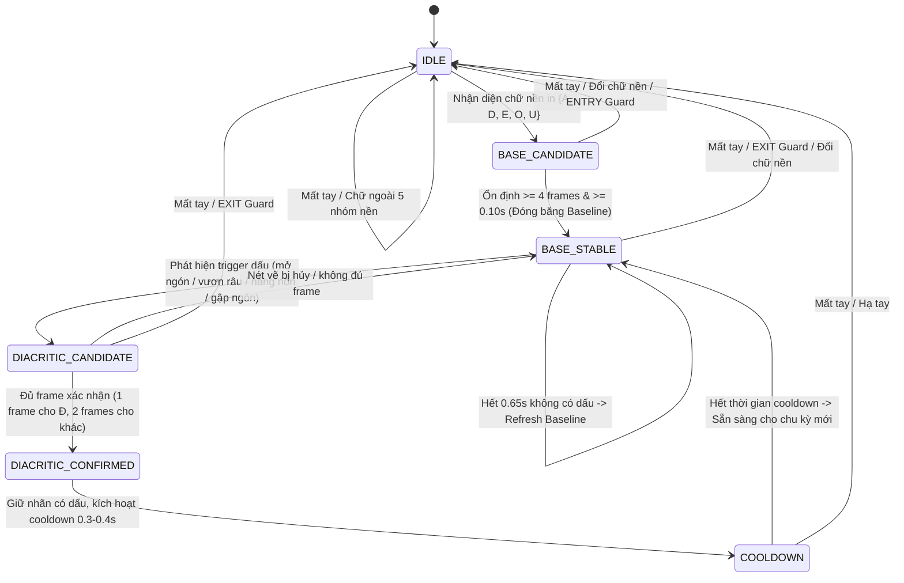

# BÁO CÁO THIẾT KẾ MÁY TRẠNG THÁI DIACRITICSTATEMACHINE (TASK 7C)

**Dự án:** VSL Connect AI  
**Nhiệm vụ:** Task 7C — Thiết kế DiacriticStateMachine cho 7 chữ cái có dấu ($Ă, Â, Ê, Ô, Ơ, Ư, Đ$)  
**Thời gian thực hiện:** 30/10/2026  
**Chế độ thực thi:** **MODULE ĐỘC LẬP & UNIT TESTS** (Không tích hợp vào production `VSLRecognizer` hay camera runtime)  
**Tập tin mã nguồn:** [`backend/vision/diacritic_state_machine.py`](file:///d:/SIGN_LANGUAGE/backend/vision/diacritic_state_machine.py)  
**Tập tin kiểm thử:** [`backend/tests/test_diacritic_state_machine.py`](file:///d:/SIGN_LANGUAGE/backend/tests/test_diacritic_state_machine.py)  
**Tập tin số liệu máy đọc:** [`backend/data/alphabet_v2/audit/diacritic_state_machine_design.json`](file:///d:/SIGN_LANGUAGE/backend/data/alphabet_v2/audit/diacritic_state_machine_design.json)

---

## 1. NGUYÊN TẮC KIẾN TRÚC VÀ PHẠM VI HOẠT ĐỘNG

Dựa trên kết luận của Task 7A và 7B, module [`DiacriticStateMachine`](file:///d:/SIGN_LANGUAGE/backend/vision/diacritic_state_machine.py) được xây dựng theo kiến trúc **Hybrid Static + Kinematic FSM** hoàn toàn độc lập với các nguyên tắc bất biến:

1. **Bảo toàn tuyệt đối hệ thống hiện có:**
   - Giữ nguyên 100% 12 luật hình học trong `VSLAlphabetClassifier`.
   - Giữ nguyên checkpoint `alphabet_static_head_v1.pt` (10 chữ tĩnh bổ sung) và `weights.pt` (84 lớp).
   - Giữ nguyên checkpoint `sign_sstcn_attention_model.pth` (102 từ vựng VSL).
   - Giữ nguyên các chế độ `digits`, `words`, `sentence`, `letters_numbers`.
2. **Nguyên tắc phân nhóm nền nghiêm ngặt (Strict Base Grouping):**
   - FSM chỉ giải quyết bài toán phân giải nội bộ trong 5 nhóm chữ cái nền:
     - Nhóm **A**: $\{A\} \rightarrow \{A, \breve{A}, \hat{A}\}$
     - Nhóm **E**: $\{E\} \rightarrow \{E, \hat{E}\}$
     - Nhóm **O**: $\{O\} \rightarrow \{O, \hat{O}, \text{Ơ}\}$
     - Nhóm **U**: $\{U\} \rightarrow \{U, \text{Ư}\}$
     - Nhóm **D**: $\{D\} \rightarrow \{D, Đ\}$
   - **Chặn tuyệt đối chuyển nhóm chéo:** Tuyệt đối không cho phép thế tay $A$ bị biến thành $Ô$, $E$ thành $Ư$ hay $D$ thành $Ă$.
3. **Zero-Lag cho 17 chữ tĩnh thuần túy:**
   - 17 chữ cái không thuộc 5 nhóm nền trên ($\{B, C, G, H, I, K, L, M, N, P, Q, R, S, T, V, X, Y\}$) **đi thẳng qua FSM**, trạng thái giữ ở `IDLE`, trả kết quả tức thì ($< 5$ ms) mà không tốn bất kỳ chu kỳ xử lý động học nào.

---

## 2. THIẾT KẾ TRẠNG THÁI VÀ CHUYỂN TRẠNG THÁI (STATE MACHINE DESIGN)



### Chi tiết các trạng thái và điều kiện chuyển dịch:

| Trạng thái | Mục đích | Điều kiện vào | Điều kiện thoát / Chuyển dịch |
| :--- | :--- | :--- | :--- |
| **`IDLE`** | Trạng thái nghỉ, chờ phát hiện bàn tay hoặc cử chỉ nền | Bắt đầu hoặc sau khi reset do mất tay / đổi chữ | Chuyển sang `BASE_CANDIDATE` khi nhận diện được $A, D, E, O, U$. |
| **`BASE_CANDIDATE`** | Tích lũy để kiểm tra độ ổn định của thế tay nền | Nhận frame đầu tiên của chữ nền | Nếu giữ vững $\ge 4$ frames và thời gian $\ge 0.10$s $\rightarrow$ chuyển sang `BASE_STABLE`. Nếu đổi nhãn hoặc vận tốc $|v_y| > 0.70$ $\rightarrow$ hủy về `IDLE`. |
| **`BASE_STABLE`** | Tư thế nền đã xác lập vững chắc. **Đóng băng Baseline Snapshot** | Đạt điều kiện từ `BASE_CANDIDATE` hoặc sau khi hết `COOLDOWN` | Nếu phát hiện trigger động học $\rightarrow$ sang `DIACRITIC_CANDIDATE`. Nếu quá $0.65$s không có dấu $\rightarrow$ tự làm mới baseline để giữ chữ nền. |
| **`DIACRITIC_CANDIDATE`** | Đang xác minh nét vẽ dấu qua các frame liên tiếp | Thỏa mãn ngưỡng động học trong nhóm chữ nền | Tích lũy đủ frame ($\ge 2$ frames cho Ă, Â, Ê, Ô, Ơ, Ư; $\ge 1$ frame cho Đ) $\rightarrow$ sang `DIACRITIC_CONFIRMED`. Nếu mất nét $\rightarrow$ lui về `BASE_STABLE`. |
| **`DIACRITIC_CONFIRMED`** | Nét dấu được xác nhận, thăng cấp nhãn từ nền lên có dấu | Đạt đủ số frame của `DIACRITIC_CANDIDATE` | Lập tức chuyển sang `COOLDOWN` để duy trì kết quả. |
| **`COOLDOWN`** | Giữ ổn định kết quả có dấu, chống nhấp nháy (anti-flicker) | Sau khi xác nhận dấu | Duy trì trong $0.3 - 0.4$s, sau đó quay lại `BASE_STABLE` để tiếp nhận cử chỉ tiếp theo. |

---

## 3. QUẢN LÝ LỊCH SỬ FRAME (DUAL HISTORY MANAGEMENT)

Để tránh nhược điểm của việc dùng một Ring Buffer 15 frames duy nhất làm trôi mất mốc so sánh ban đầu, hệ thống triển khai kiến trúc **Lịch sử Kép (Dual History Architecture)**:

```
[Camera Stream] ──► [Motion Frame Extractor]
                            │
               ┌────────────┴────────────┐
               ▼                         ▼
    ┌──────────────────────┐   ┌──────────────────────┐
    │  BASELINE SNAPSHOT   │   │    MOTION BUFFER     │
    │ (Đóng băng vĩnh viễn │   │ (Cửa sổ trượt 15     │
    │  trong suốt chu kỳ)  │   │  frames gần nhất)    │
    └──────────────────────┘   └──────────────────────┘
               │                         │
               └────────────┬────────────┘
                            ▼
               [Kinematic Evaluator Engine]
```

1. **`BaselineSnapshot` (Ảnh chụp tư thế nền đóng băng):**
   - Được chụp ngay tại khoảnh khắc FSM chuyển sang `BASE_STABLE`.
   - Lưu trữ các giá trị bất biến:
     - `wrist_y`, `palm_center_y`: Tọa độ Y ban đầu của cổ tay và tâm bàn tay trên ảnh gốc.
     - `palm_scale`: Tỉ lệ lòng bàn tay lúc bắt đầu ổn định.
     - `d_index_middle_norm`, `d_pinky_index_norm`, `pinky_curl`, `index_pip_angle`.
   - **Đặc tính kỹ thuật:** Snapshot này **hoàn toàn không bị ghi đè hay pha loãng** bởi các frame tiếp theo trong suốt thời gian tìm kiếm dấu.
2. **`MotionBuffer` (`collections.deque(maxlen=15)`):**
   - Cửa sổ trượt 15 frame ($\approx 0.5 - 0.6$ giây ở 25-30 FPS).
   - Lưu giữ: Tọa độ ảnh gốc (đo tịnh tiến nâng tay), tọa độ chuẩn hóa bàn tay (đo hình thái ngón), trạng thái ngón tay, và vận tốc tức thời $v_y(t) = \frac{y_t - y_{t-1}}{\Delta t}$.
   - Đo lường độ nâng cực đại so với baseline: $\Delta y_{apex} = \text{baseline.wrist\_y} - \min(wrist\_y)$.

---

## 4. XÁC MINH CÔNG THỨC VÀ SỬA ĐỔI SAI SỐ LANDMARK CỦA TASK 7B

Trong quá trình thiết kế chi tiết ở Task 7C, một bước kiểm tra chéo giải phẫu học quan trọng đã được thực hiện đối với các công thức của Task 7B:

### 4.1. Phát hiện và Hiệu chỉnh Sai số Đặc trưng Chữ Ơ
- **Vấn đề trong Task 7B:** Báo cáo 7B ghi nhận đặc trưng của chữ Ơ là `d_thumb_index_norm = calculate_distance(s[4], s[5])` (khoảng cách giữa Thumb Tip 4 và Index MCP 5).
- **Thực tế giải phẫu qua dữ liệu video gốc (D0508N):**
  - Chữ O khép kín có các đầu ngón tụ sát nhau: khoảng cách giữa Index Tip (8) và Pinky Tip (20) chuẩn hóa theo lòng bàn tay chỉ đạt **$0.2219$** (Max = $0.2598$).
  - Khi diễn viên thực hiện chữ **Ơ**, họ duy trì khuyên tròn giữa ngón cái (4) và ngón trỏ (8), đồng thời **VẨY NGÓN ÚT (Landmark 20) TÁCH XA RA NGOÀI** để tạo móc râu!
  - Khoảng cách giữa Pinky Tip (20) và Index Tip (8) (`d_pinky_index_norm`) **vọt từ $0.2219$ lên $1.1146$** (tăng gấp 5 lần, Min = $0.3959$, Max = $1.2407$).
- **Hiệu chỉnh trong Task 7C:** Thay thế đặc trưng nhầm lẫn của ngón cái bằng đặc trưng giải phẫu chuẩn xác:
  $$\text{d\_pinky\_index\_norm} = \frac{\|\text{PinkyTip}_{20} - \text{IndexTip}_8\|_2}{\text{palm\_scale}} \ge 0.50$$
  Biên an toàn tách biệt đạt tới $+0.1361$ giữa Max BASE ($0.2598$) và Min DIAC ($0.3959$).

### 4.2. Xác minh các công thức khác
1. **Chữ Ă (Mở ngón V):** `d(IndexTip 8, MiddleTip 12) / palm_scale >= 0.40` kết hợp `index_curl < 0.25`. (BASE A là $0.2424$, DIAC Ă là $0.5403$, biên an toàn $+0.1230$).
2. **Chữ Ư (Duỗi ngón út):** `pinky_curl <= 0.35` (BASE U là $0.7964$, DIAC Ư là $0.2154$, biên an toàn $+0.1619$).
3. **Chữ Đ (Gập đốt giữa ngón trỏ):** `index_pip_angle <= 110.0^\circ` hoặc $\Delta \theta_{drop} \ge 15.0^\circ$ (BASE D là $124.8^\circ$, DIAC Đ gập xuống $91.5^\circ$).
4. **Chữ Â, Ê, Ô (Vẽ nón):** $\Delta y_{lift} = \text{baseline.wrist\_y} - \text{current.wrist\_y} \ge 0.035$ và vận tốc $v_y \le -0.10$/s.

---

## 5. CƠ CHẾ BẢO VỆ CHỐNG DƯƠNG TÍNH GIẢ (GUARDS & REJECTION)

1. **Chặn pha đưa tay (ENTRY Guard):**
   - Khi người dùng đưa tay lên từ đùi, vận tốc hướng lên rất lớn ($|v_y| > 0.70$/s).
   - FSM khóa chuyển sang `BASE_STABLE` và cấm hoàn toàn việc nhận diện dấu cho tới khi tay dừng lại và duy trì thế nền ổn định $\ge 4$ frames.
2. **Chặn pha hạ tay (EXIT Guard):**
   - Khi cử chỉ kết thúc, người dùng thả tay xuống dưới, vận tốc rơi $v_y > +0.65$/s hoặc cổ tay chạm mép dưới ($wrist\_y > 0.75$).
   - FSM nhận diện đây là pha hạ tay nghỉ và lập tức reset về `IDLE`, ngăn chặn triệt để việc gia tốc rơi bị nhận nhầm thành nét vẽ dấu.
3. **Mất mốc xương hoặc tọa độ lỗi:**
   - Nếu frame nhận diện bị None, rỗng, chứa NaN hoặc Inf, FSM lập tức reset về `IDLE` và trả về nhãn `NEUTRAL` (confidence = $0.0$).
4. **Bảo vệ tính đơn điệu của thời gian (Timestamp Monotonicity):**
   - Nếu timestamp nhảy lùi ($\Delta t < 0$), FSM tự động reset an toàn để tránh chia cho số âm khi tính vận tốc.

---

## 6. GIAO DIỆN LẬP TRÌNH ĐỘC LẬP (API DESIGN)

Lớp [`DiacriticStateMachine`](file:///d:/SIGN_LANGUAGE/backend/vision/diacritic_state_machine.py) cung cấp API hoàn toàn độc lập:

```python
fsm = DiacriticStateMachine()

# Cập nhật theo từng frame:
result = fsm.update(
    base_label="A",                  # Nhãn từ Geometric Rules hoặc Static Head
    base_confidence=0.95,            # Độ tin cậy từ tầng phân loại tĩnh
    landmarks_raw=landmarks_21,      # 21 điểm [x, y, z] MediaPipe gốc
    timestamp=time.time(),           # Thời gian thực tính bằng giây
    source="geometric_rule"          # Nguồn nhận diện tĩnh ban đầu
)
```

**Cấu trúc dữ liệu trả về:**
```json
{
  "final_label": "Ă",
  "base_label": "A",
  "state": "DIACRITIC_CONFIRMED",
  "confidence": 0.95,
  "source": "diacritic_fsm",
  "diacritic_detected": "Ă",
  "reason": "Xác nhận dấu Ă: Mở ngón V (dist=0.54 >= 0.40)"
}
```

---

## 7. KẾT QUẢ KIỂM THỬ ĐƠN VỊ (UNIT TESTS)

Tập tin kiểm thử độc lập: [`backend/tests/test_diacritic_state_machine.py`](file:///d:/SIGN_LANGUAGE/backend/tests/test_diacritic_state_machine.py).  
Thực thi toàn bộ 15 test cases mô phỏng các kịch bản chuyển trạng thái và điều kiện biên:

```bash
python -m pytest backend/tests/test_diacritic_state_machine.py
```

```text
============================= test session starts =============================
collected 15 items

backend\tests\test_diacritic_state_machine.py ...............            [100%]

============================= 15 passed in 0.30s ==============================
```

### Danh mục 15 test cases đã vượt qua 100%:
1. `test_case_1_base_a_static_hold`: A giữ yên liên tục $\rightarrow$ Giữ nguyên A, FSM đạt `BASE_STABLE`.
2. `test_case_2_a_open_v_to_a_breve`: A mở xòe hai ngón V $\rightarrow$ Nhận diện chính xác Ă (`source='diacritic_fsm'`).
3. `test_case_3_a_lift_to_a_circumflex`: A nâng cổ tay lên đỉnh nón $\rightarrow$ Nhận diện chính xác Â.
4. `test_case_4_e_lift_to_e_circumflex`: E nâng cổ tay lên đỉnh nón $\rightarrow$ Nhận diện chính xác Ê.
5. `test_case_5_o_lift_to_o_circumflex`: O khép tròn nâng lên đỉnh $\rightarrow$ Nhận diện chính xác Ô.
6. `test_case_6_o_horn_to_o_horn`: O vẩy mở ngón út vươn xa $\rightarrow$ Nhận diện chính xác Ơ.
7. `test_case_7_u_pinky_extend_to_u_horn`: U ngón út duỗi thẳng $\rightarrow$ Nhận diện chính xác Ư.
8. `test_case_8_d_stroke_to_d_stroke`: D gập đốt giữa ngón trỏ $\rightarrow$ Nhận diện chính xác Đ chỉ sau 1 xung.
9. `test_case_9_entry_guard_rejects_premature_diacritic`: Bàn tay vọt nhanh lúc đưa lên bị ENTRY Guard chặn, không kích hoạt dấu sớm.
10. `test_case_10_exit_guard_rejects_dropping_hand`: Cổ tay rơi nhanh khi hạ tay bị EXIT Guard chặn, khóa nhận diện dấu.
11. `test_case_11_lost_landmarks_safe_neutral`: Mất bàn tay (None, rỗng, NaN) trả về NEUTRAL và reset về `IDLE`.
12. `test_case_12_base_switch_resets_cleanly`: Đổi từ A sang D lập tức reset base cũ, không gây xung đột chéo.
13. `test_case_13_sub_threshold_motion_keeps_base`: Rung nhẹ dưới ngưỡng ($\Delta y = 0.015 < 0.035$) bảo lưu chữ nền A.
14. `test_case_14_backwards_timestamp_safe_reset`: Timestamp nhảy lùi được reset an toàn.
15. `test_case_15_pure_static_letters_passthrough`: 17 chữ tĩnh ngoài 5 nhóm (B, C, G, H...) đi thẳng qua FSM ở trạng thái `IDLE`.

---

## 8. HẠN CHẾ VÀ KHUYẾN NGHỊ KIỂM THỬ THỰC TẾ

> [!CAUTION]
> **Tuyên bố phạm vi kiểm thử (Testing Disclaimer):**
> Bộ unit tests trên kiểm chứng **tính đúng đắn của logic máy trạng thái, điều kiện chuyển trạng thái và các cơ chế chốt chặn bảo vệ (guards)** bằng dữ liệu mô phỏng. Đây **KHÔNG PHẢI** là kiểm định độ chính xác tổng quát hóa trên người dùng thật.
> 
> Trước khi tích hợp vào luồng camera production, cần thực hiện thu thập dữ liệu kiểm chứng từ **$3 - 5$ người ký thực tế** (Multi-signer Evaluation) để tinh chỉnh các ngưỡng $\Delta y_{lift}$ và khoảng cách ngón trên nhiều kích thước bàn tay và góc quay camera khác nhau.

