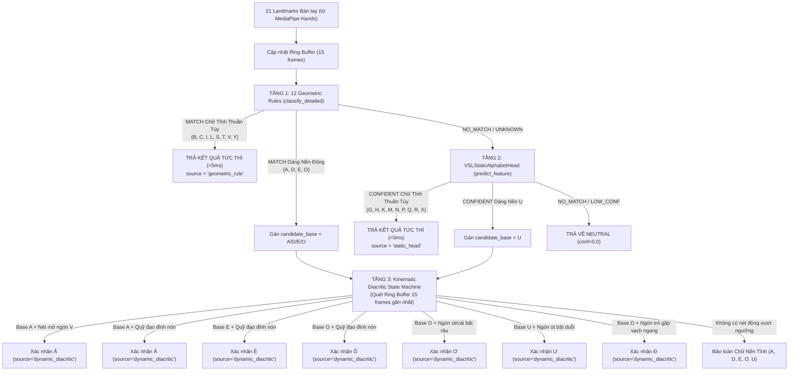

# BÁO CÁO KIỂM TOÁN TASK 7A — KHẢO SÁT KHẢ NĂNG NHẬN DIỆN 7 CHỮ CÁI CÓ DẤU BẰNG DỮ LIỆU CHUYỂN ĐỘNG

**Dự án:** VSL Connect AI  
**Nhiệm vụ:** Task 7A — Audit khả năng nhận diện 7 chữ cái có dấu ($Ă, Â, Ê, Ô, Ơ, Ư, Đ$)  
**Thời gian thực hiện:** 30/10/2026  
**Chế độ:** **READ-ONLY AUDIT** (Không sửa code, không huấn luyện model, không sửa checkpoint, không tích hợp production)  
**Tập tin máy đọc (JSON):** [dynamic_alphabet_audit.json](file:///d:/SIGN_LANGUAGE/backend/data/alphabet_v2/audit/dynamic_alphabet_audit.json)

---

## 1. KIỂM TRA DỮ LIỆU CHUYỂN ĐỘNG (DATASET V2 MOTION AUDIT)

Khảo sát trực tiếp các file:
- [`backend/data/alphabet_v2/datasets/vsl_alphabet_motion_v2.json`](file:///d:/SIGN_LANGUAGE/backend/data/alphabet_v2/datasets/vsl_alphabet_motion_v2.json)
- [`backend/data/alphabet_v2/datasets/alphabet_labels_v2.json`](file:///d:/SIGN_LANGUAGE/backend/data/alphabet_v2/datasets/alphabet_labels_v2.json)
- [`backend/data/alphabet_v2/datasets/dataset_v2_report.md`](file:///d:/SIGN_LANGUAGE/backend/data/alphabet_v2/datasets/dataset_v2_report.md)
- [`backend/data/alphabet_v2/audit/phase_review/phase_review_report.json`](file:///d:/SIGN_LANGUAGE/backend/data/alphabet_v2/audit/phase_review/phase_review_report.json)

### 1.1. Thống kê số lượng frame thực tế theo từng chữ và từng pha

Toàn bộ tập dữ liệu động gồm **7 sequences** tương ứng với 7 video QIPEDC chuẩn:

| Chữ cái | Video ID | Chữ nền | Tổng frame video | Frame hợp lệ (OK) | Frame mất tay | ENTRY (OK / Tổng) | BASE_POSE (OK / Tổng) | DIACRITIC (OK / Tổng) | EXIT (OK / Tổng) |
| :---: | :---: | :---: | :---: | :---: | :---: | :---: | :---: | :---: | :---: |
| **Ă** | `D0490B` | **A** | 89 | **53** | 36 | 1 / 7 | 19 / 19 | 23 / 23 | 10 / 40 |
| **Â** | `D0491B` | **A** | 108 | **57** | 51 | 4 / 27 | 23 / 23 | 25 / 25 | 5 / 33 |
| **Ê** | `D0497B` | **E** | 76 | **52** | 24 | 4 / 8 | 20 / 20 | 20 / 20 | 8 / 28 |
| **Ô** | `D0507B` | **O** | 84 | **58** | 26 | 9 / 16 | 19 / 19 | 20 / 20 | 10 / 29 |
| **Ơ** | `D0508N` | **O** | 89 | **45** | 44 | 6 / 35 | 9 / 9 | 24 / 24 | 6 / 21 |
| **Ư** | `D0515N` | **U** | 118 | **47** | 71 | 4 / 20 | 14 / 14 | 12 / 12 | 17 / 72 |
| **Đ** | `D0495` | **D** | 105 | **47** | 58 | 6 / 38 | 26 / 26 | 9 / 9 | 6 / 32 |
| **TỔNG CỘNG** | — | — | **669** | **359** | **310** | **34 / 151** | **130 / 130** | **133 / 133** | **62 / 255** |

> [!NOTE]
> - Tỷ lệ frame hợp lệ toàn bộ 7 video đạt **$53.66\%$** ($359/669$). 
> - $310$ frame bị mất tay tập trung chủ yếu ở giai đoạn diễn viên để tay dưới đùi/chuẩn bị (pha ENTRY) và pha hạ tay sau khi kết thúc cử chỉ (pha EXIT).
> - Trong hai pha cốt lõi **BASE_POSE** ($130$ frames) và **DIACRITIC_MOTION** ($133$ frames), tỷ lệ phát hiện landmark MediaPipe đạt **$100\%$** (không bị mất tay hay ngắt quãng).

---

### 1.2. Phân loại đặc tính động học của 7 chữ cái

Đối chiếu với dữ liệu kiểm chứng Task 5A tại [`phase_review_report.json`](file:///d:/SIGN_LANGUAGE/backend/data/alphabet_v2/audit/phase_review/phase_review_report.json), 7 chữ cái có dấu được chia thành hai nhóm bản chất hoàn toàn khác nhau:

#### Nhóm 1: Biến thiên hình thái ngón tay (Finger Morphological Transformation) — 4 chữ:
1. **Ă (D0490B):** Từ nắm đấm chữ A, ngón trỏ và giữa mở xòe tạo hình chữ V lật ngửa ($V$-spread) biểu thị dấu á (duy trì suốt 23 frames từ frame 26 đến 48). Khác biệt chính nằm ở **trạng thái duỗi ngón và khoảng cách giữa hai đầu ngón trỏ - giữa**.
2. **Ơ (D0508N):** Từ hình tròn khép kín của chữ O, ngón út hoặc ngón cái bật vẩy ra ngoài tạo móc râu ($pinky\_curl$ giảm mạnh, ngón út vươn xa khỏi lòng bàn tay, duy trì 24 frames từ frame 44 đến 67).
3. **Ư (D0515N):** Từ tư thế 2 ngón trỏ và giữa duỗi thẳng (chữ U), ngón út bật duỗi thẳng ra ngoài tạo râu ($pinky\_extended$ chuyển trạng thái từ `False` sang `True`, 12 frames từ frame 34 đến 45).
4. **Đ (D0495):** Từ tư thế ngón trỏ duỗi thẳng chỉ lên (chữ D), ngón trỏ gập đốt giữa vạch ngang tạo nét gạch trong 9 frames (frame 64 đến 72). Khác biệt thể hiện ở **góc gập nội khớp ngón trỏ**.

#### Nhóm 2: Quỹ đạo tịnh tiến không gian (Spatial Caret / Roof Trajectory Translation) — 3 chữ:
1. **Â (D0491B):** Duy trì nắm đấm chữ A, đẩy cả bàn tay lên cao và vẽ quỹ đạo dấu nón nhọn (đỉnh vận tốc ngón trỏ $v = 3.61$ tại frame 74).
2. **Ê (D0497B):** Duy trì tư thế gập ngón chữ E, bàn tay nhấc lên vùng trán/đầu vẽ dấu nón nhọn (cổ tay nâng từ độ cao $y = 0.55$ lên $y = 0.52$).
3. **Ô (D0507B):** Duy trì khuyên tròn chữ O, đẩy cả bàn tay lên trên đỉnh đầu tạo dấu nón (đạt đỉnh $y = 0.534$ tại frame 43).

---

### 1.3. Các thông tin chuyển động có thể trích xuất từ 21 landmarks

Từ chuỗi 21 landmarks MediaPipe Hands qua thời gian, hệ thống có thể trích xuất trực tiếp:
1. **Độ dời không gian cổ tay ($\Delta x, \Delta y, \Delta z$):** Đo hướng và biên độ nâng tay lên trên (vẽ nón trong Â, Ê, Ô).
2. **Vận tốc và gia tốc tức thời ($v_t, a_t$):** Xác định đỉnh vận tốc vung nét vẽ dấu và phân biệt với pha hạ tay (EXIT).
3. **Biến thiên trạng thái ngón tay ($\Delta \text{finger\_states}$):** Phát hiện tức thời sự kiện bật ngón út (`pinky_extended: False -> True`) trong chữ Ư và Ơ.
4. **Khoảng cách tương đối giữa các đầu ngón tay:** Khoảng cách giữa Landmark 8 (Index Tip) và Landmark 12 (Middle Tip) chuẩn hóa theo $palm\_scale$ để phát hiện nét mở ngón V của chữ Ă.
5. **Góc gập đốt ngón tay ($\Delta \text{angle}$):** Góc đốt giữa ngón trỏ (Landmarks 5-6-7-8) để phát hiện nét gạch ngang chữ Đ.

---

### 1.4. Hạn chế cốt tử của dữ liệu hiện có

> [!WARNING]
> **Rủi ro Overfitting cực cao:**
> Mỗi chữ cái động hiện tại **chỉ có duy nhất 1 video từ 1 người ký**. Tổng số chuỗi chuyển động chỉ có **7 sequences**.
> - Không có biến thiên về tốc độ ký (nhanh/chậm).
> - Không có biến thiên về biên độ vung tay (rộng/hẹp).
> - Không có biến thiên về góc nghiêng cổ tay giữa các người dùng khác nhau.
> 
> **Kết luận:** Dữ liệu hiện tại **HOÀN TOÀN KHÔNG ĐỦ** để huấn luyện một mô hình Deep Learning chuỗi thời gian (như LSTM/GRU/Transformer) có khả năng tổng quát hóa trên người dùng thực tế. Việc ép huấn luyện mạng nơ-ron sâu trên 7 sequence này chắc chắn sẽ dẫn đến việc mô hình học vẹt (overfit) vị trí tọa độ tuyệt đối của diễn viên QIPEDC.

---

## 2. KIỂM TRA LUỒNG CAMERA HIỆN TẠI (CAMERA PIPELINE AUDIT)

Khảo sát code:
- [`backend/vision/recognizer.py`](file:///d:/SIGN_LANGUAGE/backend/vision/recognizer.py) (các dòng 481–730)
- [`backend/app.py`](file:///d:/SIGN_LANGUAGE/backend/app.py) (hàm `recognize_landmarks`)
- [`src/components/CameraSignRecognizer.jsx`](file:///d:/SIGN_LANGUAGE/src/components/CameraSignRecognizer.jsx) (các dòng 730–830)
- [`src/services/api.js`](file:///d:/SIGN_LANGUAGE/src/services/api.js)

### 2.1. Cơ chế thu nhận và truyền nhận landmark
- **Phía Client:** `CameraSignRecognizer.jsx` sử dụng MediaPipe Hands (trong chế độ `instant` cho `mode == "letters"`). Mỗi khi frame camera có bàn tay, client lấy 21 điểm `[x, y, z]` của bàn tay chính và gửi qua HTTP POST tới `/api/recognize_landmarks`. Tần số gửi đạt khoảng 30 FPS với độ trễ mạng/suy luận $< 15$ ms.
- **Phía Backend:** `VSLRecognizer.predict_landmarks` nhận 21 điểm mốc theo từng frame hoàn toàn độc lập (stateless feature extraction).

### 2.2. Cơ chế lưu trữ lịch sử và làm mịn (Smoothing & Debounce)
- Trong `VSLRecognizer.__init__`, hệ thống có:
  ```python
  self.prediction_history = collections.deque(maxlen=smoothing_window)
  ```
- **Hạn chế hiện tại:** `prediction_history` **chỉ lưu trữ kết quả phân loại đã suy luận** `(final_sign, final_conf)`, **hoàn toàn KHÔNG lưu trữ mốc raw landmarks hay vector đặc trưng 72D qua các frame trước đó**.
- Cơ chế xác nhận từ: Đếm phiếu đa số trong nửa sau cửa sổ `smoothing_window` kết hợp `cooldown_sec = 1.2`s để chống lặp chữ.

### 2.3. Khả năng bổ sung Ring Buffer mốc xương 21 điểm
- **Hoàn toàn khả thi:** Có thể bổ sung một bộ đệm trượt tròn cục bộ (Ring Buffer) dạng `collections.deque(maxlen=15..20)` trong `VSLRecognizer` để lưu giữ `(timestamp, landmarks_21, feat_72)`.
- Chi phí bộ nhớ cho 20 frame 21 điểm $3D$ là cực kỳ nhỏ ($< 50$ KB), thời gian trượt buffer là $O(1)$ $< 0.05$ ms, hoàn toàn không gây trễ luồng camera hay ảnh hưởng tới các mode khác (`digits`, `words`, `sentence`).

### 2.4. Các module hiện có có thể tái sử dụng ngay lập tức
1. [`backend.vision.feature_extractor.normalize_hand_landmarks`](file:///d:/SIGN_LANGUAGE/backend/vision/feature_extractor.py#L186-L240): Chuẩn hóa tọa độ bàn tay bất biến với cự ly và vị trí camera.
2. [`backend.vision.feature_extractor.compute_finger_states`](file:///d:/SIGN_LANGUAGE/backend/vision/feature_extractor.py#L115-L180): Trích xuất cờ duỗi/gập (`thumb_extended`, `index_extended`, `pinky_extended`).
3. [`backend.vision.feature_extractor.finger_curl_ratio`](file:///d:/SIGN_LANGUAGE/backend/vision/feature_extractor.py#L96-L113): Tỉ lệ co gập ngón tay liên tục từ 0.0 đến 1.0.
4. [`backend.vision.alphabet_classifier.alphabet_classifier`](file:///d:/SIGN_LANGUAGE/backend/vision/alphabet_classifier.py): 12 luật hình học nhận diện dáng nền cực nhanh ($< 1$ ms).
5. [`backend.models.alphabet_static_head`](file:///d:/SIGN_LANGUAGE/backend/models/alphabet_static_head.py): Phân loại tĩnh 22 lớp nền (trong đó có $A, D, E, O, U$).

---

## 3. KIỂM TRA MÔ HÌNH DYNAMIC SSTCN HIỆN CÓ

Khảo sát code:
- [`backend/models/sstcn_model.py`](file:///d:/SIGN_LANGUAGE/backend/models/sstcn_model.py)
- [`backend/models/vsl_102_dictionary.py`](file:///d:/SIGN_LANGUAGE/backend/models/vsl_102_dictionary.py)
- Checkpoint: [`backend/models/weights/sign_sstcn_attention_model.pth`](file:///d:/SIGN_LANGUAGE/backend/models/weights/sign_sstcn_attention_model.pth)

### 3.1. Hợp đồng đầu vào (Input Preprocessing Contract)
- Lớp `SSTCN_Attention` định nghĩa đầu vào bắt buộc:
  $$\text{Shape: } (Batch, Channels=3, Time=30, Joints=75)$$
- Phân bổ 75 khớp khớp chuẩn MediaPipe Holistic:
  - Khớp $0 \dots 32$ (33 joints): **Body Pose** (vai, khuỷu tay, cổ tay, mắt, mũi, hông...).
  - Khớp $33 \dots 53$ (21 joints): **Bàn tay trái** (Left Hand).
  - Khớp $54 \dots 74$ (21 joints): **Bàn tay phải** (Right Hand).

### 3.2. Cấu trúc mô hình và các ràng buộc chỉ mục cứng
Trong hàm `forward` của `SSTCN_Attention` (dòng 58–81):
```python
self.left_hand_joints = list(range(33, 54))
self.right_hand_joints = list(range(54, 75))

left_hand = x[:, :, self.left_hand_joints]   # [B*T, 128, 21]
left_hand = self.left_hand_attn(left_hand)
right_hand = x[:, :, self.right_hand_joints] # [B*T, 128, 21]
right_hand = self.right_hand_attn(right_hand)
```

> [!CAUTION]
> **Thực nghiệm chạy trực tiếp dữ liệu 21 điểm vào SSTCN:**
> Khi đưa tensor 21 điểm $(1, 3, 30, 21)$ vào `SSTCN_Attention`:
> ```text
> IndexError: index 33 is out of bounds for dimension 0 with size 21
> ```
> Mô hình văng ngoại lệ `IndexError` ngay lập tức tại tầng Multi-head Attention đầu tiên vì các dải chỉ mục $33..53$ và $54..74$ được gán cứng cho 75 joints.

### 3.3. Tác hại nghiêm trọng nếu padding 54 điểm zeros
Nếu cố tình thêm 54 điểm tọa độ $(0, 0, 0)$ giả vào dữ liệu 21 điểm của Alphabet V2 để ép đủ 75 joints:
1. **$72\%$ dữ liệu đầu vào ($54/75$ khớp) sẽ là giá trị 0 hoàn toàn.**
2. Tầng gộp toàn cục (Global Average Pooling) tại dòng 93:
   ```python
   x = x.mean(dim=2).mean(dim=2)  # [B, 512]
   ```
   Giá trị trung bình bị pha loãng $72\%$ bởi các giá trị 0 nhân tạo, làm sụp đổ hoàn toàn phân phối biểu diễn đặc trưng (feature representation distribution) mà mạng pretrained đã học.
3. Đầu ra softmax sẽ cho xác suất ngẫu nhiên hoặc thiên lệch vào lớp có bias lớn nhất, mất hoàn toàn tính chính xác.

### 3.4. Nhãn 29 chữ cái trong checkpoint SSTCN 102 lớp
Trong `backend/models/vsl_102_dictionary.py`:
- Checkpoint SSTCN 102 lớp thực tế **có sẵn đủ 29 chữ cái tiếng Việt** tại dải index từ $0$ đến $28$:
  - Index 0: `A`, Index 1: `Ă`, Index 2: `Â`, Index 3: `B`, Index 4: `C`, Index 5: `D`, Index 6: `Đ`, Index 7: `E`, Index 8: `Ê`, Index 9: `G`... Index 28: `Y`.
- Tuy nhiên, mô hình được huấn luyện trên dữ liệu MediaPipe Holistic đầy đủ (cả thân người và 2 tay) trong giáo trình VSL. Nó **không thể tương thích** với dữ liệu MediaPipe Hands chỉ có 21 điểm của Dataset V2.

---

## 4. SO SÁNH VÀ ĐÁNH GIÁ CÁC PHƯƠNG ÁN KỸ THUẬT

| Tiêu chí | Phương án A: Dùng lại SSTCN 102 lớp | Phương án B: Mạng chuỗi độc lập 21 điểm (GRU/TCN) | Phương án C: Kết hợp Phân cấp (Hybrid Static + Kinematic FSM) |
| :--- | :--- | :--- | :--- |
| **Bản chất kỹ thuật** | Ép dữ liệu 21 điểm vào mô hình 75 joints có sẵn | Huấn luyện mạng nơ-ron chuỗi mới (Bi-GRU hoặc 1D-CNN) trên chuỗi 21 điểm | Dùng hệ thống tĩnh lọc dáng nền $\{A, D, E, O, U\}$, sau đó dùng máy trạng thái động học phân giải dấu |
| **Tương thích dữ liệu 21 điểm** | **0%** (Cần 75 điểm, lỗi IndexError nếu không pad) | **100%** (Nhận trực tiếp chuỗi 21 điểm) | **100%** (Nhận trực tiếp 21 điểm từ MediaPipe Hands) |
| **Yêu cầu dữ liệu bổ sung** | Phải quay lại toàn bộ video bằng MediaPipe Holistic (thân + 2 tay) | Phải thu thập tối thiểu **30–50 sequence/chữ** từ nhiều người ký | Chỉ cần **3–5 mẫu người ký thực tế** để calibrate ngưỡng mở ngón và đỉnh nón |
| **Độ trễ đối với 17 chữ tĩnh thuần túy** | Bị trễ 30 frames ($~1000$ ms) hoặc phải chạy song song 2 mô hình nặng | Bị trễ $15-20$ frames do phải tích lũy chuỗi thời gian | **0 ms (Tức thì <5ms)**: 17 chữ tĩnh thoát ngay lập tức, không chờ kiểm tra động |
| **Rủi ro Overfitting** | Rất cao (do phân phối zeros làm sai lệch mạng) | **Cực kỳ cao** (chỉ có 1 sequence/chữ sẽ học vẹt hoàn toàn) | **Thấp nhất**: Dựa trên quy tắc giải phẫu học bất biến (mở ngón, vẩy râu) |
| **Mức độ ảnh hưởng mã nguồn cũ** | Đòi hỏi sửa frontend sang Holistic, tăng tải CPU gấp 3 | Độc lập, nhưng cần thêm một checkpoint mạng chuỗi mới | **Bảo toàn 100%**: 12 geometric rules, Static Head và SSTCN giữ nguyên vẹn |
| **Đánh giá mức độ phù hợp** | **LOẠI BỎ (INCOMPATIBLE)** | **CHƯA KHẢ THI DO THIẾU DỮ LIỆU** | **ĐỀ XUẤT ÁP DỤNG (HIGHLY RECOMMENDED)** |

---

## 5. ĐỀ XUẤT KIẾN TRÚC TÍCH HỢP CHO 7 CHỮ CÁI ĐỘNG

Nhằm đảm bảo **7 chữ cái động ($Ă, Â, Ê, Ô, Ơ, Ư, Đ$)** hoạt động trơn tru trong `mode == "letters"` mà:
- Không làm thay đổi 12 luật hình học hiện có,
- Không làm thay đổi `VSLStaticAlphabetHead` 10 chữ tĩnh,
- Không ảnh hưởng nhận diện số (`digits`) và từ vựng (`words`),
- Không sửa checkpoint SSTCN cũ,
- **Không làm chữ tĩnh bị trì hoãn (Zero-lag for pure static letters)**,

Kiến trúc tích hợp đề xuất là **Kiến trúc Phân cấp 3 Tầng (3-Tier Hierarchical Decision Flow)**:



### Nguyên lý giải quyết bài toán độ trễ và xung đột:
1. **Không có độ trễ cho chữ tĩnh thuần túy:** 
   17 chữ cái tĩnh ($\{B, C, G, H, I, K, L, M, N, P, Q, R, S, T, V, X, Y\}$) được phân nhánh ngắt mạch ngay lập tức (short-circuit). Không một phép tính động học nào bị kích hoạt đối với các chữ này.
2. **Khử xung đột tĩnh - động cho 5 chữ nền ($\{A, D, E, O, U\}$):**
   - Khi người ký giữ tĩnh chữ $A$, Tầng 3 quét Ring Buffer nhưng không thấy sự kiện mở ngón V hay nét nón $\rightarrow$ Giữ nguyên chữ $A$.
   - Khi người ký làm chữ $Ă$, người ký bắt đầu bằng thế tay $A$, sau đó mở ngón V $\rightarrow$ Tầng 3 lập tức phát hiện sự kiện biến thiên hình thái và thăng cấp (upgrade) nhãn dự đoán từ $A$ lên $Ă$.
3. **Phòng ngừa ghi đè (Anti-Override Guarantee):**
   - Tầng 3 chỉ được phép phát ra nhãn có dấu tương ứng với chính chữ nền của frame hiện tại:
     - Base $A \rightarrow$ chỉ được chọn giữa $\{A, Ă, Â\}$.
     - Base $E \rightarrow$ chỉ được chọn giữa $\{E, Ê\}$.
     - Base $O \rightarrow$ chỉ được chọn giữa $\{O, Ô, Ơ\}$.
     - Base $U \rightarrow$ chỉ được chọn giữa $\{U, Ư\}$.
     - Base $D \rightarrow$ chỉ được chọn giữa $\{D, Đ\}$.
   - Tuyệt đối không bao giờ có chuyện dáng tay $A$ bị biến đổi thành $Ô$ hay $Đ$.

---

## 6. DANH SÁCH CÁC CÔNG VIỆC CẦN LÀM TIẾP THEO (PRIORITIZED NEXT STEPS)

Chỉ khảo sát, không triển khai trong task này. Các bước tiếp theo được sắp xếp theo mức độ ưu tiên:

1. **[Ưu tiên 1 - Thuật toán] Thiết kế Module Trích xuất Đặc trưng Động học ([KinematicFeatureExtractor]):**
   - Viết hàm trích xuất các chỉ số đặc trưng từ chuỗi 15 frames:
     - $\Delta \text{distance}(Tip_8, Tip_{12})$ cho chữ Ă.
     - $\text{pinky\_extended}$ delta cho chữ Ư và Ơ.
     - Vận tốc đỉnh $v_y$ và độ dời cực đại $\Delta y$ của cổ tay cho Â, Ê, Ô.
     - Chỉ số gập đốt ngón trỏ $\Delta \text{curl}(Index)$ cho chữ Đ.
2. **[Ưu tiên 2 - Phân tích Dữ liệu] Tính toán Ngưỡng Định lượng trên Dataset V2:**
   - Viết script quét độc lập trên 133 frames `DIACRITIC_MOTION` và 130 frames `BASE_POSE` để xác định các ngưỡng phân tách tối ưu (Threshold Calibration) cho 7 chữ.
3. **[Ưu tiên 3 - Thu thập & Đánh giá] Thu thập dữ liệu kiểm thử Đa Người Ký (Multi-signer):**
   - Thu thập mẫu thực nghiệm từ 3–5 người ký mới cho 7 chữ cái có dấu để kiểm chứng độ bền vững của các ngưỡng động học đối với sự khác biệt về kích thước bàn tay và tốc độ ký.
4. **[Ưu tiên 4 - Tích hợp] Hiện thực hóa `DiacriticStateMachine` độc lập và Unit Tests:**
   - Đóng gói logic phân giải dấu thành một class độc lập, viết unit test mô phỏng chuỗi frame trước khi tích hợp vào [`backend/vision/recognizer.py`](file:///d:/SIGN_LANGUAGE/backend/vision/recognizer.py).

