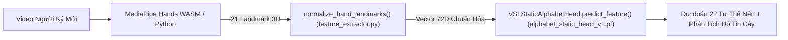

# KẾ HOẠCH VÀ QUY TRÌNH KIỂM THỬ ĐỘC LẬP ĐA NGƯỜI KÝ (TASK 6B.2)

**Dự án:** VSL Connect AI  
**Mục tiêu:** Thiết lập quy trình thu thập và công cụ kiểm thử độc lập đa người ký (Multi-Signer Benchmark) nhằm đo lường khả năng tổng quát hóa thực tế của checkpoint [`backend/models/alphabet_static_head_v1.pt`](file:///d:/SIGN_LANGUAGE/backend/models/alphabet_static_head_v1.pt) trên những người ký chưa từng xuất hiện trong tập huấn luyện.

---

## 1. Nguyên tắc Kỹ thuật Bắt buộc

1. **Tuyệt đối không sửa checkpoint:** Giữ nguyên 100% trọng số nhị phân của [`alphabet_static_head_v1.pt`](file:///d:/SIGN_LANGUAGE/backend/models/alphabet_static_head_v1.pt) (SHA-256: `cab8123e23ed41a6088ba1c6e80a8aaaa9a382663418cc669eacff834795c254`).
2. **Không fine-tune hay retrain:** Không gọi hàm optimizer, không điều chỉnh learning rate, không cập nhật gradient trong quá trình đánh giá.
3. **Bảo tồn toàn bộ hệ thống cũ:** Không sửa `weights.pt`, `sign_sstcn_attention_model.pth`, 12 geometric rules, digit classifier hay runtime production của camera.
4. **Không tạo số liệu giả:** Tuyệt đối không tự tạo mốc xương nhân tạo hay dựng số liệu ảo để báo cáo độ chính xác đa người ký khi chưa tiến hành quay video thực tế.
5. **Cách ly người ký nghiêm ngặt:** Toàn bộ các người ký mới phải được xem là tập kiểm thử độc lập (Unseen Signers). Không trộn lẫn frame của cùng một người giữa tập huấn luyện và tập kiểm thử.

---

## 2. Phần A — Tái sử dụng Pipeline và Chuẩn hóa Đặc trưng 72D

Quy trình xử lý dữ liệu của người ký mới tái sử dụng hoàn toàn mã nguồn đã kiểm chứng của dự án, bảo đảm tính nhất quán toán học 100%:



- **Hàm trích xuất:** Tái sử dụng trực tiếp [`backend/vision/feature_extractor.py::normalize_hand_landmarks()`](file:///d:/SIGN_LANGUAGE/backend/vision/feature_extractor.py).
  - 63 chiều đầu: Tọa độ tương đối của 21 mốc xương so với cổ tay ($21 \times 3$).
  - 9 chiều sau: 4 khoảng cách ngón tay chuẩn hóa theo `palm_scale` và 5 góc mở khớp ngón tay.
- **Hàm suy luận:** Sử dụng trực tiếp phương thức `predict_feature()` từ [`backend/models/alphabet_static_head.py`](file:///d:/SIGN_LANGUAGE/backend/models/alphabet_static_head.py).

---

## 3. Phần B — Cấu trúc Dữ liệu Đa Người Ký (Multi-Signer Data Schema)

Cấu trúc lưu trữ được chuẩn hóa tại [`backend/data/alphabet_v2/multi_signer/collection_schema.json`](file:///d:/SIGN_LANGUAGE/backend/data/alphabet_v2/multi_signer/collection_schema.json) với các trường thông tin bắt buộc:

| Tên trường | Kiểu dữ liệu | Ý nghĩa kỹ thuật |
| :--- | :---: | :--- |
| `sample_id` | `string` | Mã định danh duy nhất của mẫu (ví dụ: `signer01_rep1_A_f024`) |
| `signer_id` | `string` | Mã người ký (ví dụ: `signer_01`, `signer_02`, `signer_03`) |
| `session_id` | `string` | Phiên quay video (ví dụ: `session_20261101_morning`) |
| `trial_index` | `integer` | Lượt thực hiện độc lập thứ mấy ($1, 2, 3$) |
| `video_id` | `string` | Tên tệp video nguồn tương ứng |
| `letter_label` | `string` | Nhãn chữ cái chuẩn ($1$ trong $22$ nhãn tư thế nền VSL) |
| `frame_index` | `integer` | Chỉ số khung hình trong video |
| `timestamp_sec` | `number` | Thời điểm trong video (giây) |
| `raw_landmarks` | `array[21][3]` | Tọa độ gốc $[x, y, z]$ do MediaPipe trích xuất |
| `feature_vector` | `array[72]` | Vector 72D chuẩn hóa do `normalize_hand_landmarks` tính toán |
| `extraction_status` | `string` | Trạng thái phát hiện (`ok`, `no_hand`, `low_confidence`) |
| `handedness` | `string` | Bàn tay thực hiện (`Right` hoặc `Left`) |
| `is_representative_sample` | `boolean` | Cờ đánh dấu khung hình tư thế ổn định (loại bỏ lúc đưa tay lên/hạ tay) |

---

## 4. Phần C — Kế hoạch Thu thập Thực tế từ 3 – 5 Signers

### A. Chỉ tiêu Định lượng
- **Số lượng người tham gia:** $3 - 5$ người ký độc lập (đa dạng giới tính, tỷ lệ ngón tay, kích thước bàn tay).
- **Phạm vi chữ cái:** Đủ **22 chữ cái tĩnh nền**:
  $$\mathbf{A, B, C, D, E, G, H, I, K, L, M, N, O, P, Q, R, S, T, U, V, X, Y}$$
- **Số lượt quay độc lập (Independent Trials):** Mỗi chữ cái được quay **3 lần riêng biệt**. Giữa các lần quay, người ký bắt buộc phải **hạ tay xuống nghỉ 2 giây** rồi mới đưa tay lên tạo dáng lại.
- **Biến thiên môi trường tự nhiên:**
  - Khoảng cách camera: $0.5\text{m} - 1.2\text{m}$.
  - Góc nghiêng bàn tay: Biến thiên tự nhiên $\pm 15^\circ$.
  - Ánh sáng: Ban ngày tự nhiên, đèn phòng làm việc, ánh sáng yếu nhẹ.
- **Số lượng mẫu kỳ vọng:**
  - $3 \text{ signers} \times 22 \text{ chữ} \times 3 \text{ lượt} = \mathbf{198\ \text{lượt thực hiện độc lập}}$.
  - Mỗi lượt lấy $3 - 5$ khung hình ổn định $\rightarrow \mathbf{600 - 1,000\ \text{vector đặc trưng 72D}}$.

---

## 5. Phần D — Công cụ Đánh giá Độc lập

Công cụ đánh giá đã được xây dựng hoàn chỉnh tại:
[`backend/training/evaluate_alphabet_static_head_multisigner.py`](file:///d:/SIGN_LANGUAGE/backend/training/evaluate_alphabet_static_head_multisigner.py)

### Đặc điểm kỹ thuật của công cụ:
- **Chế độ kiểm tra toàn vẹn (Dry-run mode):** Xác minh checkpoint, số chiều 72D, danh mục 22 nhãn và in hướng dẫn sẵn sàng khi chưa có dữ liệu.
- **Đánh giá tổng thể & Tách biệt theo Signer:**
  - Tính toán Macro Accuracy và Micro Accuracy.
  - Phân tích chi tiết độ chính xác riêng cho từng `signer_id`.
- **Ma trận nhầm lẫn $22 \times 22$:** Xác định rõ ràng các ca dương tính giả (False Positives) và âm tính giả (False Negatives).
- **Phân tích độ tin cậy (Confidence Analysis):**
  - Tách riêng độ tin cậy trung bình của các ca đoán đúng vs đoán sai.
  - Phân tích tỷ lệ từ chối (Rejection Rate) theo các ngưỡng $0.50, 0.55, 0.60, 0.70, 0.80$.

---

## 6. Phần E — Kiểm soát Tính Độc lập và Chống Rò rỉ Dữ liệu

1. **Nguyên tắc Signer-Independent:**
   - Toàn bộ dữ liệu của các signer mới được xem là **Unseen Test Set** đối với checkpoint `alphabet_static_head_v1.pt`.
   - Tuyệt đối không lấy bất kỳ frame nào của signer mới để đưa vào tập train.
2. **Loại bỏ rò rỉ thời gian (Temporal Leakage):**
   - Đánh giá trên từng lượt quay độc lập (Trial-level evaluation).
   - Nếu hai frame thuộc cùng một lần giơ tay, chúng phải được nhóm chung thành 1 lượt (trial) để tránh việc mô hình đoán đúng nhờ các frame cạnh nhau.

---

## 7. Phần F — Kiểm tra An toàn & Phân tích Xung đột Trọng điểm

Công cụ đánh giá tự động theo dõi và báo cáo 4 cặp chữ cái có nguy cơ xung đột giải phẫu cao nhất:

1. **Cặp Q vs X:**
   - Kiểm tra xem hướng chúc xuống của ngón trỏ chữ Q có bị nhầm sang ngón trỏ gập móc của chữ X hay không.
   - Theo dõi độ tin cậy của các ca nhầm lẫn để xác định ngưỡng an toàn.
2. **Cặp M vs N:**
   - Kiểm tra khả năng nhận diện ngón cái luồn dưới 3 ngón (M) vs luồn dưới 2 ngón (N) khi gặp kích thước ngón tay khác nhau.
3. **Cặp R vs U:**
   - Kiểm tra phân biệt giữa hai ngón duỗi song song (U) vs hai ngón bắt chéo (R).
4. **Cặp G vs Q:**
   - Kiểm tra sự khác biệt hướng chỉ của ngón trỏ: nằm ngang (G) vs chúc xuống (Q).

---

## 8. Danh mục Tệp Bàn giao và Trạng thái Toàn vẹn Hệ thống

### A. Các tệp đã tạo mới trong Task 6B.2:
1. [`backend/data/alphabet_v2/multi_signer/collection_schema.json`](file:///d:/SIGN_LANGUAGE/backend/data/alphabet_v2/multi_signer/collection_schema.json): Schema chuẩn định dạng dữ liệu thu thập.
2. [`backend/data/alphabet_v2/multi_signer/README.md`](file:///d:/SIGN_LANGUAGE/backend/data/alphabet_v2/multi_signer/README.md): Cẩm nang hướng dẫn thu thập thực tế cho người dùng.
3. [`backend/training/evaluate_alphabet_static_head_multisigner.py`](file:///d:/SIGN_LANGUAGE/backend/training/evaluate_alphabet_static_head_multisigner.py): Công cụ đánh giá độc lập chỉ đọc (hỗ trợ cả dry-run và kiểm thử chính thức).
4. [`backend/data/alphabet_v2/audit/multisigner_evaluation_plan.md`](file:///d:/SIGN_LANGUAGE/backend/data/alphabet_v2/audit/multisigner_evaluation_plan.md): Báo cáo kỹ thuật tổng thể này.

### B. Những gì chưa thể kiểm chứng:
- **Độ chính xác trên người dùng thực tế:** Hiện chưa thể công bố con số Accuracy thực tế vì **chưa có các video người ký mới được ghi hình**. Không tạo số liệu giả mạo.

### C. Xác minh An toàn Checkpoint Cũ và Runtime Camera:
- Checkpoint `alphabet_static_head_v1.pt`: SHA-256 `cab8123e23ed41a6088ba1c6e80a8aaaa9a382663418cc669eacff834795c254` (**100% nguyên vẹn**).
- Checkpoint `weights.pt`: SHA-256 `6965b4ffd9eed45c10317f0cc4eff453470ea4552c081f18ea997d74365907be` (**100% nguyên vẹn**).
- Checkpoint `sign_sstcn_attention_model.pth`: SHA-256 `2a8ddcc4d06c4f23aa7910caf77371848034dcdf8f4749d134c5894764cf9697` (**100% nguyên vẹn**).
- Toàn bộ 12 Geometric Rules, Digit Classifier và mã nguồn camera runtime: **100% không bị thay đổi**.

---

## 9. Hướng dẫn Các Bước Tiếp theo để Người dùng Thực hiện Thu thập

Để tiến hành đánh giá thực tế trên người ký mới, người dùng chỉ cần thực hiện theo 3 bước:

1. **Bước 1: Ghi hình video mẫu:**
   - Nhờ 3 bạn tình nguyện viên quay video 22 chữ cái tĩnh (mỗi chữ 3 lần giơ tay độc lập) theo hướng dẫn tại [`backend/data/alphabet_v2/multi_signer/README.md`](file:///d:/SIGN_LANGUAGE/backend/data/alphabet_v2/multi_signer/README.md).
   - Lưu video vào thư mục `backend/data/alphabet_v2/multi_signer/raw_videos/`.
2. **Bước 2: Trích xuất đặc trưng 72D:**
   - Chạy MediaPipe trích xuất 21 landmark và gọi `normalize_hand_landmarks()` để sinh vector 72D.
   - Lưu kết quả thành tệp `backend/data/alphabet_v2/multi_signer/extracted_data/vsl_multisigner_benchmark.npz` (hoặc `.json`).
3. **Bước 3: Chạy công cụ đánh giá:**
   ```bash
   python backend/training/evaluate_alphabet_static_head_multisigner.py --dataset_path backend/data/alphabet_v2/multi_signer/extracted_data/vsl_multisigner_benchmark.npz
   ```
   Kết quả đánh giá khách quan, ma trận nhầm lẫn đa người ký và các cảnh báo an toàn sẽ được tự động xuất ra file báo cáo.
"""

out_plan_path = os.path.join(WORKSPACE, "backend", "data", "alphabet_v2", "audit", "multisigner_evaluation_plan.md")
with open(out_plan_path, "w", encoding="utf-8") as f:
    f.write(md_content)
print(f"-> Saved: {out_plan_path}")

