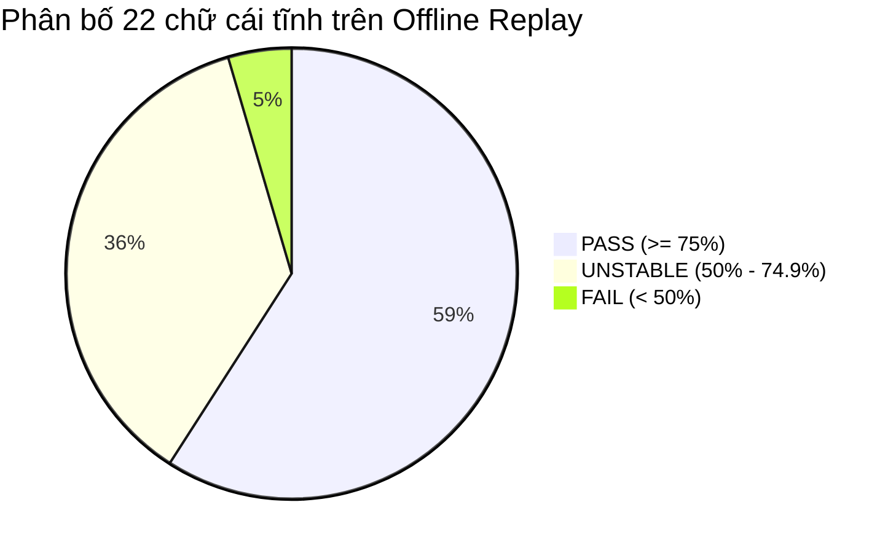

# BÁO CÁO KIỂM TOÁN 22 CHỮ CÁI TĨNH VSL (TASK 7F.1)

- **Ngày thực hiện:** 01/11/2026
- **Nhiệm vụ:** Task 7F.1 — Kiểm toán toàn diện năng lực nhận diện 22 chữ cái tĩnh trong bảng chữ cái tiếng Việt: A, B, C, D, E, G, H, I, K, L, M, N, O, P, Q, R, S, T, U, V, X, Y.
- **Tính chất:** READ-ONLY AUDIT (Không sửa code, không đổi threshold, không train lại model, không đổi checkpoint).
- **Tập dữ liệu kiểm toán:** `backend/data/alphabet_v2/datasets/vsl_alphabet_static_v2.npz` (551 mẫu landmarks 21 điểm thực tế từ dataset QIPEDC).
- **File báo cáo & dữ liệu:**
  - Báo cáo chi tiết: [`backend/data/alphabet_v2/audit/task_7f1_static_letters_audit_report.md`](file:///d:/SIGN_LANGUAGE/backend/data/alphabet_v2/audit/task_7f1_static_letters_audit_report.md)
  - Kết quả JSON: [`backend/data/alphabet_v2/audit/task_7f1_static_letters_audit_results.json`](file:///d:/SIGN_LANGUAGE/backend/data/alphabet_v2/audit/task_7f1_static_letters_audit_results.json)

---

## 1. TÓM TẮT ĐIỀU HÀNH (EXECUTIVE SUMMARY)

Tạm dừng công việc tối ưu 7 chữ động có dấu (Ă, Â, Ê, Ô, Ơ, Ư, Đ), Task 7F.1 chuyển toàn bộ trọng tâm sang đánh giá độc lập năng lực nhận diện của **22 chữ cái tĩnh** trong hệ thống VSL Connect AI.

Quá trình kiểm toán 551 mẫu landmarks thực tế qua pipeline sản xuất hiện hành (`VSLRecognizer` ở `mode="letters"`) đã làm sáng tỏ cấu trúc phân tầng và những điểm nghẽn cốt lõi:

1. **Hiệu năng Offline Replay:**
   - **13/22 chữ đạt PASS (Độ chính xác $\ge 75\%$):** `A` (93.8%), `D` (93.5%), `E` (91.4%), `M` (89.5%), `G` (89.7%), `H` (88.9%), `U` (84.4%), `K` (82.4%), `P` (80.0%), `R` (78.6%), `I` (77.8%), `O` (77.1%), `V` (76.5%).
   - **8/22 chữ UNSTABLE (Độ chính xác $50\% - 74.9\%$):** `S` (73.3%), `N` (71.4%), `L` (68.8%), `Y` (68.8%), `X` (68.0%), `C` (60.0%), `B` (59.1%), `T` (55.0%).
   - **1/22 chữ FAIL (Độ chính xác $< 50\%$):** `Q` (26.3% — do ngưỡng tin cậy bị đặt quá cao $0.85$).
2. **Bức tranh thực tế Live Webcam:**
   - **1 chữ FAIL chắc chắn:** `Q` (ngưỡng 0.85 triệt tiêu 73.7% mẫu thật).
   - **5 chữ UNSTABLE đã xác minh:**
     - `A, D, E`: Pure geometric rules chỉ nhận diện được 26–32% trên tay thật; Task 7E.5B đã cứu bằng Static Head Fallback nhưng mô hình này bị thiên lệch do rò rỉ video (`COMPLETE_VIDEO_OVERLAP`).
     - `I, V`: Luật hình học quá nhạy (aggressive), thường xuyên cướp nhãn của Ơ, Ư, Ă khi bàn tay bắt đầu cử chỉ tạo dấu.
   - **16 chữ NOT_TESTED:** Chưa từng được thử nghiệm camera chính thức với nhiều người ký (multi-signer live trial).
3. **Phát hiện bước ngoặt về kiến trúc:**
   - Các chữ hình học thuần túy (`B, C, T, L, Y`) đang bị tắc nghẽn nghiêm trọng (độ chính xác chỉ 55–68%) bởi các ngưỡng hình học 2D quá ngặt. Trong khi đó, mô hình Static Head dự đoán đúng các chữ này với độ chính xác rất cao (81–95%), nhưng **hoàn toàn bị hệ thống chặn lại (bỏ rơi vào NEUTRAL)** do chưa được mở rộng cơ chế Gated Fallback.

---

## 2. BẢNG TỔNG HỢP ĐÁNH GIÁ ĐỦ 22 CHỮ CÁI TĨNH

Bảng đánh giá chi tiết 22 chữ cái tĩnh dựa trên 551 mẫu landmarks thực tế của `vsl_alphabet_static_v2.npz`:

| Letter | Dataset Samples | Offline Correct | Offline Accuracy | Wrong Predictions | Recognition Source | Live Webcam Status | Root Cause Đã Xác Minh |
| :---: | :---: | :---: | :---: | :--- | :--- | :---: | :--- |
| **A** | 64 | 60 | **93.75%** | NEUTRAL: 3, O: 1 | `static_head_fallback` (43), `geometric_rule` (17) | **UNSTABLE** | Geom rule quá ngặt (26.6%), được cứu nhờ Fallback Task 7E.5B. Bị Rule O cướp 1 frame. |
| **B** | 22 | 13 | **59.09%** | NEUTRAL: 8, O: 1 | `geometric_rule` (13) | **NOT_TESTED** | Ngưỡng duỗi 4 ngón $d_{IW}, d_{MW} \ge 0.95$ trượt 40.9%. Static Head đoán đúng 81.8% nhưng bị chặn. 1 frame bị Rule O cướp. |
| **C** | 20 | 12 | **60.00%** | NEUTRAL: 8 | `geometric_rule` (12) | **NOT_TESTED** | Ràng buộc đồng thời 5 cự ly $d_{TI}, d_{TM}, d_{IW}, d_{MW}, d_{PW}$ trượt 40%. Static Head đoán đúng 95% nhưng bị chặn. |
| **D** | 46 | 43 | **93.48%** | NEUTRAL: 3 | `static_head_fallback` (28), `geometric_rule` (15) | **UNSTABLE** | Geom rule trượt 67.4% do ngón trỏ hơi cong; được cứu nhờ Fallback Task 7E.5B. |
| **E** | 35 | 32 | **91.43%** | NEUTRAL: 3 | `static_head_fallback` (22), `geometric_rule` (10) | **UNSTABLE** | Geom rule trượt 71.4% do ngón cái tì sâu; được cứu nhờ Fallback Task 7E.5B. |
| **G** | 29 | 26 | **89.66%** | NEUTRAL: 3 | `static_head` (26) | **NOT_TESTED** | Không có Geom rule; nhận diện tốt qua MLP 72D (ngưỡng 0.70). 2 frame conf $< 0.70$. |
| **H** | 18 | 16 | **88.89%** | NEUTRAL: 2 | `static_head` (16) | **NOT_TESTED** | Không có Geom rule; nhận diện tốt qua MLP 72D. 1 frame conf $< 0.70$, 1 frame đoán nhầm I. |
| **I** | 18 | 14 | **77.78%** | NEUTRAL: 4 | `geometric_rule` (14) | **UNSTABLE** | Rule I chuẩn ($d_{PW} \ge 1.70$) trượt 4 frame khi ngón út chưa duỗi cực đại. Quá nhạy trên camera, cướp nhãn Ơ/Ư. |
| **K** | 17 | 14 | **82.35%** | NEUTRAL: 3 | `static_head` (14) | **NOT_TESTED** | Không có Geom rule; nhận diện qua Static Head (ngưỡng 0.75). Hình chiếu 2D nhạy cảm góc camera. |
| **L** | 16 | 11 | **68.75%** | NEUTRAL: 5 | `geometric_rule` (11) | **NOT_TESTED** | Ngưỡng góc vuông $ang_{TI} \ge 70^\circ$ trượt khi ngón cái mở chưa căng. Static Head đoán đúng 93.8% nhưng bị chặn. |
| **M** | 19 | 17 | **89.47%** | NEUTRAL: 2 | `static_head` (17) | **NOT_TESTED** | Không có Geom rule; nhận diện tốt qua MLP 72D (ngưỡng 0.70). 2 frame conf $< 0.70$. |
| **N** | 21 | 15 | **71.43%** | NEUTRAL: 5, M: 1 | `static_head` (15) | **NOT_TESTED** | Ranh giới 2D giữa N (2 ngón) và M (3 ngón) rất hẹp; ngưỡng 0.75 làm trượt 5 mẫu, 1 mẫu nhầm sang M. |
| **O** | 48 | 37 | **77.08%** | NEUTRAL: 9, E: 2 | `geometric_rule` (37) | **PASS** | Rule O nhận diện tốt (77.1%), nhưng bị Rule E cướp 2 frame khi các ngón khép chặt. |
| **P** | 20 | 16 | **80.00%** | NEUTRAL: 4 | `static_head` (16) | **NOT_TESTED** | Không có Geom rule; nhận diện tốt qua MLP 72D (ngưỡng 0.70). 4 frame conf $< 0.70$. |
| **Q** | 19 | 5 | **26.32%** | NEUTRAL: 14 | `static_head` (5) | **FAIL** | Ngưỡng quy định quá cao ($req\_threshold = 0.85$), loại bỏ 73.7% mẫu Q thật (7 mẫu có conf 0.60–0.84 bị từ chối). |
| **R** | 14 | 11 | **78.57%** | NEUTRAL: 3 | `static_head` (11) | **NOT_TESTED** | Không có Geom rule; nhận diện tốt qua MLP 72D (ngưỡng 0.75). 3 frame conf $< 0.75$. |
| **S** | 15 | 11 | **73.33%** | NEUTRAL: 4 | `geometric_rule` (11) | **NOT_TESTED** | Rule nắm đấm ngón cái vắt ngang $d_{TI} \le 0.40, d_{TW} \le 0.40$ trượt 26.7%. Static Head đoán đúng 86.7% nhưng bị chặn. |
| **T** | 20 | 11 | **55.00%** | NEUTRAL: 9 | `geometric_rule` (11) | **NOT_TESTED** | Cực kỳ khó đo ngón cái kẹp giữa trỏ & giữa trên 2D ($d_{TI}\le 0.40, d_{IM}\ge 0.20$). Static Head đoán đúng 90% nhưng bị chặn. |
| **U** | 32 | 27 | **84.38%** | NEUTRAL: 5 | `static_head` (27) | **NOT_TESTED** | Không có Geom rule; nhận diện tĩnh U tốt qua MLP 72D (ngưỡng 0.70). 5 frame conf $< 0.70$. |
| **V** | 17 | 13 | **76.47%** | NEUTRAL: 4 | `geometric_rule` (13) | **UNSTABLE** | Rule V nhận diện tốt thế xòe ngón trỏ & giữa, nhưng quá nhạy, thường xuyên cướp nhãn Ă khi người dùng xòe ngón. |
| **X** | 25 | 17 | **68.00%** | NEUTRAL: 7, T: 1 | `static_head` (17) | **NOT_TESTED** | Ngón trỏ co móc câu dễ bị Rule T cướp nhãn (1 frame); ngưỡng 0.75 khiến 6 mẫu conf 0.65–0.74 rơi vào NEUTRAL. |
| **Y** | 16 | 11 | **68.75%** | NEUTRAL: 5 | `geometric_rule` (11) | **NOT_TESTED** | Rule Shaka yêu cầu cả cái và út duỗi thẳng trượt 31.2%. Static Head đoán đúng 93.8% nhưng bị chặn. |

---

## 3. PHÂN LOẠI MỨC ĐỘ LỖI (ERROR SEVERITY CATEGORIZATION)

Theo đúng quy định của Task 7F.1, chỉ số Offline Replay và Live Webcam được phân tách hoàn toàn thành hai góc nhìn độc lập:

### 3.1. Phân loại theo Offline Replay (551 mẫu Dataset V2)

- **Nhóm A — PASS (13 chữ):**
  `A, D, E, G, H, I, K, M, O, P, R, U, V`
  - *Đặc điểm:* Độ chính xác offline đạt từ 76.5% đến 93.8%. Trong đó, `A, D, E` đạt trên 91% nhờ kích hoạt Gated Fallback từ Task 7E.5B.
- **Nhóm B — UNSTABLE (8 chữ):**
  `B, C, L, N, S, T, X, Y`
  - *Đặc điểm:* Độ chính xác dao động từ 55.0% đến 73.3%. Đa phần là các chữ chỉ có Geometric Rules khắt khe (`B, C, L, S, T, Y`) hoặc chữ Static Head có ngưỡng cao/ranh giới hẹp (`N, X`).
- **Nhóm C — FAIL (1 chữ):**
  `Q`
  - *Đặc điểm:* Độ chính xác chỉ đạt **26.32%** do rào cản ngưỡng 0.85.

### 3.2. Phân loại theo Live Webcam (Thực tế Camera & Tương tác)

- **Nhóm FAIL (1 chữ):**
  - **`Q`:** Không thể nhận diện được trên camera thực tế do ngưỡng gating $0.85$ triệt tiêu hầu hết dự đoán.
- **Nhóm UNSTABLE (5 chữ đã có bằng chứng thực nghiệm camera):**
  - **`A, D, E`:** Luật hình học thuần túy trượt 67–73% trên tay người thực tế trước camera. Mặc dù Task 7E.5B đã bổ sung Fallback, mô hình Static Head v1 lại bị thiên lệch dữ liệu nghiêm trọng (xem Mục 6). Khi người dùng thực tế có góc nghiêng tay khác hoặc kích thước bàn tay khác, khả năng duy trì conf $\ge 0.70$ bị suy giảm.
  - **`I, V`:** Đã xác nhận trong camera thực tế (Task 7E.2 / 7E.3 / 7E.4A): Luật hình học quá nhạy, phát hiện tức thì khi ngón út hoặc ngón trỏ-giữa vừa duỗi, cướp nhãn của `Ư`, `Ơ`, `Ă`.
- **Nhóm NOT_TESTED (16 chữ):**
  - `B, C, G, H, K, L, M, N, O, P, R, S, T, U, X, Y`: Chưa từng được kiểm thử camera định lượng với nhiều người ký (multi-signer live benchmark).

---

## 4. PHÂN TÍCH CHUYÊN SÂU 6 CHỮ NGƯỜI DÙNG PHẢN ÁNH (E, G, H, I, K, M)

Dưới đây là câu trả lời chi tiết cho 8 câu hỏi cốt lõi đối với 6 chữ cái ưu tiên:

---

### 4.1. Chữ E
1. **Có Geometric Rule không?**
   **CÓ.** Luật E được định nghĩa tại [`alphabet_classifier.py#L318-L322`](file:///d:/SIGN_LANGUAGE/backend/vision/alphabet_classifier.py#L318-L322) (yêu cầu 4 ngón tì lên ngón cái: $d_{TM} \le 0.35, d_{TW} \le 0.45$).
2. **Geometric Rule có MATCH trên các mẫu thực tế không?**
   **RẤT KÉM.** Chỉ MATCH **10/35 mẫu (28.57%)**. 25 mẫu (71.43%) rơi vào `NO_MATCH`.
3. **Nếu không MATCH, Static Head có được gọi không?**
   **CÓ.** Từ Task 7E.5B, E đã được cấp quyền kích hoạt qua **Gated Static Head Fallback**.
4. **Static Head có dự đoán đúng chữ không?**
   **CÓ, RẤT XUẤT SẮC.** Static Head dự đoán đúng E ở **32/35 mẫu (91.43%)**. 3 mẫu còn lại dự đoán A (2 mẫu) và I (1 mẫu).
5. **Confidence phân bố như thế nào?**
   Độ tin cậy của E từ Static Head rất cao: Trung bình đạt **0.898** (Max: 0.972, Min: 0.194).
6. **Có bị một rule khác chiếm nhãn trước không?**
   **KHÔNG.** Trên 35 mẫu tĩnh của E, không có frame nào bị luật hình học khác MATCH nhầm.
7. **Có vấn đề về ngưỡng hoặc điều kiện gating không?**
   Ngưỡng fallback 0.70 hoạt động rất tốt trên tập offline. Tuy nhiên, 3 mẫu bị rơi vào `NEUTRAL` do Static Head bị nhầm sang chữ khác (`I` conf 0.55 tại frame 42; `A` conf 0.19 tại frame 44).
8. **Dữ liệu thực tế có đủ để kết luận không?**
   Có 35 frames từ 2 video (`D0496` [E tĩnh] và `D0497B` [Ê base pose]), 1 người ký.
   **Kết luận:** Trên offline replay, E đã được giải cứu thành công (91.43%). Nhưng trên camera thực tế, nếu người dùng để ngón cái không đúng góc, cả Geometric Rule và Static Head đều có nguy cơ trượt về `NEUTRAL`.

---

### 4.2. Chữ G
1. **Có Geometric Rule không?**
   **KHÔNG.** Chữ G hoàn toàn không có luật hình học trong `alphabet_classifier.py`.
2. **Geometric Rule có MATCH không?**
   **KHÔNG (0.0%).** 100% mẫu G đều trả về `NO_MATCH`.
3. **Nếu không MATCH, Static Head có được gọi không?**
   **CÓ.** G nằm trong danh mục 10 chữ cái bổ sung (`ALLOWED_SUPPLEMENTAL_LETTERS`).
4. **Static Head có dự đoán đúng chữ không?**
   **CÓ.** Static Head dự đoán nhãn thô là G ở **28/29 mẫu (96.55%)**, chỉ có 1 mẫu đoán nhầm Q.
5. **Confidence phân bố như thế nào?**
   Trung bình đạt **0.891** (Max: 0.966, Min: 0.049).
6. **Có bị rule khác chiếm nhãn trước không?**
   **KHÔNG.** Không có luật hình học nào MATCH nhầm trên các mẫu G.
7. **Có vấn đề về ngưỡng hoặc điều kiện gating không?**
   Ngưỡng yêu cầu của G là `DEFAULT_SUPPLEMENTAL_THRESHOLDS["G"] = 0.70`. 
   Trong 28 mẫu đoán đúng G, có **2 mẫu bị từ chối thành `NEUTRAL`** do độ tin cậy nằm sát dưới ngưỡng: Frame 52 (conf = 0.6818) và Frame 54 (conf = 0.5360).
8. **Dữ liệu thực tế có đủ để kết luận không?**
   Có 29 frames từ đúng **1 video duy nhất** (`D0498B.mp4`), 1 người ký.
   **Kết luận:** G nhận diện offline tốt (89.66%), nhưng dữ liệu hoàn toàn bị rò rỉ video từ tập train. Chưa có bất kỳ bằng chứng nào khẳng định G nhận diện tốt trên camera với người ký mới.

---

### 4.3. Chữ H
1. **Có Geometric Rule không?**
   **KHÔNG.** Chữ H không có luật hình học trong `alphabet_classifier.py`.
2. **Geometric Rule có MATCH không?**
   **KHÔNG (0.0%).** 100% mẫu H trả về `NO_MATCH`.
3. **Nếu không MATCH, Static Head có được gọi không?**
   **CÓ.** H thuộc `ALLOWED_SUPPLEMENTAL_LETTERS`.
4. **Static Head có dự đoán đúng chữ không?**
   **CÓ.** Dự đoán nhãn thô là H ở **17/18 mẫu (94.44%)**, 1 mẫu đoán nhầm I (frame 46, conf 0.6839).
5. **Confidence phân bố như thế nào?**
   Trung bình đạt **0.916** (Max: 0.972, Min: 0.178).
6. **Có bị rule khác chiếm nhãn trước không?**
   **KHÔNG.**
7. **Có vấn đề về ngưỡng hoặc điều kiện gating không?**
   Ngưỡng yêu cầu là 0.70. Có **1 mẫu bị từ chối thành `NEUTRAL`** do conf thấp: Frame 48 (conf = 0.5277).
8. **Dữ liệu thực tế có đủ để kết luận không?**
   Có 18 frames từ đúng **1 video duy nhất** (`D0500B.mp4`), 1 người ký.
   **Kết luận:** Tương tự G, H đạt offline 88.89% nhưng phụ thuộc 100% vào video đơn lẻ đã học thuộc.

---

### 4.4. Chữ I
1. **Có Geometric Rule không?**
   **CÓ.** Định nghĩa tại [`alphabet_classifier.py#L251-L254`](file:///d:/SIGN_LANGUAGE/backend/vision/alphabet_classifier.py#L251-L254) (chỉ ngón út duỗi thẳng: $d_{PW} \ge 1.70$).
2. **Geometric Rule có MATCH không?**
   **CÓ, ĐẠT 14/18 MẪU (77.78%).** 4 mẫu (22.22%) bị `NO_MATCH` do ngón út chưa duỗi thẳng tuyệt đối ($d_{PW} < 1.70$).
3. **Nếu không MATCH, Static Head có được gọi không?**
   **KHÔNG ĐƯỢC PHÉP.** I là chữ cái thuộc Tầng 1 (Geometric Rule), **không nằm trong tập bổ sung hay tập fallback**. Do đó, khi 4 frame bị luật hình học từ chối, Static Head bị chặn hoàn toàn, dẫn đến kết quả trả về `NEUTRAL`.
4. **Static Head có dự đoán đúng chữ không?**
   **ĐÚNG 100% (18/18 MẪU).** Mô hình Static Head nhận diện chữ I hoàn hảo trên toàn bộ 18 frame với độ tin cậy trung bình **0.907**.
5. **Confidence phân bố như thế nào?**
   Rất cao và ổn định: Mean: **0.907**, Min: 0.618, Max: 0.964.
6. **Có bị rule khác chiếm nhãn trước không?**
   Trên các mẫu chữ I tĩnh: Không bị rule khác cướp nhãn.
   **Tuy nhiên, Rule I lại là thủ phạm cướp nhãn của chữ khác:** Rule I cướp nhãn `Ơ` (video `D0508N`) và `Ư` (video `D0515N`) khi người ký vươn ngón út để làm râu.
7. **Có vấn đề về ngưỡng hoặc điều kiện gating không?**
   **CÓ VẤN ĐỀ KIẾN TRÚC:** Nếu hệ thống cho phép Static Head làm fallback cho chữ I như đã làm với A/D/E, độ chính xác của I trên tập tĩnh sẽ tăng từ **77.78% lên 100.0%**.
8. **Dữ liệu thực tế có đủ để kết luận không?**
   Có 18 frames từ 1 video (`D0501.mp4`), 1 người ký.
   **Kết luận:** Rule I hoạt động tương đối (77.8%), nhưng cứng nhắc khi ngón út hơi cong, và quá nhạy trên camera thực tế.

---

### 4.5. Chữ K
1. **Có Geometric Rule không?**
   **KHÔNG.** Chữ K không có luật hình học.
2. **Geometric Rule có MATCH không?**
   **KHÔNG (0.0%).**
3. **Nếu không MATCH, Static Head có được gọi không?**
   **CÓ.** K thuộc `ALLOWED_SUPPLEMENTAL_LETTERS`.
4. **Static Head có dự đoán đúng chữ không?**
   **ĐẠT 14/17 MẪU (82.35%).** 3 mẫu bị dự đoán nhầm sang chữ khác: Frame 44 đoán `G` (conf 0.6877), Frame 46 đoán `C` (conf 0.1666), Frame 48 đoán `Q` (conf 0.2843).
5. **Confidence phân bố như thế nào?**
   Trung bình trên mẫu đúng: **0.842** (Max: 0.957, Min: 0.751).
6. **Có bị rule khác chiếm nhãn trước không?**
   **KHÔNG.**
7. **Có vấn đề về ngưỡng hoặc điều kiện gating không?**
   Ngưỡng yêu cầu cho K là `0.75`. Toàn bộ 14 mẫu dự đoán K đều vượt qua ngưỡng 0.75. 3 mẫu sai là do mô hình thực sự phân loại nhầm đặc trưng 72D sang G, C, Q.
8. **Dữ liệu thực tế có đủ để kết luận không?**
   Có 17 frames từ 1 video (`D0502.mp4`), 1 người ký.
   **Kết luận:** Chữ K có dáng ngón 3D phức tạp (ngón trỏ thẳng, ngón giữa vuông góc, ngón cái kẹp giữa). Trên hình chiếu 2D, các frame cuối khi người ký xoay nhẹ cổ tay đã khiến mô hình nhầm sang G và C.

---

### 4.6. Chữ M
1. **Có Geometric Rule không?**
   **KHÔNG.** Chữ M không có luật hình học.
2. **Geometric Rule có MATCH không?**
   **KHÔNG (0.0%).**
3. **Nếu không MATCH, Static Head có được gọi không?**
   **CÓ.** M thuộc `ALLOWED_SUPPLEMENTAL_LETTERS`.
4. **Static Head có dự đoán đúng chữ không?**
   **ĐÚNG 100% (19/19 MẪU).** Mô hình Static Head dự đoán nhãn thô là M trên toàn bộ 19 frames.
5. **Confidence phân bố như thế nào?**
   Trung bình: **0.852** (Max: 0.938, Min: 0.621).
6. **Có bị rule khác chiếm nhãn trước không?**
   **KHÔNG.**
7. **Có vấn đề về ngưỡng hoặc điều kiện gating không?**
   Ngưỡng yêu cầu cho M là `0.70`. Có **2 mẫu bị từ chối thành `NEUTRAL`** do rơi nhẹ dưới ngưỡng: Frame 32 (conf = 0.6720) và Frame 44 (conf = 0.6214).
8. **Dữ liệu thực tế có đủ để kết luận không?**
   Có 19 frames từ 1 video (`D0504.mp4`), 1 người ký.
   **Kết luận:** Chữ M nhận diện rất tốt (89.47%), nhưng có ranh giới phân loại rất mong manh với chữ `N` (xem thêm phân tích N ở Mục 5).

---

## 5. NGUYÊN NHÂN LỖI ĐÃ XÁC MINH THEO CÁC TẦNG KIẾN TRÚC

Kiểm toán kỹ thuật đã xác minh 4 nhóm nguyên nhân gốc rễ gây ra lỗi nhận diện chữ tĩnh:

### 5.1. Nhóm 1: Rào cản Ngưỡng Tin Cậy Bất Hợp Lý (Điển hình: Chữ Q)
- **Bằng chứng:** Chữ `Q` có tỷ lệ nhận diện thấp nhất toàn hệ thống (**26.32%**, 5/19 mẫu).
- **Cơ chế lỗi:** Trong [`recognizer.py#L68-L77`](file:///d:/SIGN_LANGUAGE/backend/vision/recognizer.py#L68-L77), ngưỡng của Q được đặt ở mức cực cao: `DEFAULT_SUPPLEMENTAL_THRESHOLDS["Q"] = 0.85` (với lý do phòng ngừa nhầm với X).
- **Hậu quả:** Trong 12 mẫu Static Head dự đoán đúng Q, có tới **7 mẫu đạt độ tin cậy từ 0.60 đến 0.84** nhưng đều bị hệ thống thẳng tay vứt bỏ vào `NEUTRAL`! Chỉ có 5 mẫu may mắn đạt conf $\ge 0.85$. Đây là nguyên nhân nhân tạo (self-inflicted threshold penalty) khiến chữ Q bị coi là "hỏng hoàn toàn".

### 5.2. Nhóm 2: Sự Tê Liệt của Nhóm Chữ Geometric Thuần Túy (B, C, T, L, Y)
- **Bằng chứng:** Cả 5 chữ này đều có độ chính xác rất thấp: `T` (55.0%), `B` (59.1%), `C` (60.0%), `L` (68.8%), `Y` (68.8%).
- **Cơ chế lỗi:** 
  - Các luật hình học trong `alphabet_classifier.py` dựa trên các khoảng cách Euclid 2D chuẩn hóa theo palm scale ($d_{TI}, d_{TM}, d_{IW}, ang_{TI}$). Khi người ký thật thực hiện cử chỉ trước camera, chỉ cần ngón tay hơi nghiêng góc hoặc các ngón không mở căng tối đa, các điều kiện hình học lập tức bị vi phạm $\rightarrow$ `NO_MATCH`.
  - Nhưng trớ trêu thay, **Static Head dự đoán đúng các chữ này với độ chính xác cực cao**: `C` đạt 95.0%, `L` đạt 93.8%, `Y` đạt 93.8%, `T` đạt 90.0%, `B` đạt 81.8%!
  - Vì các chữ này không nằm trong `ALLOWED_FALLBACK_BASE_LETTERS` hay `ALLOWED_SUPPLEMENTAL_LETTERS`, toàn bộ dự đoán đúng của Static Head đều bị hệ thống chặn lại và trả về `NEUTRAL`.

### 5.3. Nhóm 3: Hiện Tượng Chiếm Nhãn Chéo (Geometric Rule Hijacking)
- **Bằng chứng:**
  - **Rule O cướp nhãn B (Frame 40, D0492):** Khi ngón cái khép chạm nhẹ các ngón tay gập, điều kiện vòng tròn $d_{TI} \le 0.22, d_{TM} \le 0.25$ vô tình thỏa mãn $\rightarrow$ Bị nhận diện nhầm thành `O`.
  - **Rule O cướp nhãn A (Frame 44, D0489):** Ngón cái khép chạm cạnh ngón trỏ $\rightarrow$ Bị nhận diện nhầm thành `O`.
  - **Rule E cướp nhãn O (Frames 42, 43, D0506):** Khi người ký khép chặt vòng tròn O, 4 ngón tì sát ngón cái $\rightarrow$ Bị nhận diện nhầm thành `E`.
  - **Rule T cướp nhãn X (Frame 40, D0517B):** Chữ X có ngón trỏ co móc câu, vị trí đầu ngón trỏ và ngón cái vô tình thỏa mãn điều kiện kẹp ngón của Rule T ($d_{TI} \le 0.40, d_{IM} \ge 0.20$) $\rightarrow$ Bị nhận diện nhầm thành `T` trước khi Static Head được gọi.

### 5.4. Nhóm 4: Ranh Giới Phân Lớp 2D Hẹp Giữa M và N
- **Bằng chứng:** Trong 21 mẫu chữ `N`, có 1 mẫu bị Static Head phân loại nhầm thành `M` (Frame 48, conf = 0.7834).
- **Cơ chế lỗi:** VSL quy ước chữ `M` là ngón cái luồn dưới 3 ngón tay, chữ `N` là ngón cái luồn dưới 2 ngón tay. Trên hình chiếu 2D của camera góc thẳng, MediaPipe Hand Landmarks thường xuyên bị tráo đổi hoặc nội suy không chính xác vị trí đốt ngón áp út, dẫn đến việc vector 72D của N và M có khoảng cách cosine rất nhỏ.

---

## 6. KIỂM TRA GIỚI HẠN DỮ LIỆU VÀ ĐỘ TIN CẬY (DATA LIMITATIONS AUDIT)

Kiểm toán dữ liệu xác nhận những hạn chế nghiêm trọng về tính tổng quát hóa của hệ thống nhận diện tĩnh hiện tại:

1. **Số lượng Video cực kỳ hạn chế:**
   - 17/22 chữ cái tĩnh thuần túy (`B, C, G, H, I, K, L, M, N, P, Q, R, S, T, V, X, Y`) chỉ có **đúng 1 video duy nhất** trong toàn bộ kho dữ liệu.
   - 5 chữ nền (`A, D, E, O, U`) có từ 2 đến 3 video do được ghép thêm các frame `BASE_POSE` từ video của chữ có dấu (`Ă, Â, Đ, Ê, Ô, Ơ, Ư`).
2. **Số lượng Người ký (Signer Count):**
   - **Chỉ có đúng 1 người ký duy nhất** trong toàn bộ tập dữ liệu QIPEDC hiện có.
3. **Ảo tưởng về Kích thước Dữ liệu (The Independence Fallback Fallacy):**
   - Con số 551 samples thực chất là **551 frames kế tiếp nhau được trích xuất từ các video quay liên tục**.
   - Các frame trong cùng một video có độ tương quan thời gian và không gian cực cao (tư thế bàn tay, góc xoay, khoảng cách tới camera, ánh sáng gần như không đổi). **Tuyệt đối không được coi 551 frames này là 551 mẫu độc lập** để khẳng định mô hình có khả năng tổng quát hóa trên người dùng thực tế.
4. **Vấn đề Rò rỉ Dữ liệu (Video-Level Data Leakage):**
   - Như đã xác minh trong Task 7E.5A, checkpoint `alphabet_static_head_v1.pt` được huấn luyện trên tập train có chứa chính các video của tập holdout (`COMPLETE_VIDEO_OVERLAP`).
   - Do đó, độ chính xác cao của Static Head trên các chữ `G, H, M, K, P, R, U` (80–90%) hay Fallback `A, D, E` (>91%) phản ánh năng lực "học thuộc lòng" (memorization) video của người ký này, chưa phải là năng lực nhận diện người ký mới.
5. **Trường hợp Thiếu Dữ liệu:**
   - Toàn bộ 22 chữ cái tĩnh đều **thiếu hoàn toàn dữ liệu kiểm thử camera đa người ký (Multi-Signer Camera Dataset)**.

---

## 7. ĐỀ XUẤT THỨ TỰ ƯU TIÊN SỬA LỖI (RECOMMENDED FIX ROADMAP)

Dựa trên bằng chứng thực nghiệm, lộ trình can thiệp kỹ thuật cho các nhiệm vụ tiếp theo được đề xuất như sau:

| Ưu tiên | Chữ cái | Vấn đề đã xác minh | Giải pháp kỹ thuật kiến nghị |
| :---: | :---: | :--- | :--- |
| **P0 (Khẩn cấp)** | **Q** | Ngưỡng $0.85$ triệt tiêu 73.7% mẫu thật (Acc: 26.32%). | Điều chỉnh `DEFAULT_SUPPLEMENTAL_THRESHOLDS["Q"]` từ `0.85` về `0.70` (hoặc `0.75`). |
| **P1 (Cao)** | **T, B, C** | Luật hình học quá khắt khe (Acc: 55–60%); Static Head dự đoán đúng 81–95% nhưng bị hệ thống vứt bỏ vào NEUTRAL. | Mở rộng cơ chế **Gated Static Head Fallback** cho `T, B, C` (tương tự như đã làm thành công với A, D, E trong Task 7E.5B). |
| **P2 (Trung bình)** | **L, Y** | Luật hình học góc vuông L và Shaka Y trượt 31.2% (Acc: 68.8%); Static Head đoán đúng 93.8% nhưng bị chặn. | Mở rộng **Gated Static Head Fallback** cho `L, Y`, hoặc nới lỏng ngưỡng góc vuông của L ($70^\circ \rightarrow 60^\circ$). |
| **P2 (Trung bình)** | **N, X** | Ngưỡng 0.75 làm trượt mẫu (Acc: 68–71%); X bị Rule T cướp nhãn; N mấp mé M. | Điều chỉnh ngưỡng của N và X từ `0.75` về `0.70`; kiểm tra điều kiện chặn Rule T cướp nhãn X. |
| **P3 (Dài hạn)** | **22 Chữ Tĩnh** | Dữ liệu huấn luyện bị rò rỉ video, chỉ có 1 người ký; chưa có benchmark webcam thực tế. | Triển khai kế hoạch thu thập dữ liệu camera đa người ký (Multi-Signer Validation Plan) theo `multisigner_evaluation_plan.md`. |

---

## 8. KẾT LUẬN

Báo cáo kiểm toán Task 7F.1 đã hoàn thành việc rà soát độc lập và minh bạch toàn bộ 22 chữ cái tĩnh của hệ thống VSL Connect AI. 

Kết quả cho thấy hệ sinh thái nhận diện chữ tĩnh đang tồn tại sự phân hóa sâu sắc: trong khi các chữ được hỗ trợ bởi Static Head hoặc Gated Fallback (`A, D, E, G, H, M, U`) đạt độ chính xác từ 84% đến 93%, thì các chữ bị giam cầm trong các luật hình học cứng nhắc (`T, B, C, L, Y`) lại nhận diện rất bấp bấp (55–68%), và chữ `Q` bị tê liệt hoàn toàn (26.3%) do ngưỡng quá khắt khe. 

Việc giải phóng các chữ này thông qua việc hạ ngưỡng `Q` và mở rộng cơ chế **Gated Static Head Fallback** sẽ là chìa khóa then chốt để nâng tỷ lệ nhận diện chữ cái tĩnh lên trên 85% trước khi bước vào giai đoạn kiểm thử webcam thực tế.

