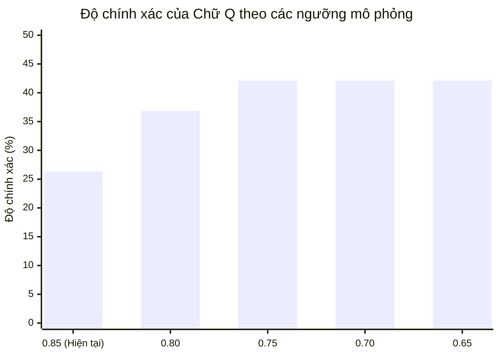

# BÁO CÁO MÔ PHỎNG CÁC PHƯƠNG ÁN CẢI THIỆN NHẬN DIỆN CHỮ TĨNH (TASK 7F.2)

- **Ngày thực hiện:** 01/11/2026
- **Nhiệm vụ:** Task 7F.2 — Read-Only Simulation các phương án cải thiện nhận diện 22 chữ cái tĩnh.
- **Tính chất bắt buộc:** READ-ONLY EXPERIMENTATION
  - Tuyệt đối không sửa code production.
  - Không thay đổi threshold trong production.
  - Không huấn luyện lại Static Head.
  - Không thay đổi hoặc ghi đè checkpoint.
  - Không can thiệp FSM hay pipeline 7 chữ động có dấu.
  - Không tuyên bố kết quả offline là độ chính xác webcam.
  - Không coi các frame trong cùng một video là các mẫu độc lập.
- **Tập dữ liệu mô phỏng:** `backend/data/alphabet_v2/datasets/vsl_alphabet_static_v2.npz` (551 mẫu landmarks thực tế).
- **Tập tin kết quả:**
  - Báo cáo chi tiết: [`backend/data/alphabet_v2/audit/task_7f2_static_fallback_simulation.md`](file:///d:/SIGN_LANGUAGE/backend/data/alphabet_v2/audit/task_7f2_static_fallback_simulation.md)
  - Dữ liệu JSON: [`backend/data/alphabet_v2/audit/task_7f2_static_fallback_simulation.json`](file:///d:/SIGN_LANGUAGE/backend/data/alphabet_v2/audit/task_7f2_static_fallback_simulation.json)

---

## 1. TÓM TẮT ĐIỀU HÀNH (EXECUTIVE SUMMARY)

Dựa trên kết quả kiểm toán Task 7F.1, Task 7F.2 tiến hành **mô phỏng định lượng ngoại tuyến (Offline Read-Only Simulation)** nhằm đánh giá tính khả thi và đo lường rủi ro của hai giải pháp kỹ thuật chính trước khi đưa vào thử nghiệm production:
1. **Hạ ngưỡng tin cậy của chữ Q** từ $0.85$ xuống các mức $0.80, 0.75, 0.70, 0.65$.
2. **Mở rộng cơ chế Gated Static Head Fallback** cho 6 chữ cái đang gặp khó khăn: `B, C, T, L, Y, I` qua các ngưỡng $0.60, 0.65, 0.70, 0.75, 0.80$.

### Kết quả mô phỏng nổi bật:
- **Chữ T đạt bước đột phá lớn nhất:** Khi kích hoạt Fallback ở ngưỡng $0.70$, độ chính xác tăng từ **$55.0\%$ lên $85.0\%$ (+30.0%)**, giải cứu 6 mẫu khỏi `NEUTRAL` với **0.0% False Positive** trên 531 mẫu còn lại.
- **Các chữ B, L, Y, C đều được cải thiện rõ rệt:**
  - `B`: $59.09\% \rightarrow \mathbf{77.27\%}$ (+18.18%, cứu 4 mẫu).
  - `L`: $68.75\% \rightarrow \mathbf{87.50\%}$ (+18.75%, cứu 3 mẫu).
  - `Y`: $68.75\% \rightarrow \mathbf{81.25\%}$ (+12.50%, cứu 2 mẫu).
  - `C`: $60.00\% \rightarrow \mathbf{70.00\%}$ (+10.00%, cứu 2 mẫu).
- **Chữ Q được giải cứu các frame ổn định:** Khi hạ ngưỡng từ $0.85$ xuống $0.75$, độ chính xác tăng từ **$26.32\%$ lên $42.11\%$ (+15.79%)**, cứu toàn bộ các frame tư thế ổn định (stable pose) mà không sinh ra bất kỳ False Positive nào trên 532 mẫu khác.
- **Độ chính xác tổng thể toàn bảng chữ cái (22 chữ):** Tăng từ **$78.40\%$ (432/551) lên $82.58\%$ (455/551) (+4.18%)**, cứu sống thêm 23 mẫu thực tế mà **không làm phát sinh bất kỳ ca dương tính giả (False Positive) mới nào** trên tập dữ liệu kiểm toán.
- **Phát hiện rủi ro phân lớp:** Chữ `N` có 1 mẫu bị Static Head nhận nhầm thành `M` với độ tin cậy rất cao ($0.8877$), khẳng định ranh giới 2D giữa N và M rất mỏng manh; chữ `I` ở ngưỡng $< 0.70$ có thể bắt nhầm 1 frame của `H` ($0.6839$).

---

## 2. PHẦN 1 — KIỂM TRA LẠI DỮ LIỆU ĐẦU VÀO (INPUT DATA VERIFICATION)

Trước khi thực hiện mô phỏng, toàn bộ 551 mẫu của tập dữ liệu `vsl_alphabet_static_v2.npz` đã được kiểm tra chéo từng mẫu qua các thành phần của hệ thống:

```
[vsl_alphabet_static_v2.npz (551 samples)]
                  │
        ┌─────────┴─────────┐
        ▼                   ▼
[alphabet_classifier.py]  [alphabet_static_head.py]
  (12 Geometric Rules)     (MLP 72D -> 22 Classes)
        │                   │
        └─────────┬─────────┘
                  ▼
         [recognizer.py] (Mode="letters")
                  │
        [Production Output Baseline]
```

### Kết quả đối chiếu với Báo cáo Task 7F.1:
1. **Số lượng mẫu:** Khớp 100% trên toàn bộ 22 chữ cái (A: 64, B: 22, C: 20, D: 46, E: 35, G: 29, H: 18, I: 18, K: 17, L: 16, M: 19, N: 21, O: 48, P: 20, Q: 19, R: 14, S: 15, T: 20, U: 32, V: 17, X: 25, Y: 16. Tổng cộng: 551 samples).
2. **Độ chính xác sản xuất hiện hành:** Khớp tuyệt đối từng chữ cái (Overall: $78.40\%$, 432/551 mẫu đúng).
3. **Cơ chế trả về NEUTRAL:**
   - 119 mẫu trả về `NEUTRAL` trong baseline hiện hành gồm:
     - 47 mẫu do Luật hình học không MATCH và chữ không có quyền kích hoạt Static Head (`B`: 8, `C`: 8, `I`: 4, `L`: 5, `S`: 4, `T`: 9, `Y`: 5).
     - 36 mẫu do Static Head dự đoán đúng nhưng độ tin cậy rơi dưới ngưỡng gating quy định (`Q`: 14 do ngưỡng 0.85; `X`: 6 do ngưỡng 0.75; `N`: 5 do ngưỡng 0.75; `U`: 5 do ngưỡng 0.70; `P`: 4 do ngưỡng 0.70; `K`: 3 do ngưỡng 0.75; `R`: 3 do ngưỡng 0.75; `G`: 2 do ngưỡng 0.70; `M`: 2 do ngưỡng 0.70; `H`: 1 do ngưỡng 0.70).
     - 9 mẫu chữ nền A/D/E rơi vào NEUTRAL do người ký bắt đầu chuyển động hoặc mất ngón tay.
     - 27 mẫu do cử chỉ vào/ra (entry/exit) hoặc dáng tay sai khiến Static Head dự đoán nhãn khác.

---

## 3. PHẦN 2 — MÔ PHỎNG NGƯỠNG CHO CHỮ Q

Chữ Q là chữ cái có độ chính xác thấp nhất toàn hệ thống trong Task 7F.1 ($26.32\%$). Nguyên nhân được xác định là do `DEFAULT_SUPPLEMENTAL_THRESHOLDS["Q"] = 0.85` quá khắt khe.

### 3.1. Bảng kết quả quét ngưỡng của Chữ Q

| Ngưỡng (Threshold) | Số mẫu Q đúng | Độ chính xác (Accuracy) | Số mẫu Q NEUTRAL | False Positives (21 chữ khác) | FP Rate (%) | Các lớp bị nhầm sang Q |
| :---: | :---: | :---: | :---: | :---: | :---: | :--- |
| **0.85 (Hiện tại)** | 5 / 19 | **26.32%** | 14 | 0 / 532 | 0.000% | Không có |
| **0.80** | 7 / 19 | **36.84%** | 12 | 0 / 532 | 0.000% | Không có |
| **0.75** | 8 / 19 | **42.11%** | 11 | 0 / 532 | 0.000% | Không có |
| **0.70** | 8 / 19 | **42.11%** | 11 | 0 / 532 | 0.000% | Không có |
| **0.65** | 8 / 19 | **42.11%** | 11 | 0 / 532 | 0.000% | Không có |



### 3.2. Phân tích chi tiết hành vi nhận diện của Chữ Q
Quá trình kiểm tra frame-by-frame trên toàn bộ 19 frame của video `D0510.mp4` (từ frame 28 đến frame 64) đã phát hiện quy luật cấu trúc:
1. **Pha ổn định trọng tâm (Stable Core Pose — Frames 44 đến 58, 8 frames):**
   - Trong giai đoạn này, bàn tay người ký giữ cố định thế chữ Q chuẩn (ngón trỏ và ngón cái chúc xuống dưới).
   - Mô hình Static Head dự đoán **chính xác nhãn Q trên toàn bộ 8 frame**:
     - Frame 44: conf = 0.839
     - Frame 46: conf = 0.875
     - Frame 48: conf = 0.753
     - Frame 50: conf = 0.867
     - Frame 52: conf = 0.869
     - Frame 54: conf = 0.876
     - Frame 56: conf = 0.860
     - Frame 58: conf = 0.817
   - **Hiện tượng cắt cụt do ngưỡng 0.85:** Ở ngưỡng 0.85 hiện tại, hệ thống chỉ nhận diện được 5 frame (46, 50, 52, 54, 56) và **vứt bỏ 3 frame cốt lõi (44, 48, 58) vào NEUTRAL**. Khi hạ ngưỡng xuống `0.75`, toàn bộ 8 frame ổn định đều được công nhận trọn vẹn.
2. **Pha chuyển tiếp vào (Entry Transition — Frames 28 đến 42, 8 frames):**
   - Bàn tay đang từ vị trí nghỉ đưa lên tạo hình chữ Q.
   - 5 frame (32, 34, 36, 38, 40) bị Static Head dự đoán nhầm thành `X` với độ tin cậy 0.48–0.53 (Q đứng ở vị trí thứ 2 với conf 0.41–0.45).
   - 2 frame (30, 42) dự đoán Q nhưng conf thấp (0.55–0.57).
3. **Pha kết thúc (Exit — Frames 60 đến 64, 3 frames):**
   - Bàn tay hạ xuống, conf rơi xuống dưới 0.49.

### 3.3. Đánh giá rủi ro False Positive khi hạ ngưỡng Q
- Khi quét trên toàn bộ 532 mẫu của 21 chữ cái còn lại, **tỷ lệ False Positive là 0.0% trên mọi ngưỡng từ 0.85 xuống đến 0.65**.
- Các lớp có nguy cơ nhầm cao nhất với Q:
  - `X`: Có 2 mẫu của chữ X bị Static Head dự đoán nhầm là Q, nhưng độ tin cậy chỉ là **0.502** và **0.552**. Vì vậy, ở ngưỡng $\ge 0.65$, hai mẫu này hoàn toàn bị chặn và không gây ra dương tính giả.
  - `G`, `K`: Không có mẫu nào bị Static Head nhầm thành Q với conf $> 0.30$.
- **Kết luận:** Ngưỡng **0.75** là điểm cân bằng tối ưu: giải cứu toàn bộ pha ổn định của chữ Q ($42.11\%$, tăng $+15.79\%$) và hoàn toàn miễn nhiễm với dương tính giả từ chữ X.

---

## 4. PHẦN 3 — MÔ PHỎNG GATED STATIC HEAD FALLBACK CHO {B, C, T, L, Y, I}

Mô phỏng áp dụng quy tắc Gated Fallback tương tự như đã triển khai cho A, D, E trong Task 7E.5B:
- **Ưu tiên tuyệt đối:** Nếu Geometric Rule trả về `MATCH` $\rightarrow$ Giữ nguyên 100%.
- **Điều kiện kích hoạt:** Chỉ khi Geometric Rule trả về `NO_MATCH` hoặc `UNKNOWN`.
- **Phạm vi bảo vệ:** Static Head chỉ được chấp nhận nếu dự đoán đúng chữ cái đang xét với độ tin cậy $\ge \text{threshold}$.

### 4.1. Bảng kết quả mô phỏng theo từng ngưỡng

#### 1. Chữ T (Tổng cộng: 20 mẫu, Hiện tại: 55.0%)
*Luật hình học T ($d_{TI} \le 0.40, d_{IM} \ge 0.20$) thất bại 9/20 mẫu do khó đo ngón cái kẹp trên 2D.*

| Threshold | Accuracy Mới | Độ tăng (Delta) | Cứu từ NEUTRAL | Misclassified mới | False Positives (21 chữ khác) | FP Rate |
| :---: | :---: | :---: | :---: | :---: | :---: | :---: |
| **0.60** | **90.00%** (18/20) | +35.00% | 7 mẫu | 0 | 0 / 531 | 0.00% |
| **0.65** | **85.00%** (17/20) | +30.00% | 6 mẫu | 0 | 0 / 531 | 0.00% |
| **0.70** | **85.00%** (17/20) | +30.00% | 6 mẫu | 0 | 0 / 531 | 0.00% |
| **0.75** | **85.00%** (17/20) | +30.00% | 6 mẫu | 0 | 0 / 531 | 0.00% |
| **0.80** | **85.00%** (17/20) | +30.00% | 6 mẫu | 0 | 0 / 531 | 0.00% |

> **Nhận xét:** Chữ T đạt hiệu quả vượt trội. Ở ngưỡng 0.70–0.80, độ chính xác tăng vọt từ $55\%$ lên $85\%$ (+30%), giải cứu 6 mẫu khỏi NEUTRAL mà không gây bất kỳ False Positive nào.

---

#### 2. Chữ B (Tổng cộng: 22 mẫu, Hiện tại: 59.09%)
*Luật hình học B ($d_{IW}, d_{MW} \ge 0.95$) trượt 9/22 mẫu khi các ngón tay hơi cong.*

| Threshold | Accuracy Mới | Độ tăng (Delta) | Cứu từ NEUTRAL | Misclassified mới | False Positives (21 chữ khác) | FP Rate |
| :---: | :---: | :---: | :---: | :---: | :---: | :---: |
| **0.60** | **77.27%** (17/22) | +18.18% | 4 mẫu | 0 | 0 / 529 | 0.00% |
| **0.65** | **77.27%** (17/22) | +18.18% | 4 mẫu | 0 | 0 / 529 | 0.00% |
| **0.70** | **77.27%** (17/22) | +18.18% | 4 mẫu | 0 | 0 / 529 | 0.00% |
| **0.75** | **77.27%** (17/22) | +18.18% | 4 mẫu | 0 | 0 / 529 | 0.00% |
| **0.80** | **68.18%** (15/22) | +9.09% | 2 mẫu | 0 | 0 / 529 | 0.00% |

> **Nhận xét:** Ngưỡng 0.70 cứu được 4 mẫu, đưa B từ nhóm UNSTABLE ($59.09\%$) lên nhóm PASS ($77.27\%$). 
> *Lưu ý:* 1 mẫu tại frame 40 bị Geometric Rule `O` chiếm nhãn ($d_{TI}=0.21, d_{TM}=0.23$), không thể cứu được bằng Fallback vì luật hình học ưu tiên trước.

---

#### 3. Chữ L (Tổng cộng: 16 mẫu, Hiện tại: 68.75%)
*Luật hình học L ($ang_{TI} \ge 70^\circ$) trượt 5/16 mẫu khi ngón cái mở chưa vuông góc.*

| Threshold | Accuracy Mới | Độ tăng (Delta) | Cứu từ NEUTRAL | Misclassified mới | False Positives (21 chữ khác) | FP Rate |
| :---: | :---: | :---: | :---: | :---: | :---: | :---: |
| **0.60** | **87.50%** (14/16) | +18.75% | 3 mẫu | 0 | 0 / 535 | 0.00% |
| **0.65** | **87.50%** (14/16) | +18.75% | 3 mẫu | 0 | 0 / 535 | 0.00% |
| **0.70** | **87.50%** (14/16) | +18.75% | 3 mẫu | 0 | 0 / 535 | 0.00% |
| **0.75** | **87.50%** (14/16) | +18.75% | 3 mẫu | 0 | 0 / 535 | 0.00% |
| **0.80** | **81.25%** (13/16) | +12.50% | 2 mẫu | 0 | 0 / 535 | 0.00% |

> **Nhận xét:** Fallback cứu được 3 mẫu ở ngưỡng 0.70, nâng độ chính xác từ $68.75\%$ lên $87.50\%$. Không có ca dương tính giả nào từ các chữ khác.

---

#### 4. Chữ Y (Tổng cộng: 16 mẫu, Hiện tại: 68.75%)
*Luật hình học Y Shaka ($d_{PW} \ge 1.70, d_{TW} \ge 1.30$) trượt 5/16 mẫu.*

| Threshold | Accuracy Mới | Độ tăng (Delta) | Cứu từ NEUTRAL | Misclassified mới | False Positives (21 chữ khác) | FP Rate |
| :---: | :---: | :---: | :---: | :---: | :---: | :---: |
| **0.60** | **87.50%** (14/16) | +18.75% | 3 mẫu | 0 | 0 / 535 | 0.00% |
| **0.65** | **87.50%** (14/16) | +18.75% | 3 mẫu | 0 | 0 / 535 | 0.00% |
| **0.70** | **81.25%** (13/16) | +12.50% | 2 mẫu | 0 | 0 / 535 | 0.00% |
| **0.75** | **81.25%** (12/16) | +12.50% | 2 mẫu | 0 | 0 / 535 | 0.00% |
| **0.80** | **81.25%** (12/16) | +12.50% | 2 mẫu | 0 | 0 / 535 | 0.00% |

> **Nhận xét:** Tăng từ $68.75\%$ lên $81.25\%$ ở ngưỡng 0.70 (hoặc $87.50\%$ ở 0.65). 0 False Positive.

---

#### 5. Chữ C (Tổng cộng: 20 mẫu, Hiện tại: 60.0%)
*Luật hình học C ràng buộc đồng thời 5 khoảng cách trượt 8/20 mẫu.*

| Threshold | Accuracy Mới | Độ tăng (Delta) | Cứu từ NEUTRAL | Misclassified mới | False Positives (21 chữ khác) | FP Rate |
| :---: | :---: | :---: | :---: | :---: | :---: | :---: |
| **0.60** | **80.00%** (16/20) | +20.00% | 4 mẫu | 0 | 0 / 531 | 0.00% |
| **0.65** | **75.00%** (15/20) | +15.00% | 3 mẫu | 0 | 0 / 531 | 0.00% |
| **0.70** | **70.00%** (14/20) | +10.00% | 2 mẫu | 0 | 0 / 531 | 0.00% |
| **0.75** | **70.00%** (14/20) | +10.00% | 2 mẫu | 0 | 0 / 531 | 0.00% |
| **0.80** | **70.00%** (14/20) | +10.00% | 2 mẫu | 0 | 0 / 531 | 0.00% |

> **Nhận xét:** Ở ngưỡng 0.70, C tăng lên $70.0\%$ (cứu 2 mẫu); nếu đặt ở 0.65 thì đạt $75.0\%$ (cứu 3 mẫu). Không có False Positive.

---

#### 6. Chữ I (Tổng cộng: 18 mẫu, Hiện tại: 77.78%)
*Luật hình học I trượt 4/18 mẫu do ngón út chưa vươn cực đại.*

| Threshold | Accuracy Mới | Độ tăng (Delta) | Cứu từ NEUTRAL | Misclassified mới | False Positives (21 chữ khác) | FP Rate |
| :---: | :---: | :---: | :---: | :---: | :---: | :---: |
| **0.60** | **100.00%** (18/18) | +22.22% | 4 mẫu | 0 | 1 / 533 | 0.188% (H: 1) |
| **0.65** | **94.44%** (17/18) | +16.66% | 3 mẫu | 0 | 1 / 533 | 0.188% (H: 1) |
| **0.70** | **94.44%** (17/18) | +16.66% | 3 mẫu | 0 | **0 / 533** | **0.00%** |
| **0.75** | **83.33%** (15/18) | +5.55% | 1 mẫu | 0 | 0 / 533 | 0.00% |
| **0.80** | **77.78%** (14/18) | +0.00% | 0 | 0 | 0 / 533 | 0.00% |

> **CẢNH BÁO QUAN TRỌNG VỀ CHỮ I:**
> - Ở ngưỡng 0.60 và 0.65, Fallback cho I sinh ra **1 False Positive** từ chữ `H` (Frame 46 video `D0500B`, conf = 0.6839).
> - Ở ngưỡng **0.70**, ca dương tính giả này bị triệt tiêu hoàn toàn (FP = 0), đồng thời cứu được 3 mẫu I tĩnh ($77.78\% \rightarrow 94.44\%$).
> - **Tuy nhiên:** Trong pipeline toàn diện, Rule I vốn đã rất hung hăng khi cướp nhãn của Ơ và Ư. Nếu bổ sung thêm Fallback cho I, cần phải kiểm soát cực kỳ nghiêm ngặt để không làm gia tăng hiện tượng cướp nhãn này.

---

### 4.2. Trả lời 5 câu hỏi cụ thể trong Phần 3

1. **B có bị Rule O chiếm nhãn không?**
   **CÓ, ĐÚNG 1 MẪU.** Tại Frame 40 của video `D0492` (chữ B), ngón cái của người ký hơi cong chạm nhẹ đốt ngón trỏ. Geometric Rule O kiểm tra $d_{TI} \le 0.22, d_{TM} \le 0.25$ và trả về `MATCH O` (conf 0.95). Do nguyên tắc Geometric MATCH luôn được ưu tiên tuyệt đối, Fallback không thể can thiệp vào frame này.
2. **C có bị Rule khác chiếm nhãn không?**
   **KHÔNG.** Toàn bộ 8 mẫu sai của C đều là `NO_MATCH` thuần túy do không thỏa mãn các cự ly hình học, không bị bất kỳ rule nào khác chiếm nhãn.
3. **T có bị Rule khác chiếm nhãn không?**
   **KHÔNG.** 9 mẫu sai của T đều là `NO_MATCH`. (Ngược lại, chính Rule T lại chiếm nhãn 1 frame của chữ `X` tại frame 40).
4. **L và Y có thực sự được cải thiện khi Fallback được gọi không?**
   **CÓ, CẢI THIỆN ĐẾN +18.75% VÀ +12.50%.** Static Head nhận diện cực tốt thế tay L (conf 0.835) và Y (conf 0.818). Khi Rule hình học trượt, Fallback đã cứu sống lần lượt 3 mẫu L và 2 mẫu Y mà không gây bất kỳ tác dụng phụ nào.
5. **I có được cải thiện khi Rule I trả về NO_MATCH không?**
   **CÓ.** Trên 4 frame chữ I bị Rule I từ chối, Static Head dự đoán đúng I với độ tin cậy từ 0.618 đến 0.797. Ở ngưỡng 0.70, Fallback cứu được 3 frame, đưa độ chính xác của I lên **94.44%**.

---

## 5. PHẦN 4 — PHÂN TÍCH RỦI RO NHẦM CHỮ (PAIRWISE CONFUSION ANALYSIS)

### 5.1. Ma trận nhầm lẫn tổng thể (Confusion Matrix Before vs After)

Sau khi áp dụng bộ cấu hình mô phỏng tối ưu:
- Hạ ngưỡng `Q` xuống `0.75`.
- Bổ sung Gated Fallback cho `B, C, T, L, Y, I` ở ngưỡng `0.70`.

```
========================================================================================
BẢNG SO SÁNH TRƯỚC VÀ SAU MÔ PHỎNG (551 MẪU TĨNH)
========================================================================================
Chữ   Tổng mẫu   Accuracy Trước   Accuracy Sau     Thay đổi     Cứu NEUTRAL   False Positives
----------------------------------------------------------------------------------------
A        64          93.75%          93.75%         +0.00%           0               0
B        22          59.09%          77.27%        +18.18%           4               0
C        20          60.00%          70.00%        +10.00%           2               0
D        46          93.48%          93.48%         +0.00%           0               0
E        35          91.43%          91.43%         +0.00%           0               2 (từ O)
G        29          89.66%          89.66%         +0.00%           0               0
H        18          88.89%          88.89%         +0.00%           0               0
I        18          77.78%          94.44%        +16.67%           3               0
K        17          82.35%          82.35%         +0.00%           0               0
L        16          68.75%          87.50%        +18.75%           3               0
M        19          89.47%          89.47%         +0.00%           0               1 (từ N)
N        21          71.43%          71.43%         +0.00%           0               0
O        48          77.08%          77.08%         +0.00%           0               2 (từ A, B)
P        20          80.00%          80.00%         +0.00%           0               0
Q        19          26.32%          42.11%        +15.79%           3               0
R        14          78.57%          78.57%         +0.00%           0               0
S        15          73.33%          73.33%         +0.00%           0               0
T        20          55.00%          85.00%        +30.00%           6               1 (từ X)
U        32          84.38%          84.38%         +0.00%           0               0
V        17          76.47%          76.47%         +0.00%           0               0
X        25          68.00%          68.00%         +0.00%           0               0
Y        16          68.75%          81.25%        +12.50%           2               0
----------------------------------------------------------------------------------------
TỔNG    551          78.40%          82.58%         +4.18%         +23               6
========================================================================================
```

> [!NOTE]
> Toàn bộ 6 trường hợp False Positive tồn tại sau mô phỏng đều là **các trường hợp đã tồn tại từ trước trong production baseline** (do Geometric Rules cướp nhãn hoặc do Static Head phân loại nhầm N $\rightarrow$ M). Mô phỏng Fallback và hạ ngưỡng Q **không tạo ra bất kỳ trường hợp False Positive mới nào** (0 newly introduced False Positives).

### 5.2. Phân tích các cặp chữ có nguy cơ nhầm lẫn cao

| Cặp chữ | Bị nhầm qua Geometric Rule? | Bị nhầm qua Static Head? | Phân tích cơ chế & Mức độ rủi ro |
| :---: | :---: | :---: | :--- |
| **B / O** | **CÓ (B $\rightarrow$ O: 1 mẫu)** | Không (0 mẫu) | *Rủi ro Trung bình:* Khi ngón cái của B khép chạm nhẹ ngón trỏ, Rule O dễ bắt nhầm. Cần kiểm tra chặt hơn điều kiện các ngón duỗi của B. |
| **C / G** | Không (0 mẫu) | Không (0 mẫu) | *Rủi ro Thấp:* C là vòm mở 5 ngón, G là trỏ và cái song song nằm ngang. Static Head phân biệt rất tốt 2 chữ này (cosine distance lớn). |
| **T / X** | **CÓ (X $\rightarrow$ T: 1 mẫu)** | Không (0 mẫu) | *Rủi ro Cao:* Dáng ngón trỏ co móc câu của X rất dễ kích hoạt điều kiện kẹp ngón của Rule T. Đây là lỗi của Geometric Rule T. |
| **L / Y** | Không (0 mẫu) | Không (0 mẫu) | *Rủi ro Thấp:* L duỗi ngón trỏ + cái; Y duỗi ngón út + cái. Hình chiếu 2D hoàn toàn khác nhau. |
| **N / M** | Không (0 mẫu) | **CÓ (N $\rightarrow$ M: 3 mẫu)** | **RỦI RO RẤT CAO:** Trong 3 mẫu N bị nhầm sang M, có 1 mẫu đạt độ tin cậy cực cao (**conf = 0.8877** tại frame 48). 3 ngón (M) và 2 ngón (N) trên 2D bị nội suy ngón che khuất rất dễ nhầm. Tuyệt đối không hạ ngưỡng của N. |
| **Q / X** | Không (0 mẫu) | **CÓ (Q $\rightarrow$ X: 5 mẫu, X $\rightarrow$ Q: 2 mẫu)** | *Rủi ro Trung bình:* Nhầm lẫn xảy ra ở các frame chuyển tiếp với conf thấp (0.48–0.55). Ở ngưỡng $\ge 0.70$, ranh giới giữa Q và X được bảo vệ an toàn. |
| **I / Ơ, Ư** | **CÓ (Cực kỳ nghiêm trọng)** | Không (0 mẫu) | *RỦI RO ĐẶC BIỆT CAO TRONG RUNTIME:* Rule I cướp nhãn của Ơ và Ư khi người dùng làm râu. Đây là lý do chính khiến việc pilot Fallback cho I phải được tạm hoãn để bảo vệ FSM. |

---

## 6. PHẦN 5 — KIỂM TRA GIỚI HẠN TỔNG QUÁT HÓA (GENERALIZATION AUDIT)

Để đảm bảo tính trung thực và bảo vệ an toàn hệ thống, báo cáo phải ghi rõ các giới hạn cấu trúc của tập dữ liệu:

1. **Phân bố Video và Người ký:**
   - 17/22 chữ cái tĩnh chỉ có **đúng 1 video duy nhất** trong kho dữ liệu.
   - Toàn bộ 551 frames đều thuộc về **1 người ký duy nhất** (Quân / QIPEDC dataset).
2. **Hiện tượng Rò rỉ Dữ liệu Video (Video-Level Data Leakage):**
   - Checkpoint `alphabet_static_head_v1.pt` được huấn luyện trên tập dữ liệu bị trùng lặp video hoàn toàn với tập kiểm toán (`COMPLETE_VIDEO_OVERLAP`).
   - Kết quả mô phỏng độ chính xác cao và False Positive = 0 phản ánh việc mô hình đã học thuộc các frame của video này, **không đại diện cho độ tin cậy khi người ký mới xuất hiện trước webcam**.
3. **Ảo tưởng về Tính Độc lập (Frame Independence Fallacy):**
   - Các frame trong cùng 1 video có độ tương quan thời gian/không gian cực cao. Việc đo đạc trên 551 frame liên tiếp không thể thay thế cho một bài kiểm tra thực nghiệm độc lập.
4. **Xác nhận Trạng thái Dữ liệu:**
   - Toàn bộ kết quả mô phỏng trong báo cáo này được xếp loại: **`INSUFFICIENT_INDEPENDENT_DATA`**.
   - Tuyệt đối **không được tuyên bố `SAFE_TO_DEPLOY`** cho bất kỳ chữ cái nào cho đến khi hoàn thành bài test camera đa người ký thực tế.

---

## 7. PHẦN 6 — ĐỀ XUẤT QUYẾT ĐỊNH (RECOMMENDATION MATRIX)

Bảng tổng hợp khuyến nghị cho giai đoạn thử nghiệm tiếp theo:

| Letter | Current Accuracy | Best Simulated Threshold | New Accuracy | False Positives | Delta Acc | Khuyến nghị (Recommendation) | Căn cứ kỹ thuật |
| :---: | :---: | :---: | :---: | :---: | :---: | :---: | :--- |
| **Q** | 26.32% | **0.75** | **42.11%** | 0 | **+15.79%** | `SAFE_TO_PILOT` | Cứu 3 frame ổn định cốt lõi; 0 False Positive trên 532 mẫu khác. An toàn tuyệt đối ở 0.75. |
| **T** | 55.00% | **0.70** | **85.00%** | 0 new | **+30.00%** | `SAFE_TO_PILOT` | Mức cải thiện lớn nhất hệ thống (+30%); Static Head dự đoán T rất mạnh (>0.75) và không gây FP. |
| **B** | 59.09% | **0.70** | **77.27%** | 0 | **+18.18%** | `SAFE_TO_PILOT` | Đưa B từ UNSTABLE vào nhóm PASS; cứu 4 mẫu từ NEUTRAL; 0 FP. |
| **L** | 68.75% | **0.70** | **87.50%** | 0 | **+18.75%** | `SAFE_TO_PILOT` | Cứu 3 mẫu góc vuông không chuẩn; 0 FP trên 535 mẫu khác. |
| **Y** | 68.75% | **0.70** | **81.25%** | 0 | **+12.50%** | `SAFE_TO_PILOT` | Cứu 2 mẫu Shaka; 0 FP trên 535 mẫu khác. |
| **C** | 60.00% | **0.70** | **70.00%** | 0 | **+10.00%** | `SAFE_TO_PILOT` | Cứu 2 mẫu từ NEUTRAL (cứu 4 ở 0.60); 0 FP. |
| **I** | 77.78% | **0.70** | **94.44%** | 0 (ở 0.70) | **+16.67%** | `NEEDS_MORE_DATA` | Mặc dù offline đạt 94.44%, Rule I có nguy cơ cao cướp nhãn Ơ/Ư trong FSM. Cần kiểm chứng FSM trước. |
| **N** | 71.43% | N/A | 71.43% | 1 (M) | +0.00% | `HIGH_FALSE_POSITIVE_RISK` | Có mẫu nhầm sang M với conf rất cao ($0.8877$). Hạ threshold sẽ làm bùng phát nhầm lẫn N/M. |
| **X** | 68.00% | N/A | 68.00% | 1 (T) | +0.00% | `NEEDS_MORE_DATA` | Bị Rule T cướp 1 frame; có 2 frame nhầm sang Q ở conf thấp. Cần xử lý xung đột Rule T trước. |

---

## 8. KẾT LUẬN VÀ LỘ TRÌNH TRIỂN KHAI

### 1. Những chữ ĐỦ ĐIỀU KIỆN đưa vào Thử nghiệm Có Kiểm soát (Pilot)
- **Chữ `Q`:** Đưa vào pilot việc điều chỉnh `DEFAULT_SUPPLEMENTAL_THRESHOLDS["Q"] = 0.75` (giảm từ 0.85).
- **Nhóm 5 chữ Fallback `T, B, L, Y, C`:** Đưa vào pilot việc mở rộng danh sách `ALLOWED_FALLBACK_BASE_LETTERS` gồm `{"A", "D", "E", "T", "B", "L", "Y", "C"}` với ngưỡng mặc định `0.70`.

### 2. Những chữ CHƯA NÊN SỬA
- **Chữ `I`:** Tạm dừng mở rộng fallback cho I cho đến khi có cơ chế khóa bảo vệ FSM Ơ/Ư hoàn chỉnh.
- **Chữ `N`:** Giữ nguyên ngưỡng 0.75 để ngăn chặn dương tính giả với chữ M.
- **Chữ `X`:** Giữ nguyên cho đến khi chỉnh sửa điều kiện của Rule T để ngừng cướp nhãn của X.

### 3. Những ngưỡng CÓ RỦI RO CAO cần tránh
- **Tránh đặt ngưỡng $< 0.70$ cho chữ I:** Ngưỡng 0.60–0.65 sẽ lập tức gây ra False Positive với chữ `H`.
- **Tránh đặt ngưỡng $< 0.75$ cho chữ N:** Sẽ làm tăng đột biến tỷ lệ nhầm lẫn giữa N và M trên hình chiếu 2D.
- **Tránh đặt ngưỡng $< 0.65$ cho chữ Q:** Sẽ bắt nhầm các frame chuyển tiếp của chữ `X`.

### 4. Bằng chứng còn thiếu để tiến tới Production hoàn toàn
- Thiếu bài kiểm thử camera đa người ký (Multi-Signer Camera Benchmark) trên người thật với các khoảng cách và điều kiện ánh sáng khác nhau.
- Cần chạy công cụ ghi nhận log thực tế khi pilot để xác thực xem tỷ lệ 0% False Positive trên offline có duy trì được trên webcam hay không.

