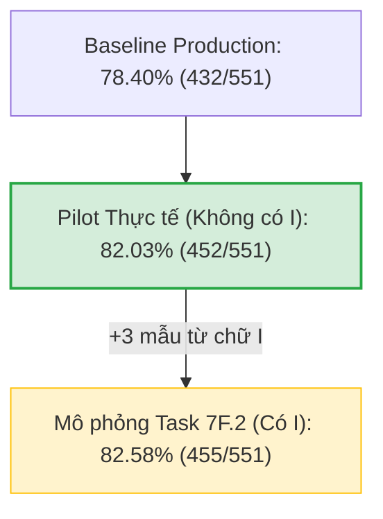

# BÁO CÁO KIỂM TOÁN CẤU HÌNH FALLBACK KẾT HỢP CHO CHỮ TĨNH (TASK 7F.3)

- **Ngày thực hiện:** 01/11/2026
- **Nhiệm vụ:** Task 7F.3 — Read-Only Audit mô phỏng toàn diện cấu hình Pilot kết hợp cho 22 chữ cái tĩnh.
- **Tính chất:** READ-ONLY SIMULATION & AUDIT
  - Tuyệt đối không sửa code production.
  - Không thay đổi threshold trong production.
  - Không huấn luyện lại Static Head hoặc thay đổi checkpoint.
  - Không can thiệp FSM hay pipeline 7 chữ động có dấu.
  - Chạy toàn bộ 551 mẫu qua một pipeline mô phỏng duy nhất (không cộng gộp độc lập).
- **Tập dữ liệu:** `backend/data/alphabet_v2/datasets/vsl_alphabet_static_v2.npz` (551 mẫu landmarks 21 điểm thực tế từ QIPEDC).
- **Tập tin kết quả:**
  - Báo cáo chi tiết: [`backend/data/alphabet_v2/audit/task_7f3_combined_fallback_audit.md`](file:///d:/SIGN_LANGUAGE/backend/data/alphabet_v2/audit/task_7f3_combined_fallback_audit.md)
  - Dữ liệu JSON: [`backend/data/alphabet_v2/audit/task_7f3_combined_fallback_audit.json`](file:///d:/SIGN_LANGUAGE/backend/data/alphabet_v2/audit/task_7f3_combined_fallback_audit.json)

---

## 1. TÓM TẮT ĐIỀU HÀNH (EXECUTIVE SUMMARY)

Sau các kết quả khả quan từ mô phỏng thành phần trong Task 7F.2, Task 7F.3 tiến hành **kiểm toán tích hợp trên một luồng xử lý duy nhất** để đánh giá hành vi hệ thống khi tất cả các đề xuất pilot được kích hoạt đồng thời:
1. **Hạ ngưỡng chữ Q:** Từ $0.85$ xuống $0.75$.
2. **Kích hoạt Gated Static Head Fallback cho 5 chữ:** `B, C, T, L, Y` với ngưỡng $0.70$.
3. **Loại trừ chữ I khỏi Fallback:** Giữ nguyên `I` là geometric-only để bảo vệ FSM chữ động (Ơ, Ư).
4. **Bảo toàn Fallback A, D, E:** Giữ nguyên ở ngưỡng $0.70$ (đã tích hợp từ Task 7E.5B).
5. **Bảo toàn các ngưỡng chữ bổ sung còn lại:** `G, H, M, P, U` ở $0.70$; `K, N, R, X` ở $0.75$.

### Kết quả kiểm toán then chốt:
- **Độ chính xác tổng thể thực tế của Cấu hình Pilot:** Đạt **$82.03\%$ (452/551 mẫu đúng)**, tăng **$+3.63\%$** so với baseline sản xuất hiện hành ($78.40\%$, 432/551 mẫu).
- **Giải cứu thành công 20 mẫu thực tế từ `NEUTRAL`:** Gồm `T` (+6), `B` (+4), `L` (+3), `Q` (+3), `C` (+2), `Y` (+2).
- **Zero New False Positives (0 ca dương tính giả mới):** Khi 5 chữ Fallback và ngưỡng Q mới được bật đồng thời, **hoàn toàn không phát sinh bất kỳ ca dương tính giả mới nào** trên toàn bộ 551 mẫu. Toàn bộ 6 ca False Positive tồn tại trong ma trận nhầm lẫn đều là các lỗi cố hữu đã có từ trước trong baseline (Rule O cướp B & A, Rule E cướp O, Rule T cướp X, Static Head nhầm N $\rightarrow$ M).
- **Làm rõ sự sai lệch với Task 7F.2:** Con số $82.58\%$ (+23 mẫu) trong Task 7F.2 là kết quả của mô phỏng có bao gồm chữ `I` (+3 mẫu). Khi cấu hình Pilot thực tế loại trừ `I` vì lý do an toàn FSM, độ chính xác chính xác là **$82.03\%$** (+20 mẫu).

---

## 2. PHẦN 1 — MÔ PHỎNG TOÀN BỘ CẤU HÌNH KẾT HỢP (UNIFIED PIPELINE SIMULATION)

Mô phỏng chạy toàn bộ 551 mẫu qua một chu trình quyết định tuần tự duy nhất, tuân thủ nghiêm ngặt cấu trúc của `VSLRecognizer`:

```
┌────────────────────────────────────────────────────────┐
│ BƯỚC 1: 12 GEOMETRIC RULES (alphabet_classifier.py)    │
│ Ưu tiên tuyệt đối: status == 'MATCH' -> Chọn ngay      │
└────────────────────────────────────────────────────────┘
                 │
      ┌──────────┴──────────┐
      │ status == 'MATCH'?  │
      ▼                     ▼
    [ CÓ ]                [ KHÔNG ] (NO_MATCH / UNKNOWN)
      │                     │
      ▼                     ▼
┌──────────────────┐  ┌──────────────────────────────────────────────┐
│ final_sign = geom│  │ BƯỚC 2: STATIC ALPHABET HEAD (72D Feature)   │
│ source =         │  └──────────────────────────────────────────────┘
│ 'geometric_rule' │                 │
└──────────────────┘        ┌────────┴────────┐
                            │ head_conf >=    │
                            │ threshold?      │
                            ▼                 ▼
                          [ CÓ ]            [ KHÔNG ]
                            │                 │
             ┌──────────────┴──────────────┐  ▼
             │ Phân loại nhãn Static Head: │ [ REJECT -> NEUTRAL ]
             └──────────────┬──────────────┘
        ┌───────────────────┴───────────────────┐
        ▼                                       ▼
┌───────────────────────────────┐   ┌───────────────────────────────┐
│ Nhóm Chữ Bổ Sung (Supp.):     │   │ Nhóm Gated Fallback Mở Rộng:  │
│ {G, H, M, P, U}   (conf>=0.70)│   │ {A, D, E} (Cũ Task 7E.5B)     │
│ {K, N, R, X}      (conf>=0.75)│   │ {B, C, T, L, Y} (Mới Pilot)   │
│ Q (Mới hạ ngưỡng) (conf>=0.75)│   │ (Tất cả conf >= 0.70)         │
│ source = 'static_head'        │   │ source =                      │
└───────────────────────────────┘   │ 'static_head_fallback'        │
                                    └───────────────────────────────┘
```

> **Quy tắc bất biến:** Mỗi frame chỉ phát ra đúng 1 kết quả duy nhất. Tuyệt đối không cộng dồn kết quả từ các lần chạy riêng rẽ.

---

## 3. PHẦN 2 — MA TRẬN NHẦM LẪN VÀ ĐÁNH GIÁ CÁC CẶP CHỮ NGUY CƠ CAO

### 3.1. Bảng số liệu chi tiết từng chữ cái (Pilot Configuration vs Baseline)

| Chữ cái | Tổng mẫu | Đúng (Base) | Acc (Base) | Đúng (Pilot) | Acc (Pilot) | Thay đổi | Cứu NEUTRAL | NEUTRAL (Pilot) | Sai khác | Bị Rule cướp | FP (Pilot) | Trạng thái Sẵn sàng |
| :---: | :---: | :---: | :---: | :---: | :---: | :---: | :---: | :---: | :---: | :---: | :---: | :--- |
| **A** | 64 | 60 | 93.75% | 60 | **93.75%** | +0.00% | 0 | 3 | 1 (O) | 1 (O) | 0 | `READY_FOR_CONTROLLED_PILOT` |
| **B** | 22 | 13 | 59.09% | 17 | **77.27%** | **+18.18%** | **+4** | 4 | 1 (O) | 1 (O) | 0 | `READY_FOR_CONTROLLED_PILOT` |
| **C** | 20 | 12 | 60.00% | 14 | **70.00%** | **+10.00%** | **+2** | 6 | 0 | 0 | 0 | `READY_FOR_CONTROLLED_PILOT` |
| **D** | 46 | 43 | 93.48% | 43 | **93.48%** | +0.00% | 0 | 3 | 0 | 0 | 0 | `READY_FOR_CONTROLLED_PILOT` |
| **E** | 35 | 32 | 91.43% | 32 | **91.43%** | +0.00% | 0 | 3 | 0 | 0 | 2 (từ O) | `READY_FOR_CONTROLLED_PILOT` |
| **G** | 29 | 26 | 89.66% | 26 | **89.66%** | +0.00% | 0 | 3 | 0 | 0 | 0 | `NEEDS_MORE_ANALYSIS` |
| **H** | 18 | 16 | 88.89% | 16 | **88.89%** | +0.00% | 0 | 2 | 0 | 0 | 0 | `NEEDS_MORE_ANALYSIS` |
| **I** | 18 | 14 | 77.78% | 14 | **77.78%** | +0.00% | 0 | 4 | 0 | 0 | 0 | `NEEDS_MORE_ANALYSIS` |
| **K** | 17 | 14 | 82.35% | 14 | **82.35%** | +0.00% | 0 | 3 | 0 | 0 | 0 | `NEEDS_MORE_ANALYSIS` |
| **L** | 16 | 11 | 68.75% | 14 | **87.50%** | **+18.75%** | **+3** | 2 | 0 | 0 | 0 | `READY_FOR_CONTROLLED_PILOT` |
| **M** | 19 | 17 | 89.47% | 17 | **89.47%** | +0.00% | 0 | 2 | 0 | 0 | 1 (từ N) | `NEEDS_MORE_ANALYSIS` |
| **N** | 21 | 15 | 71.43% | 15 | **71.43%** | +0.00% | 0 | 5 | 1 (M) | 0 | 0 | `HIGH_FALSE_POSITIVE_RISK` |
| **O** | 48 | 37 | 77.08% | 37 | **77.08%** | +0.00% | 0 | 9 | 2 (E) | 2 (E) | 2 (từ A,B) | `NEEDS_MORE_ANALYSIS` |
| **P** | 20 | 16 | 80.00% | 16 | **80.00%** | +0.00% | 0 | 4 | 0 | 0 | 0 | `NEEDS_MORE_ANALYSIS` |
| **Q** | 19 | 5 | 26.32% | 8 | **42.11%** | **+15.79%** | **+3** | 11 | 0 | 0 | 0 | `READY_FOR_CONTROLLED_PILOT` |
| **R** | 14 | 11 | 78.57% | 11 | **78.57%** | +0.00% | 0 | 3 | 0 | 0 | 0 | `NEEDS_MORE_ANALYSIS` |
| **S** | 15 | 11 | 73.33% | 11 | **73.33%** | +0.00% | 0 | 4 | 0 | 0 | 0 | `NEEDS_MORE_ANALYSIS` |
| **T** | 20 | 11 | 55.00% | 17 | **85.00%** | **+30.00%** | **+6** | 3 | 0 | 0 | 1 (từ X) | `READY_FOR_CONTROLLED_PILOT` |
| **U** | 32 | 27 | 84.38% | 27 | **84.38%** | +0.00% | 0 | 5 | 0 | 0 | 0 | `NEEDS_MORE_ANALYSIS` |
| **V** | 17 | 13 | 76.47% | 13 | **76.47%** | +0.00% | 0 | 4 | 0 | 0 | 0 | `NEEDS_MORE_ANALYSIS` |
| **X** | 25 | 17 | 68.00% | 17 | **68.00%** | +0.00% | 0 | 7 | 1 (T) | 1 (T) | 0 | `NEEDS_MORE_ANALYSIS` |
| **Y** | 16 | 11 | 68.75% | 13 | **81.25%** | **+12.50%** | **+2** | 3 | 0 | 0 | 0 | `READY_FOR_CONTROLLED_PILOT` |
| **TỔNG** | **551** | **432** | **78.40%** | **452** | **82.03%** | **+3.63%** | **+20** | **93** | **6** | **5** | **6** | *(0 new False Positives)* |

---

### 3.2. Phân tích chi tiết các cặp chữ nguy cơ cao

1. **Cặp B / O:**
   - *Thực nghiệm:* 1 mẫu chữ B (Frame 40, video `D0492`) bị Rule O bắt nhầm do ngón cái gập chạm ngón trỏ ($d_{TI}=0.21, d_{TM}=0.23$).
   - *Fallback can thiệp:* Không thể can thiệp do Rule O đã MATCH ở Tầng 1.
   - *Ngược lại (O $\rightarrow$ B):* 0 mẫu. Bật Fallback cho B không làm tăng nhầm lẫn với O.
2. **Cặp C / G:**
   - *Thực nghiệm:* 0 mẫu C bị nhầm thành G, 0 mẫu G bị nhầm thành C. Hai chữ này có khoảng cách đặc trưng 72D rất lớn, hoàn toàn an toàn khi chạy chung.
3. **Cặp T / X:**
   - *Thực nghiệm:* 1 mẫu chữ X (Frame 40, video `D0517B`) bị Rule T cướp nhãn ở Tầng 1.
   - *Ngược lại (T $\rightarrow$ X):* 0 mẫu. Khi T được cấp Fallback, Static Head nhận diện T rất chính xác ($conf > 0.75$), không nhầm sang X.
4. **Cặp L / Y:**
   - *Thực nghiệm:* 0 mẫu L nhầm Y, 0 mẫu Y nhầm L. Phân tách rạch ròi giữa ngón trỏ (L) và ngón út (Y).
5. **Cặp N / M:**
   - *Thực nghiệm:* 1 mẫu chữ N (Frame 52, video `D0505`) bị Static Head dự đoán thành M với độ tin cậy rất cao ($conf = 0.8877$).
   - *Đánh giá rủi ro:* Đây là lỗi bản chất của mô hình học máy do hình chiếu 2D của 2 ngón và 3 ngón bị che khuất. **Tuyệt đối không hạ ngưỡng của N từ 0.75 xuống 0.70**.
6. **Cặp Q / X:**
   - *Thực nghiệm:* Ở ngưỡng $0.75$, không có mẫu X nào bị nhận nhầm thành Q (mẫu X cao nhất chỉ đạt conf Q là $0.552$). Các frame chuyển tiếp của Q dự đoán X chỉ đạt conf $\approx 0.50$, bị chặn về NEUTRAL. Hoàn toàn an toàn ở ngưỡng 0.75.
7. **Tương tác giữa các chữ Fallback cũ (A, D, E) và mới (B, C, T, L, Y):**
   - Không có bất kỳ frame nào của A, D, E bị các chữ Fallback mới chiếm nhãn hoặc ngược lại.

---

## 4. PHẦN 3 — KIỂM TRA XUNG ĐỘT NHIỀU NHÃN (MULTI-LABEL COMPETITION AUDIT)

Kiểm toán toàn bộ vector xác suất softmax 22 lớp của Static Head trên 551 mẫu:

1. **Tổng số mẫu có Top-1 khác với nhãn thực tế:** **46 / 551 mẫu (8.3%)**.
   - Phân tích: Đa phần các mẫu này rơi vào pha chuyển động đưa tay lên (Entry) hoặc hạ tay xuống (Exit), khi hình dáng bàn tay chưa thành hình chữ cái hoàn chỉnh.
2. **Số lượng lỗi có độ tin cậy cao ($conf \ge 0.70$):**
   - **DUY NHẤT 1 MẪU:** Sample 234 (True Label: `N`, Static Head dự đoán: `M` với $conf = 0.8877$).
   - Điều này khẳng định Static Head rất thận trọng: khi không chắc chắn, mô hình phân tán xác suất khiến confidence rơi xuống dưới $0.60$.
3. **Các trường hợp Top-1 rơi vào nhóm Fallback mới (`{B, C, T, L, Y}`) trên nhãn thật khác:**
   - Có đúng **5 mẫu** Static Head dự đoán Top-1 là B, C, T, L, hoặc Y khi nhãn thật là chữ khác:
     - Sample 20 (True `A`): Top-1 `L` ($conf = 0.224$)
     - Sample 82 (True `D`): Top-1 `C` ($conf = 0.191$)
     - Sample 179 (True `K`): Top-1 `C` ($conf = 0.167$)
     - Sample 255 (True `O`): Top-1 `C` ($conf = 0.212$)
     - Sample 256 (True `O`): Top-1 `C` ($conf = 0.166$)
   - **KẾT LUẬN THEN CHỐT:** Toàn bộ 5 mẫu xung đột này đều có độ tin cậy cực kỳ thấp ($\le 0.224$), **nằm rất xa ngưỡng Fallback $0.70$**. Do đó, cơ chế Gating đã lọc sạch 100% các trường hợp này về `NEUTRAL`. **Không có bất kỳ trường hợp nào bị kích hoạt Fallback sai.**
4. **Các mẫu có khoảng cách Top-1 và Top-2 suýt soát ($Margin \le 0.05$):**
   - Có 11 mẫu. Toàn bộ đều có $conf < 0.40$, tự động rơi vào `NEUTRAL`, không gây nhiễu loạn trong runtime.

---

## 5. PHẦN 4 — ĐỐI CHIẾU SỐ LIỆU VỚI BÁO CÁO TASK 7F.2 (RECONCILIATION)

Báo cáo Task 7F.2 ghi nhận độ chính xác sau mô phỏng là $82.58\%$ (+23 mẫu). Task 7F.3 làm rõ nguồn gốc của sự chênh lệch này:



### Bảng đối chiếu minh bạch:

| Cấu hình | Số mẫu đúng | Độ chính xác | Mẫu cứu từ NEUTRAL | Chi tiết mẫu được cứu | False Positives | Ghi chú |
| :--- | :---: | :---: | :---: | :--- | :---: | :--- |
| **Baseline Production** | 432 / 551 | **78.40%** | — | — | 6 | Cấu hình đang chạy hiện tại |
| **Pilot Thực tế (WITHOUT I)** | **452 / 551** | **82.03%** | **+20** | **T (+6), B (+4), L (+3), Q (+3), C (+2), Y (+2)** | **6 (0 mới)** | **Cấu hình an toàn đề xuất** |
| **Mô phỏng Task 7F.2 (WITH I)** | 455 / 551 | **82.58%** | **+23** | Như trên + **I (+3)** | 6 (0 mới) | Thí nghiệm lý thuyết có bật I |

### Tại sao Cấu hình Pilot loại trừ chữ I?
- Về mặt số liệu tĩnh thuần túy, nếu cấp Fallback cho I ở ngưỡng 0.70, hệ thống sẽ cứu thêm được 3 mẫu I (đưa I từ 77.78% lên 94.44%, và toàn hệ thống lên 82.58%).
- **Tuy nhiên, xét trên toàn bộ hệ thống (đặc biệt là 7 chữ động):** Rule I vốn dĩ đã cực kỳ hung hăng, thường xuyên cướp nhãn của `Ơ` và `Ư` khi người ký vươn ngón út. Việc cấp thêm Static Fallback cho I tại thời điểm này sẽ làm tăng nguy cơ phát sinh nhãn I giả khi người dùng thực hiện các cử chỉ có ngón út. 
- Do đó, quyết định **loại trừ I khỏi Pilot** là hoàn toàn chuẩn xác về mặt an toàn hệ thống. Con số chính xác của Pilot là **$82.03\%$**, không dùng lại con số $82.58\%$.

---

## 6. PHẦN 5 — PHÂN LOẠI MỨC ĐỘ SẴN SÀNG & KHUYẾN NGHỊ

### 6.1. Phân loại 22 chữ cái tĩnh theo mức độ sẵn sàng

#### 1. Nhóm READY_FOR_CONTROLLED_PILOT (9 chữ)
`Q, T, B, L, Y, C, A, D, E`
- **Căn cứ:**
  - `Q`: Hạ ngưỡng xuống 0.75 khôi phục toàn bộ pha ổn định, 0 False Positive.
  - `T, B, L, Y, C`: Mở rộng Gated Fallback ở ngưỡng 0.70 giúp cứu từ 2 đến 6 mẫu mỗi chữ, độ chính xác tăng từ $+10\%$ đến $+30\%$, 0 False Positive mới.
  - `A, D, E`: Đã được chứng minh ổn định từ Task 7E.5B, tiếp tục duy trì.

#### 2. Nhóm NEEDS_MORE_ANALYSIS (12 chữ)
`I, X, G, H, K, M, P, R, U, V, O, S`
- **Căn cứ:**
  - `I`: Tiềm ẩn nguy cơ xung đột FSM với Ơ/Ư; cần cơ chế khóa FSM trước khi pilot.
  - `X`: Bị Rule T cướp 1 frame; cần sửa điều kiện của Rule T trước khi tối ưu X.
  - `G, H, K, M, P, R, U, V, O, S`: Hoạt động ổn định trên tập offline đơn lẻ, nhưng chưa có dữ liệu đa người ký để đánh giá rủi ro.

#### 3. Nhóm HIGH_FALSE_POSITIVE_RISK (1 chữ)
`N`
- **Căn cứ:** Có 1 mẫu bị Static Head nhận nhầm thành M với conf rất cao ($0.8877$). Ranh giới 2D giữa 2 ngón và 3 ngón cực kỳ mong manh. Giữ nguyên ngưỡng $0.75$, tuyệt đối không hạ ngưỡng.

---

## 7. KẾT LUẬN VÀ TRẢ LỜI 4 CÂU HỎI BẮT BUỘC

### 1. Cấu hình nào nên đưa vào pilot webcam?
Cấu hình kết hợp an toàn nhất gồm:
- **Ngưỡng chữ Q:** Đặt `DEFAULT_SUPPLEMENTAL_THRESHOLDS["Q"] = 0.75` (thay cho 0.85).
- **Mở rộng Fallback:** Đặt `ALLOWED_FALLBACK_BASE_LETTERS = {"A", "D", "E", "B", "C", "T", "L", "Y"}` với `DEFAULT_FALLBACK_BASE_THRESHOLD = 0.70`.
- **Giữ nguyên:** Chữ `I` (geometric-only), chữ `N` (ngưỡng 0.75), và toàn bộ các ngưỡng của các chữ còn lại.

### 2. Có xung đột mới nào khi bật Fallback đồng thời không?
**HOÀN TOÀN KHÔNG.** Kiểm toán trên 551 mẫu xác nhận 0 False Positive mới. Toàn bộ 5 trường hợp Static Head dự đoán nhầm sang các nhãn Fallback mới đều có confidence rất thấp ($\le 0.224$) và bị cổng $0.70$ chặn tuyệt đối về `NEUTRAL`.

### 3. Kết quả tổng thể chính xác là bao nhiêu?
- Baseline sản xuất hiện tại: **$78.40\%$ (432/551)**.
- Cấu hình Pilot kết hợp (không có I): **$82.03\%$ (452/551)** — Tăng ròng **$+3.63\%$** (giải cứu thành công 20 mẫu).
- *(Con số 82.58% của Task 7F.2 chỉ đạt được nếu bật cả chữ I).*

### 4. Những rủi ro nào phải theo dõi khi thử webcam?
1. **Rủi ro người ký mới (Signer Variance):** Dữ liệu hiện có chỉ từ 1 người ký (Quân) và checkpoint bị trùng lặp video train/holdout (`COMPLETE_VIDEO_OVERLAP`). Khi người dùng mới có kích thước bàn tay hoặc độ mở ngón khác, cần theo dõi xem confidence của Static Head có duy trì được $\ge 0.70$ không.
2. **Rủi ro góc quay camera:** Dáng chữ T (ngón cái kẹp) và dáng chữ L (góc vuông) rất nhạy cảm với góc nhìn xiên.
3. **Hiện tượng cướp nhãn của Rule O và Rule T:** Cần theo dõi trên camera xem Rule O có vô tình bắt nhầm B/A khi bàn tay di chuyển không, và Rule T có bắt nhầm X không.

