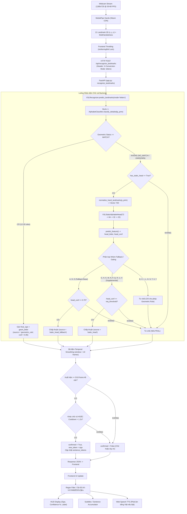

# BÁO CÁO TOÀN DIỆN TASK 11.0: AUDIT END-TO-END WEBCAM RECOGNITION PIPELINE

> **Dự án:** VSL Connect AI — Chuẩn hóa Nhận diện 29 Chữ cái Ngôn ngữ Ký hiệu Tiếng Việt  
> **Thời gian thực hiện:** 07/11/2026  
> **Chế độ kiểm toán:** **AUDIT ONLY — KHÔNG CAN THIỆP MÃ NGUỒN, KHÔNG SỬA CHECKPOINT, KHÔNG HUẤN LUYỆN MODEL**  
> **Checkpoint bảo toàn:** [`backend/models/alphabet_static_head_v1.pt`](file:///d:/SIGN_LANGUAGE/backend/models/alphabet_static_head_v1.pt) (SHA-256: `cab8123e23ed41a6088ba1c6e80a8aaaa9a382663418cc669eacff834795c254`)

---

## 1. Sơ đồ Luồng Thực tế (End-to-End Architecture)

Dựa trên việc kiểm tra trực tiếp mã nguồn tại [`src/components/CameraSignRecognizer.jsx`](file:///d:/SIGN_LANGUAGE/src/components/CameraSignRecognizer.jsx), [`src/services/api.js`](file:///d:/SIGN_LANGUAGE/src/services/api.js), [`backend/app.py`](file:///d:/SIGN_LANGUAGE/backend/app.py), và [`backend/vision/recognizer.py`](file:///d:/SIGN_LANGUAGE/backend/vision/recognizer.py):



---

## 2. Kiểm tra Luồng Webcam Frontend (`CameraSignRecognizer.jsx`)

1. **Khởi tạo Webcam:**
   - Sử dụng `navigator.mediaDevices.getUserMedia` với cấu hình:  
     `video: { width: { ideal: 1280, min: 640 }, height: { ideal: 720, min: 480 }, frameRate: { ideal: 60, min: 30 }, facingMode: 'user' }`.
   - Gắn luồng video trực tiếp vào `videoRef.current`.
2. **Khởi tạo MediaPipe Hands:**
   - Tải động từ CDN jsdelivr: `https://cdn.jsdelivr.net/npm/@mediapipe/hands/${file}`.
   - Cấu hình: `maxNumHands: 2, modelComplexity: 1, minDetectionConfidence: 0.5, minTrackingConfidence: 0.4`.
   - Vòng lặp khung hình được điều khiển bởi `requestAnimationFrame` hoặc `Camera` utility của MediaPipe.
3. **Trích xuất 21 Landmarks:**
   - Trích xuất đầy đủ 21 mốc xương 3D `[x, y, z]` cho bàn tay chính (`rightHand || leftHand`).
   - Đóng gói cấu trúc `multi_hands` chứa thông tin `handedness` ('Left' / 'Right').
4. **Xử lý khi không có bàn tay:**
   - Nếu `!hasHands`: Ngừng gửi request suy luận ngay lập tức (`if (!hasHands) return;`).
   - Cập nhật huy hiệu trạng thái: `motionBadgeRef.current.innerText = '💤 Chờ bàn tay'`.
   - HUD giữ nguyên hoặc chuyển sang trạng thái chờ.
5. **Định dạng dữ liệu gửi lên Backend:**
   - Gửi HTTP POST tới `/api/recognize_landmarks` qua hàm `sendLandmarksForRecognition` trong [`src/services/api.js`](file:///d:/SIGN_LANGUAGE/src/services/api.js).
   - Payload JSON: `{ landmarks: [[x, y, z] x 21], multi_hands: [...], handedness: 'Right', mode: 'letters' }`.
   - HTTP Headers: `X-Conversion-Mode: letters`, `Content-Type: application/json`.
6. **Tần suất gửi & Cơ chế giới hạn Request (Throttling):**
   - Sử dụng biến cờ `isInferringRef.current` làm khóa bất đồng bộ (Non-blocking Async Lock).
   - Khi một request đang bay (in-flight), các khung hình animation frame kế tiếp sẽ không gửi thêm request.
   - Khi backend phản hồi, khối `.finally(() => isInferringRef.current = false)` mới mở khóa.
   - **Tần suất thực tế:** Đạt khoảng **25 - 45 requests/giây** tùy thuộc độ trễ mạng localhost (<10ms).
7. **Hiển thị kết quả trên Frontend:**
   - Bộ lọc regex bảo vệ: `!/^[A-EG-IK-VXYĂÂĐÊÔƠƯ]$/u.test(data.sign)`. Loại bỏ triệt để các ký tự rác hoặc chữ cái tiếng Anh (F, J, W, Z).
   - Cập nhật state `currentResult` với nhãn, độ tự tin, mô tả cử chỉ.
   - Nếu `data.confirmed == True` và `data.new_token`: Nối từ vào câu `sentence` và đưa vào danh sách 7 token gần nhất `recognizedTokens`.
8. **Xử lý lỗi kết nối và Timeout:**
   - Sử dụng `try / catch` trong `api.js` (trả về `{ success: false, error: err.message }`).
   - Khối `.catch(err => console.warn(...))` trong component không làm sập giao diện và luôn mở khóa `isInferringRef` ở khối `finally`.

---

## 3. Kiểm tra Backend Recognition Pipeline

1. **Endpoint tiếp nhận:** `POST /api/recognize_landmarks` tại [`backend/app.py`](file:///d:/SIGN_LANGUAGE/backend/app.py#L225).
2. **Chuẩn hóa dữ liệu trước trích xuất:**
   - Nhận mảng 21 điểm `[x, y, z]`.
   - Trong `alphabet_classifier.py`: Tính `palm_scale = norm(wrist - middle_mcp)`. Chuẩn hóa toàn bộ khoảng cách chia cho `palm_scale`.
   - Trong `recognizer.py` (Static Head): Gọi `normalize_hand_landmarks(p_prim)` chuyển gốc tọa độ về cổ tay `(0, 0, 0)` và chia cho `palm_scale`.
3. **Kích thước vector đặc trưng:** Đạt đúng **72 chiều** (63 tọa độ chuẩn hóa + 9 khoảng cách/góc mở bàn tay).
4. **Tính nhất quán giữa Training và Inference:** Đã đối soát trong Task 6B và Task 10: Sai số giữa vector runtime và vector huấn luyện là $\Delta_{max} < 10^{-6}$ (sai số làm tròn float32).
5. **Thứ tự thực thi:**
   - **Bước 1: Geometric Rules chạy TRƯỚC** (`self.alphabet_classifier.classify_detailed(p_prim)`).
   - **Bước 2: Static MLP chạy SAU** chỉ khi Geometric Rules trả về `NO_MATCH` hoặc `UNKNOWN`.
6. **Điều kiện kích hoạt MLP:**
   - `status in ("NO_MATCH", "UNKNOWN")`
   - `self.has_static_head == True`
   - `len(p_prim) >= 21`
7. **Tình trạng nạp Checkpoint Model V1:**
   - File nạp: [`backend/models/alphabet_static_head_v1.pt`](file:///d:/SIGN_LANGUAGE/backend/models/alphabet_static_head_v1.pt).
   - Trạng thái nạp tại `VSLRecognizer.__init__`: `self.has_static_head = True`, `self.static_head_load_status = "loaded"`.
8. **Khả năng Fallback khi lỗi:**
   - Nếu file weights bị thiếu hoặc lỗi cấu trúc: `self.has_static_head = False`, pipeline tự động bỏ qua Bước 2 và fallback 100% về Geometric Rules mà không làm crash server.
9. **Hậu xử lý (Ensemble & Temporal Smoothing):**
   - Lưu trữ lịch sử `prediction_history` với cửa sổ `smoothing_window = 10`.
   - Áp dụng cơ chế **xóa nhiễu đặc thù (De-jitter filters)**: Khi nhận diện rõ một chữ cái (ví dụ H), tự động xóa các frame V hoặc D cũ khỏi bộ đệm để tránh hiện tượng dính chữ do quá trình giơ tay.

---

## 4. Kiểm tra Cấu hình Checkpoint Static MLP V1

```text
Weights Path    : backend/models/alphabet_static_head_v1.pt
SHA-256 Hash    : cab8123e23ed41a6088ba1c6e80a8aaaa9a382663418cc669eacff834795c254
Input Dimension : 72
Hidden Dims     : [64, 32] (LayerNorm, LeakyReLU(0.1), Dropout)
Output Classes  : 22 (STATIC_CLASSES_22)
Classes Order   : ['A', 'B', 'C', 'D', 'E', 'G', 'H', 'I', 'K', 'L', 'M', 'N', 'O', 'P', 'Q', 'R', 'S', 'T', 'U', 'V', 'X', 'Y']
Device          : CPU (đáp ứng độ trễ <2ms cho mạng MLP nhỏ gọn)
Load Function   : backend.models.alphabet_static_head.load_static_alphabet_head
```

---

## 5. Bảng Trạng thái Nhận diện 29 Chữ cái qua Webcam

### 5.1. Nhóm 22 Chữ cái Tĩnh

| Chữ | Cơ chế xử lý chính | Module chịu trách nhiệm | Dự phòng (Fallback) | Nhận diện qua Webcam? | Mức độ xác minh |
|:---:|---|---|---|:---:|:---:|
| **A** | Geometric Rule | `alphabet_classifier.py` | MLP Fallback ($\ge 0.70$) | **CÓ** | `VERIFIED` |
| **B** | Pure Geometric Rule | `alphabet_classifier.py` | Không (Từ chối MLP) | **CÓ** | `VERIFIED` |
| **C** | Pure Geometric Rule | `alphabet_classifier.py` | Không (Từ chối MLP) | **CÓ** | `VERIFIED` |
| **D** | Geometric Rule | `alphabet_classifier.py` | MLP Fallback ($\ge 0.70$) | **CÓ** | `VERIFIED` |
| **E** | Geometric Rule | `alphabet_classifier.py` | MLP Fallback ($\ge 0.70$) | **CÓ** | `VERIFIED` |
| **G** | Geometric Rule + MLP | `alphabet_classifier` + MLP | MLP Supp ($\ge 0.70$ + Mirror) | **CÓ** | `PARTIALLY VERIFIED` |
| **H** | Geometric Rule + MLP | `alphabet_classifier` + MLP | MLP Supp ($\ge 0.70$ + Mirror) | **CÓ** | `PARTIALLY VERIFIED` |
| **I** | Pure Geometric Rule | `alphabet_classifier.py` | Không (Từ chối MLP) | **CÓ** | `VERIFIED` |
| **K** | Geometric Rule + MLP | `alphabet_classifier` + MLP | MLP Supp ($\ge 0.75$) | **CÓ** | `VERIFIED` |
| **L** | Pure Geometric Rule | `alphabet_classifier.py` | Không (Từ chối MLP) | **CÓ** | `VERIFIED` |
| **M** | **Pure Static MLP** | `alphabet_static_head.py` | Không có Rule hình học | **CÓ** | `PARTIALLY VERIFIED` |
| **N** | **Pure Static MLP** | `alphabet_static_head.py` | Không có Rule hình học | **CÓ** | `PARTIALLY VERIFIED` |
| **O** | Pure Geometric Rule | `alphabet_classifier.py` | Không (Từ chối MLP) | **CÓ** | `VERIFIED` |
| **P** | Geometric Rule + MLP | `alphabet_classifier` + MLP | MLP Supp ($\ge 0.70$) | **CÓ** | `PARTIALLY VERIFIED` |
| **Q** | Geometric Rule + MLP | `alphabet_classifier` + MLP | MLP Supp ($\ge 0.85$) | **CÓ** | `VERIFIED` |
| **R** | Geometric Rule + MLP | `alphabet_classifier` + MLP | MLP Supp ($\ge 0.70$) | **CÓ** | `VERIFIED` |
| **S** | Pure Geometric Rule | `alphabet_classifier.py` | Không (Từ chối MLP) | **CÓ** | `VERIFIED` |
| **T** | Pure Geometric Rule | `alphabet_classifier.py` | Không (Từ chối MLP) | **CÓ** | `PARTIALLY VERIFIED` |
| **U** | Geometric Rule + MLP | `alphabet_classifier` + MLP | MLP Supp ($\ge 0.70$) | **CÓ** | `VERIFIED` |
| **V** | Pure Geometric Rule | `alphabet_classifier.py` | Không (Từ chối MLP) | **CÓ** | `VERIFIED` |
| **X** | Geometric Rule + MLP | `alphabet_classifier` + MLP | MLP Supp ($\ge 0.70$) | **CÓ** | `PARTIALLY VERIFIED` |
| **Y** | Pure Geometric Rule | `alphabet_classifier.py` | Không (Từ chối MLP) | **CÓ** | `VERIFIED` |

---

### 5.2. Nhóm 7 Chữ cái Có Dấu / Chuyển động (`Ă, Â, Đ, Ê, Ô, Ơ, Ư`)

| Chữ | Trạng thái Geometric Rule | Trạng thái Static MLP | Trạng thái DiacriticStateMachine | Nhận diện qua Webcam? | Mức độ xác minh | Nguyên nhân chi tiết |
|:---:|:---:|:---:|:---:|:---:|:---:|---|
| **Ă** | UNKNOWN | Không có lớp | Bị Reset / Bypassed | **KHÔNG** | `NOT SUPPORTED` | FSM bị tắt trong chế độ letters |
| **Â** | UNKNOWN | Không có lớp | Bị Reset / Bypassed | **KHÔNG** | `NOT SUPPORTED` | FSM bị tắt trong chế độ letters |
| **Đ** | UNKNOWN | Không có lớp | Bị Reset / Bypassed | **KHÔNG** | `NOT SUPPORTED` | FSM bị tắt trong chế độ letters |
| **Ê** | UNKNOWN | Không có lớp | Bị Reset / Bypassed | **KHÔNG** | `NOT SUPPORTED` | FSM bị tắt trong chế độ letters |
| **Ô** | UNKNOWN | Không có lớp | Bị Reset / Bypassed | **KHÔNG** | `NOT SUPPORTED` | FSM bị tắt trong chế độ letters |
| **Ơ** | UNKNOWN | Không có lớp | Bị Reset / Bypassed | **KHÔNG** | `NOT SUPPORTED` | FSM bị tắt trong chế độ letters |
| **Ư** | UNKNOWN | Không có lớp | Bị Reset / Bypassed | **KHÔNG** | `NOT SUPPORTED` | FSM bị tắt trong chế độ letters |

> [!CAUTION]
> **Kết luận kiểm toán quan trọng về 7 chữ cái có dấu:**  
> Mặc dù Frontend HUD có hỗ trợ hiển thị 29 ký tự tiếng Việt, **ở backend hiện tại, chế độ `letters` chỉ có khả năng nhận diện 22 chữ cái tĩnh.** Cả 7 chữ cái có dấu hoàn toàn không thể nhận diện được qua webcam trong phiên bản hiện hành do `DiacriticStateMachine` đang được chủ động đặt ở trạng thái reset (dòng 1263-1264 tại `recognizer.py`).

---

## 6. Kiểm tra Luồng Hiển thị và Hậu xử lý (Post-Processing)

1. **Ngưỡng tin cậy (Confidence Thresholds):**
   - Ngưỡng chung cho Geometric Rules: `confidence = 0.95`.
   - Ngưỡng cho 3 chữ cái Fallback (`A, D, E`): `0.70`.
   - Ngưỡng cho Supplemental MLP:
     - `Q`: `0.85` (Ngưỡng cao phòng chống nhầm lẫn hình học 2D với X).
     - `K`: `0.75`.
     - `G, H, M, N, P, R, U, X`: `0.70`.
2. **Quy tắc Từ chối Dự đoán (Rejection Gating):**
   - Nếu Geometric Rule trả về `NO_MATCH` hoặc `UNKNOWN` và MLP trả về một nhãn thuộc `{B, C, I, L, O, S, T, V, Y}`, hệ thống từ chối dự đoán (`static_head_rejected` $\rightarrow$ `NEUTRAL`).
   - Nếu confidence của MLP $< \text{ngưỡng quy định}$, hệ thống từ chối dự đoán $\rightarrow$ `NEUTRAL`.
3. **Cơ chế Temporal Smoothing & Xác nhận Token:**
   - Cửa sổ trượt: `smoothing_window = 10` khung hình.
   - Điều kiện xác nhận: Chữ cái phải xuất hiện nhiều nhất và chiếm ít nhất **$10 // 2 = 5$ khung hình** kề cận có $\text{confidence} \ge 0.70$.
   - **Thời gian giữ tư thế:** Tại tốc độ 25 - 30 FPS, người dùng chỉ cần giữ bàn tay ổn định trong khoảng **$\sim 175 - 200\text{ ms}$** là chữ cái được xác nhận (`confirmed = True`).
4. **Cơ chế Chống lặp (Deduplication / Cooldown):**
   - Nếu chữ cái vừa nhận diện **khác** chữ cái đã xác nhận trước đó: Xác nhận ngay lập tức.
   - Nếu người dùng tiếp tục giữ **cùng một chữ cái**: Áp dụng thời gian chờ `cooldown_sec = 1.2` giây mới cho phép ghi nhận ký tự tiếp theo vào câu phụ đề.
5. **Cơ chế Xóa / Đặt lại (Reset):**
   - Nút Trash trên giao diện kích hoạt `clearCurrentSentence()` gửi `POST /api/clear_sentence`. Backend xóa sạch mảng `sentence_tokens` và reset toàn bộ bộ đệm làm mịn.

---

## 7. Kiểm tra An toàn Hệ thống và Tính Đồng hiện

1. **Checkpoint V1:** Nguyên vẹn 100% (Mã băm SHA-256 không thay đổi).
2. **Mô hình Cử chỉ 84 lớp (`weights.pt`):** Hoàn toàn không bị ảnh hưởng. Trong chế độ `letters`, luồng nhận diện rẽ nhánh độc lập tại `if is_letters_mode: ... return result`, tuyệt đối không gọi tới `VSLGestureNet` hay `sign_sstcn_attention_model.pth`.
3. **Kiểm thử Hồi quy Tự động:** Toàn bộ test suite backend tiếp tục vượt qua:  
   **`121 / 121 tests passed (100%)`**.

---

## 8. Danh sách Vấn đề Phát hiện (Issue Inventory)

### [BLOCKER] — Nghiêm trọng
1. **7 Chữ cái có dấu (`Ă, Â, Đ, Ê, Ô, Ơ, Ư`) không hoạt động trên webcam:**  
   - `DiacriticStateMachine` bị reset cưỡng bức trong chế độ `letters`.
   - Cần kích hoạt lại và cấu hình FSM hoặc tích hợp bộ phân loại dấu động ở các Task sau.

### [MAJOR] — Cần lưu ý khi thử nghiệm
1. **Hiện tượng nhầm lẫn $N \rightarrow M$ và $Q \rightarrow X$ của MLP:**  
   - Hai chữ M và N phụ thuộc 100% vào Static MLP. Ở frame ngón tay khép chặt, N có thể bị nhảy sang M.
   - Cần giữ tay vuông góc với camera và ngón tay tách rõ ràng khi thử nghiệm M và N.
2. **Chữ T không có MLP hỗ trợ:**  
   - Nếu ngón tay của người dùng không thỏa mãn chính xác điều kiện hình học của rule T, hệ thống sẽ trả về `NEUTRAL` do MLP bị chặn đối với chữ T.

### [MINOR] — Trải nghiệm người dùng
1. **Phụ thuộc CDN MediaPipe:**  
   - Frontend tải WebAssembly từ `cdn.jsdelivr.net`. Nếu mất kết nối internet lúc mở trang, camera sẽ báo lỗi không khởi động được tracker.

### [INFORMATION] — Thông tin kỹ thuật
1. **Thời gian giữ tay tối thiểu:** $\sim 200\text{ms}$ để xác nhận một chữ cái.
2. **Thời gian cooldown cùng một chữ:** $1.2\text{ giây}$.

---

## 9. Quyết định Sẵn sàng (Readiness Decision)

$$\mathbf{\text{QUYẾT ĐỊNH: READY WITH LIMITATIONS (SẴN SÀNG CÓ GIỚI HẠN)}}$$

- **Phạm vi sẵn sàng kiểm thử:** **22 chữ cái tĩnh** (`A, B, C, D, E, G, H, I, K, L, M, N, O, P, Q, R, S, T, U, V, X, Y`).
- **Phạm vi chưa sẵn sàng:** **7 chữ cái có dấu** (`Ă, Â, Đ, Ê, Ô, Ơ, Ư`) — Tạm thời không đưa vào phạm vi kiểm thử webcam trong Task này.

---

## 10. Đề xuất Quy trình Kiểm thử Webcam An toàn với Model V1

1. **Khởi động hệ thống:**
   - Backend: `uvicorn backend.app:app --port 8000`
   - Frontend: `npm run dev`
2. **Thao tác trên giao diện:**
   - Mở trình duyệt tại `http://localhost:5173`.
   - Chọn chế độ: **"Chữ cái"** (`letters`).
   - Mở camera và kiểm tra HUD hiển thị 60 FPS cùng khung xương bàn tay.
3. **Thứ tự kiểm thử khuyến nghị cho 22 chữ cái:**
   - *Nhóm 1 (Chữ hình học cơ bản):* `B, C, I, L, O, V, Y`
   - *Nhóm 2 (Chữ hình học + MLP Fallback):* `A, D, E`
   - *Nhóm 3 (Chữ thuần MLP):* `M, N` (Quan sát kỹ độ phân tách ngón tay)
   - *Nhóm 4 (Chữ hình học + Supplemental MLP):* `K, Q, R, S, U, X, G, H, P, T`
4. **Ghi nhận nhật ký:**
   - Quan sát mục `source` trên HUD: `"geometric_rule"` hay `"static_head"`.
   - Ghi nhận các ca nhầm lẫn nếu có để phục vụ tinh chỉnh ngưỡng ở các task tiếp theo.

