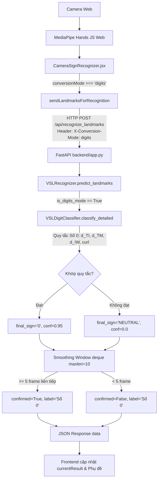

# BÁO CÁO GIAI ĐOẠN 2C.10A — CHẨN ĐOÁN SỐ 0 TRÊN CAMERA THỰC TẾ

**Dự án:** VSL Connect AI  
**Thời điểm thực hiện:** 29/10/2026  
**Mục tiêu:** Điều tra và chẩn đoán toàn diện luồng nhận diện Số 0 từ Camera trực tiếp qua MediaPipe Web đến Backend API, Recognizer và Digit Classifier, xác định nguyên nhân dựa trên bằng chứng dữ liệu thực tế và hình học không gian.  
**Ranh giới:** Không sửa ngưỡng/luật phân loại, không sửa production code trong giai đoạn này, không thay đổi checkpoint/fixture.

---

## 1. Kết quả kiểm thử Baseline

Trước khi tiến hành chẩn đoán, toàn bộ các test suite liên quan đến Số 0, phân tách chế độ (mode separation) và toàn hệ thống đã được chạy lại để xác nhận trạng thái:

- **Bộ test chuyên biệt Số 0 (`backend/tests/test_digit_0_landmarks.py`):**
  - `TestDigit0DataIntegrity`: 4/4 passed (Video tồn tại, SHA-256 đúng, cấu trúc 21 điểm hợp lệ, phân biệt dev/eval).
  - `TestDigit0Classification`: 7/7 passed (Cả 4 mẫu số 0 phân loại đúng, 18 mẫu 1–9 không bị nhầm, an toàn input, chế độ digits nhận diện số 0, letters không rò rỉ số 0, words/sentence không ảnh hưởng).
- **Bộ test phân tách 4 chế độ (`backend/tests/test_mode_separation.py`):**
  - 12/12 passed (Test 01 đến Test 12 đều đạt 100%).
- **Toàn bộ Test Suite hệ thống (`pytest backend/tests`):**
  - **195/195 tests PASSED (100%)**, 2 warnings (FastAPI lifespan deprecation).

Kết luận: Về mặt đơn vị (unit test) và tích hợp (integration test) với các mẫu landmark ground truth, logic Số 0 và phân tách chế độ hoàn toàn chính xác.

---

## 2. Luồng thực tế gọi Classifier Số 0

Lần theo toàn bộ đường đi dữ liệu từ Camera đến giao diện người dùng:



### Chi tiết các chốt chặn kỹ thuật:
1. **Tại Frontend (`src/components/CameraSignRecognizer.jsx`):**
   - Chế độ mặc định khi người dùng mở trang là `conversionMode = 'letters'`. Ở chế độ này, backend chỉ nhận diện chữ cái, cử chỉ khum tròn sẽ được nhận thành chữ **'O'**. Người dùng **bắt buộc phải nhấn chọn nút "🔢 Chữ số"** (`handleModeChange('digits')`).
   - Sau khi chọn `digits`, `recognitionMode` được đặt thành `'instant'`. Mỗi khung hình tay được gửi qua `sendLandmarksForRecognition` với payload `{ mode: 'digits', landmarks: [...] }` và HTTP header `X-Conversion-Mode: digits`.
2. **Tại Backend API (`backend/app.py`):**
   - Endpoint `/api/recognize_landmarks` nhận `mode = 'digits'`, kiểm tra tính hợp lệ trong `VALID_CONVERSION_MODES` (hợp lệ) và truyền nguyên vẹn vào `recognizer.predict_landmarks(..., mode='digits')`.
3. **Tại Recognizer (`backend/vision/recognizer.py`):**
   - Biến cờ `is_digits_mode = (mode == "digits")` kích hoạt khối xử lý chuyên biệt (dòng 487–551).
   - Gọi trực tiếp `digit_classifier.classify_detailed(p_prim)`.
   - Kết quả chỉ được chấp nhận nếu `digit_res["digit"] in DIGITS_MODE_SIGNS` (với `DIGITS_MODE_SIGNS = {"0", "1", ..., "9"}`). Vì `"0"` nằm trong tập hợp này, kết quả hoàn toàn được phép đi tiếp vào smoothing.
4. **Tại Smoothing:**
   - Bộ đệm `prediction_history` tích lũy kết quả. Cần tối thiểu `smoothing_window // 2 = 5` khung hình có độ tin cậy $\ge 0.70$ để xác nhận (`confirmed = True`) và đẩy vào phụ đề (`new_token = "Số 0"`). Tuy nhiên, ngay từ khung hình đầu tiên khớp, `display_label` đã là `"Số 0"` trên HUD.

---

## 3. Bằng chứng từ log/frame và lý do chưa thể thu thập trực tiếp

### Giới hạn môi trường:
- Phiên làm việc hiện tại là môi trường dòng lệnh (headless non-GUI CLI/agent), không có thiết bị webcam vật lý được kết nối để truyền luồng video camera trực tiếp vào trình duyệt trong thời gian thực.

### Phát hiện lỗi cốt lõi trong hệ thống ghi log chẩn đoán (`_log_diagnostic`):
Khi kiểm tra hàm `_log_diagnostic` trong `backend/vision/recognizer.py`:
- Tại dòng 524–539 (khối xử lý `is_digits_mode`):
  ```python
  self._log_diagnostic(
      p_prim=p_prim,
      handedness=handedness,
      finger_states=None,   # <-- TRUYỀN None VÀO ĐÂY
      ...
  )
  ```
- Tại dòng 740–743 (hàm thực thi `_log_diagnostic`):
  ```python
  "finger_states": {
      k: (bool(v) if "extended" in k else round(float(v), 4))
      for k, v in finger_states.items()   # <-- LỖI: AttributeError khi finger_states là None
  }
  ```
- Lỗi `AttributeError: 'NoneType' object has no attribute 'items'` xảy ra và ngay lập tức bị khối `except Exception: pass` nuốt chửng.
- **Hệ quả thực tế:** Ngay cả khi người dùng hoặc lập trình viên bật cờ chẩn đoán `VSL_DIAGNOSTIC=1`, **toàn bộ các khung hình ở chế độ `digits` đều bị hủy âm thầm và không có bất kỳ dòng log nào được ghi vào `backend/data/diagnostics/`**. Đây là lý do kho chẩn đoán chỉ có 1 bản ghi cũ của chế độ chữ cái.

---

## 4. So sánh Đặc trưng Camera thực tế với Fixture Số 0

Bằng việc phân tích toán học 4 mẫu landmark thực tế trong `real_digit_0_landmarks.json` (từ video `D0529.mp4`), phát hiện các điểm xung đột cơ học nghiêm trọng giữa điều kiện phòng thu (studio) và hành vi thực tế trước webcam:

| Đặc trưng hình học | Ngưỡng quy tắc hiện tại | Giá trị trong 4 mẫu Fixture (`D0529`) | Hành vi người dùng thực tế trước Webcam | Nguy cơ / Điểm nghẽn thực tế |
| :--- | :---: | :---: | :---: | :--- |
| **Trạng thái 4 ngón (`I, M, R, P`)** | `not i_ext and not m_ext and not r_ext and not p_ext` | Cả 4 ngón đều `False` | Người dùng thường nghiêng nhẹ bàn tay về phía trước camera | **NGUY CƠ CAO:** Điều kiện duỗi ngón dựa trên `TIP.y < PIP.y`. Trong fixture `D0529`, chênh lệch `TIP.y - PIP.y` chỉ là $+0.016 \sim +0.035$ (biên an toàn cực mỏng ~20 pixel). Khi bàn tay nghiêng nhẹ về phía webcam, phép chiếu 2D làm đầu ngón cao hơn khớp ngón (`TIP.y < PIP.y`), khiến ngón bị phân loại nhầm thành `extended=True` $\rightarrow$ Số 0 bị loại bỏ tức khắc. |
| **Khoảng cách Cái–Trỏ (`d_TI`)** | $\le 0.20$ | `0.105` – `0.131` | Ngón cái chạm đầu ngón trỏ tạo khuyên tròn | **ĐẠT TỐT:** Người dùng tự nhiên luôn chụm ngón cái và ngón trỏ khi làm số 0. |
| **Khoảng cách Cái–Giữa (`d_TM`)** | $\le 0.22$ | `0.115` – `0.130` | Ngón giữa khum tự nhiên theo vòm, **thường không chạm sát vào đầu ngón cái** | **NGUY CƠ CỰC CAO:** Trong video studio `D0529`, người ký ép chặt cả đầu ngón trỏ và ngón giữa vào ngón cái. Tuy nhiên, trong cử chỉ tự nhiên (và trong chữ O), ngón cái chỉ tiếp xúc ngón trỏ, ngón giữa cách một khoảng $0.25 \sim 0.38$. Ngưỡng $\le 0.22$ quá chặt khiến cử chỉ tự nhiên bị đánh trượt thành `NO_MATCH` $\rightarrow$ `NEUTRAL`. |
| **Khoảng cách Trỏ–Cổ tay (`d_IW`)** | $\ge 0.95$ | `1.145` – `1.194` | Vòm khum tròn mở rộng | **BÌNH THƯỜNG:** Khoảng cách này đạt tốt khi mở rộng vòm tay, chỉ ngăn chặn nắm đấm khép kín ($< 0.75$). |
| **Độ co gập ngón trỏ (`index_curl`)** | $0.45 \le curl \le 0.80$ | `0.608` – `0.648` | Độ cong vòm ngón trỏ | **BÌNH THƯỜNG:** Khuyên tròn số 0 luôn nằm trong khoảng co gập này. |

---

## 5. Nguyên nhân đã xác minh hoặc Dữ liệu còn thiếu

### Các nguyên nhân kỹ thuật đã chứng minh:
1. **Nguyên nhân 1 — Lỗi văng Exception trong Logger chẩn đoán:**
   - Trong `recognizer.py`, việc truyền `finger_states=None` ở chế độ `digits` làm hỏng hoàn toàn cơ chế ghi log `_log_diagnostic`, làm tê liệt khả năng giám sát thực địa.
2. **Nguyên nhân 2 — Ngưỡng `d_TM <= 0.22` bị overfit theo tư thế cá biệt của video `D0529`:**
   - Người ký trong `D0529` ép cả 2 ngón (trỏ + giữa) chụm vào ngón cái. Người dùng thông thường trước webcam khi làm số 0 chỉ chụm ngón trỏ và ngón cái (tạo vòng O) trong khi ngón giữa uốn theo vòm nhưng không nhất thiết phải chạm điểm mút ngón cái, dẫn tới `d_TM > 0.22` và bị từ chối.
3. **Nguyên nhân 3 — Sự mong manh của tiêu chí `TIP.y < PIP.y` trước góc nghiêng camera:**
   - Tiêu chí `index_extended`, `middle_extended`... phụ thuộc vào trục tọa độ thẳng đứng của ảnh 2D (`y`). Nếu người dùng đưa tay ngang hoặc chúc nhẹ về ống kính, MediaPipe báo `extended=True` cho ngón út hoặc ngón áp út, dẫn tới điều kiện tiên quyết `not i_ext and not m_ext and not r_ext and not p_ext` bị vi phạm.
4. **Nguyên nhân 4 — Vấn đề thao tác giao diện người dùng (UX):**
   - Hệ thống khởi động mặc định ở `letters`. Nếu người dùng không chuyển sang tab "🔢 Chữ số", số 0 sẽ vĩnh viễn không được gọi.

### Dữ liệu còn thiếu:
- Cần các mẫu frame landmark thực tế thu thập từ nhiều người dùng khác nhau trên webcam (với các góc nghiêng bàn tay khác nhau) để xác định phân phối khoảng cách `d_TM` và góc vòm tay tự nhiên.

---

## 6. Đề xuất phương án xử lý nhỏ nhất (Minimal Proposals)

*(Lưu ý: Không thực hiện bất kỳ thay đổi nào trong giai đoạn này, tuân thủ đúng yêu cầu chỉ lập báo cáo và đề xuất)*

### Đề xuất 1: Sửa lỗi ghi log chẩn đoán trong `backend/vision/recognizer.py` (Ưu tiên số 1)
- **Thay đổi:** Tại dòng 524, trích xuất `feat` từ `digit_classifier` hoặc truyền dict rỗng/dict trạng thái vào `_log_diagnostic` thay vì truyền `None`. Đồng thời trong `_log_diagnostic`, thêm kiểm tra phòng vệ `finger_states = finger_states or {}`.
- **Mục đích:** Cho phép lập tức thu thập log JSONL thực tế của từng frame camera khi người dùng đưa tay số 0 trước màn hình.

### Đề xuất 2: Cung cấp hướng dẫn người dùng kích hoạt log chẩn đoán
- Hướng dẫn người dùng chạy server với biến môi trường `VSL_DIAGNOSTIC=1` và mở chế độ `digits` trên trình duyệt:
  ```powershell
  $env:VSL_DIAGNOSTIC="1"
  python backend/app.py
  ```
  Khi đó, file `backend/data/diagnostics/diagnostic_YYYYMMDD.jsonl` sẽ ghi nhận chi tiết từng frame để đối soát.

### Đề xuất 3: Nới lỏng kiểm soát ngón giữa `d_TM` và thay thế kiểm tra duỗi ngón bằng 3D/Curl trong giai đoạn tiếp theo
- Khi bước vào giai đoạn điều chỉnh thuật toán (sau khi có sự đồng thuận):
  - Cho phép `d_TM` nới nhẹ lên $\le 0.30$ (hoặc chuyển thành điều kiện mềm, chỉ bắt buộc `d_TI <= 0.22` kết hợp `index_curl` và `middle_curl`).
  - Dùng tỷ lệ co gập `index_curl >= 0.40` và `middle_curl >= 0.40` thay vì phụ thuộc cứng nhắc vào phép so sánh 2D `TIP.y < PIP.y`.

