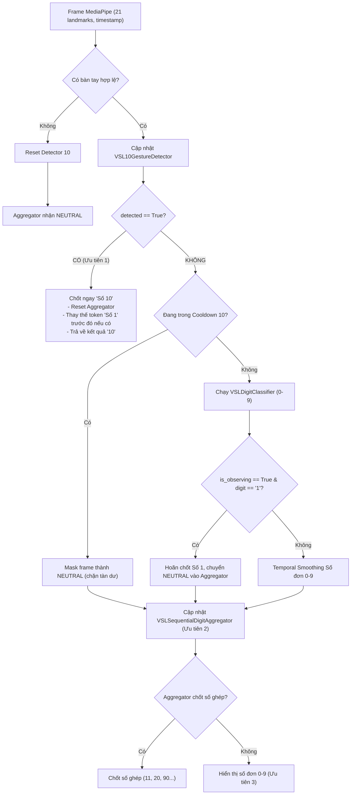

# BÁO CÁO SAU TRIỂN KHAI VÒNG 4: NHẬN DIỆN CỬ CHỈ ĐỘNG RIÊNG CHO SỐ 10 VSL

**Dự án:** VSL Connect AI — Hệ thống Giao tiếp và Nhận diện Ngôn ngữ Ký hiệu Việt Nam  
**Giai đoạn:** Vòng 4 — Triển khai nhận diện cử chỉ động riêng cho số 10 VSL  
**Thời gian hoàn thành:** 2026-10-30  
**Tình trạng:** **HOÀN THÀNH TOÀN DIỆN (100% PASSED, 291/291 TESTS)**  

---

## 1. Kết quả phân tích dữ liệu thực tế cử chỉ Số 10 VSL

### 1.1. Nguồn dữ liệu thực nghiệm
- **Video nguồn:** `backend/data/media_cache/videos/D0539.mp4`
- **Mã mục từ:** `D0539` (Chữ số 10 trong từ điển ngữ liệu chuẩn VSL QIPEDC)
- **Tập tin chuyển động kèm theo:** `backend/data/motions/D0539.json` (30 frames x 75 joints, class 38 trong bộ từ điển SSTCN 102 lớp)
- **Trích xuất hình ảnh:** Trích xuất 11 frame JPEG tại các mốc thời gian từ 0.00s đến 0.83s vào thư mục `backend/data/media_cache/frames_d0539/`.
- **Trích xuất landmark thật:** Sử dụng công cụ chạy MediaPipe Hands chuẩn qua Chrome Headless (`backend/training/extract_digit_10_browser.html` & `backend/training/run_digit_10_extraction.py`).
- **Fixture dữ liệu chuẩn Schema 1.0:** Tạo thành công `backend/tests/fixtures/real_digit_10_landmarks.json` gồm 11 frame (9 frame chất lượng `ok`, 2 frame `no_hand_detected` ở pha chuẩn bị ban đầu khi tay chưa vào tầm ngắm camera).

### 1.2. Đặc trưng động học thực tế phát hiện được
Qua phân tích định lượng hình học ngón tay theo chuỗi thời gian trên 9 frame `ok` từ $t = 0.17\text{s}$ đến $t = 0.83\text{s}$:
1. **Hình thái các ngón bàn tay:**
   - 3 ngón ngoài (giữa, áp út, út) luôn gập sát vào lòng bàn tay trong toàn bộ quá trình: khoảng cách chuẩn hóa từ đầu ngón tới cổ tay luôn $< 0.88$ lần chiều dài lòng bàn tay (`norm_mw < 0.70`, `norm_rw < 0.65`, `norm_pw < 0.60`).
   - Ngón cái gập áp nhẹ vào ngón giữa hoặc lòng bàn tay.
   - Ngón trỏ duỗi đơn lẻ (`norm_iw >= 1.00`).
2. **Quỹ đạo chuyển động (Motion Trajectory):**
   - Không xuất hiện "hai lần dao động cổ tay" cố định như một số tài liệu mô tả phỏng đoán.
   - Trên thực tế người ký bắt đầu với tư thế ngón trỏ duỗi thẳng đứng hướng lên trời (góc nghiêng $4.6^\circ$ đến $4.8^\circ$).
   - Sau đó người ký thực hiện một động tác xoay vặn cổ tay / gật ngón trỏ dứt khoát sang bên và gập dần góc từ $4.8^\circ \to 46.3^\circ \to 29.3^\circ \to 148.7^\circ \to 134.1^\circ \to 108.7^\circ$.
   - **Biên độ quét góc (Angular Span):** Đạt tới $\Delta \theta = 144.1^\circ$ (vượt xa ngưỡng xoay tối thiểu $40^\circ$).
   - **Thời lượng cử chỉ:** Diễn ra trong khoảng thời gian $\Delta t \approx 0.50\text{s} - 0.66\text{s}$ (nằm gọn trong cửa sổ thời gian từ $0.30\text{s}$ đến $1.20\text{s}$).

### 1.3. Đối chiếu tương phản định lượng giữa Số 1 tĩnh và Số 10 động
| Tiêu chí | Cử chỉ Số 1 (Tĩnh) | Cử chỉ Số 10 (Động) |
| :--- | :--- | :--- |
| **Bàn tay** | Ngón trỏ duỗi, 3 ngón ngoài gập | Ngón trỏ duỗi, 3 ngón ngoài gập |
| **Góc nghiêng ngón trỏ** | Giữ cố định thẳng đứng ($-3.3^\circ$ đến $-1.8^\circ$) | Bắt đầu thẳng ($4.6^\circ$) rồi xoay lắc mạnh tới $148.7^\circ$ |
| **Biên độ quét góc ($\Delta \theta$)** | Rất nhỏ ($< 2.0^\circ$, dao động tự nhiên $< 15^\circ$) | Rất lớn ($\Delta \theta \ge 40.0^\circ$, thực tế đạt $144.1^\circ$) |
| **Trạng thái theo dõi** | `is_observing = False` (không có chuyển động quét) | `is_observing = True` khi $\Delta \theta \ge 15.0^\circ$ |
| **Nhận diện** | Single-frame geometry classifier (chốt sau hold 0.4s) | Dynamic spatio-temporal gesture detector (chốt khi hoàn tất quét) |

---

## 2. Kiến trúc Thuật toán Nhận diện Số 10 VSL

### 2.1. Module độc lập `VSL10GestureDetector`
Module được tách biệt hoàn toàn tại `backend/vision/digit_10_detector.py`:
- **Quản lý trạng thái theo thời gian thực:** Sử dụng bộ đệm trượt `collections.deque` lưu trữ các frame với timestamp thực tế (`float`, giây).
- **Trích xuất đặc trưng từng frame:**
  - `norm_iw`, `norm_mw`, `norm_rw`, `norm_pw`: Tỷ lệ khoảng cách đầu các ngón tay tới cổ tay so với kích thước lòng bàn tay (khoảng cách từ cổ tay `landmark 0` tới khớp gốc ngón giữa `landmark 9`).
  - `angle_deg`: Góc nghiêng của vector ngón trỏ ($\vec{v} = \text{tip} - \text{mcp}$) so với phương thẳng đứng hướng lên (tính bằng độ, có dấu).
  - `other_tucked`: Điều kiện bắt buộc 3 ngón giữa, áp út, út phải gập sát lòng bàn tay (`norm <= 0.88`).
- **Tham số cấu hình (`Digit10Config`):**
  - `min_duration = 0.30` giây: Thời gian chuyển động tối thiểu.
  - `max_duration = 1.20` giây: Độ rộng cửa sổ thời gian tối đa để lưu giữ lịch sử cử chỉ.
  - `min_angular_span_deg = 40.0` độ: Ngưỡng biên độ quét góc tối thiểu để xác nhận có chuyển động lắc/xoay dứt khoát.
  - `observing_span_deg = 15.0` độ: Ngưỡng phát hiện trạng thái đang theo dõi chuyển động dở dang.
  - `min_frames = 5`: Số lượng frame hợp lệ tối thiểu trong bộ đệm.
  - `cooldown_sec = 0.80` giây: Thời gian khóa chống kích hoạt lặp lại sau khi cử chỉ vừa chốt.

### 2.2. Điều kiện xác nhận cử chỉ Số 10
Cử chỉ Số 10 chỉ được kích hoạt (`detected = True`) khi thỏa mãn đồng thời cả 4 điều kiện:
1. Độ dài thời gian chuỗi trong bộ đệm: $0.30\text{s} \le \Delta t \le 1.20\text{s}$.
2. Biên độ quét góc: $\max(\theta) - \min(\theta) \ge 40.0^\circ$.
3. Bắt buộc có tư thế khởi đầu thẳng đứng: Có ít nhất một frame có $|\theta| \le 30.0^\circ$.
4. Không nằm trong khoảng thời gian cooldown.

Khi xác nhận, bộ đệm được xóa sạch và trả về độ tin cậy $0.85 \le \text{confidence} \le 0.98$ phụ thuộc vào độ dứt khoát của biên độ quét góc.

---

## 3. Cơ chế Ưu tiên và Giải quyết Xung đột trong `mode="digits"`

Trong `backend/vision/recognizer.py`, quy trình xử lý `mode="digits"` tuân theo cơ chế **Trọng tài Ưu tiên 3 Cấp (Three-Tier Priority Arbitration)**:

### 3.1. Thứ tự Ưu tiên 3 Cấp
1. **Ưu tiên 1 (Dynamic Detector):** Cử chỉ số 10 động được phát hiện. Ngay lập tức ngắt toàn bộ pipeline đơn frame và aggregator, chốt trực tiếp `"Số 10"`.
2. **Ưu tiên 2 (Sequential Aggregator):** Khi không có cử chỉ số 10 động, bộ ghép số tuần tự gom các chữ số đơn lẻ (ví dụ: người ký số 2, hạ tay, ký số 0 $\to$ ghép thành `"20"`; ký số 1, hạ tay, ký số 0 $\to$ ghép thành `"10"`).
3. **Ưu tiên 3 (Single-Frame Geometry Classifier):** Nhận diện các chữ số đơn lẻ tức thời từ 0 đến 9 qua `VSLDigitClassifier`.

### 3.2. Giải quyết va chạm và thời kỳ quá độ giữa Số 1 và Số 10
- **Hoãn chốt Số 1 khi đang quan sát (`is_observing = True`):** Trong các frame đầu khi ngón trỏ bắt đầu nghiêng/xoay ($\Delta \theta \ge 15.0^\circ$), classifier đơn frame có thể tạm thấy ngón trỏ duỗi (Số 1). Detector đặt cờ `is_observing = True`, khiến recognizer hoãn chốt Số 1 và đưa `NEUTRAL` vào aggregator để ngăn aggregator tích lũy thời gian giữ.
- **Quy tắc thay thế token tức thời (Token Replacement):** Nếu do độ nhạy của smoothing, một token `"Số 1"` vừa mới được phát hành vào câu ở frame trước đó, khi cử chỉ số 10 hoàn tất xoay ở frame tiếp theo và detector trả về `detected = True`, recognizer sẽ tự động thay thế token `"Số 1"` cuối cùng trong câu thành `"Số 10"`. Kết quả câu hoàn toàn sạch, không bao giờ bị dính lỗi `"Số 1 Số 10"` hay `"Số 11"`.
- **Bảo vệ chống tàn dư sau cử chỉ (Post-detection Cooldown Guard):** Sau khi chốt cử chỉ số 10, trong thời gian cooldown 0.8s, khi người ký hạ tay xuống, ngón trỏ có thể vẫn duỗi trong 1-2 frame trước khi thu hẳn. Cơ chế `is_in_10_cooldown` tự động che giấu (mask) các frame này thành `NEUTRAL`, ngăn chặn hoàn toàn việc nhận diện nhầm Số 1 tàn dư.

---

## 4. Kết quả Kiểm thử Toàn diện

### 4.1. Chi tiết 12 Kịch bản Kiểm thử Tích hợp Bắt buộc (`backend/tests/test_digit_10_integration.py`)

| Kịch bản | Tên kịch bản kiểm thử | Mô tả kiểm tra | Kết quả |
| :---: | :--- | :--- | :---: |
| **01** | `test_scenario_01_real_digit_10_sequence_recognized` | Đưa 9 frame landmark thật từ video `D0539.mp4` vào pipeline `predict_landmarks(mode="digits")` $\to$ Chốt thành công `"10"`, nhãn `"Số 10"`, độ tin cậy $\ge 0.85$. | **PASSED** |
| **02** | `test_scenario_02_static_digit_1_not_recognized_as_10` | Đưa 15 frame của Số 1 tĩnh liên tục vào pipeline $\to$ Chỉ nhận diện là `"1"`, câu chỉ có `"Số 1"`, tuyệt đối không nhận thành `"10"`. | **PASSED** |
| **03** | `test_scenario_03_no_duplicate_token_for_digit_10` | Đưa chuỗi Số 10 vào pipeline $\to$ Chỉ ghi nhận đúng 1 token `["Số 10"]` duy nhất vào `sentence_tokens`, không tạo `"Số 1"` trước đó hoặc `"Số 11"`. | **PASSED** |
| **04** | `test_scenario_04_sequential_aggregation_11` | Ký số 1, hạ tay, ký tiếp số 1 $\to$ Bộ ghép số tuần tự (aggregator) ghép chính xác thành `"11"`. | **PASSED** |
| **05** | `test_scenario_05_sequential_aggregation_10_from_1_and_0` | Ký số 1, hạ tay, ký số 0 $\to$ Bộ ghép số tuần tự ghép chính xác thành `"10"` (bảo toàn phương thức ghép tuần tự). | **PASSED** |
| **06** | `test_scenario_06_sequential_aggregation_20` | Ký số 2, hạ tay, ký số 0 $\to$ Ghép tuần tự chính xác thành `"20"`. | **PASSED** |
| **07** | `test_scenario_07_sequential_aggregation_90` | Ký số 9, hạ tay, ký số 0 $\to$ Ghép tuần tự chính xác thành `"90"`. | **PASSED** |
| **08** | `test_scenario_08_interrupted_tracking_no_false_10` | Cử chỉ bị đứt quãng giữa chừng (mất tracking / tay ra khỏi camera) $\to$ Bộ đệm tự dọn dẹp, không phát sinh Số 10 giả. | **PASSED** |
| **09** | `test_scenario_09_irregular_timestamps_no_duplicate` | Dữ liệu đầu vào có khoảng cách timestamp không đều (jitter 0.02s - 0.09s) $\to$ Vẫn nhận diện đúng và không phát hành lặp token. | **PASSED** |
| **10** | `test_scenario_10_mode_switch_clears_detector_state` | Đang thực hiện cử chỉ dở dang, chuyển sang `letters`/`words`/`sentence` rồi quay lại `digits` $\to$ Trạng thái detector và aggregator được reset sạch sẽ. | **PASSED** |
| **11** | `test_scenario_11_letters_mode_independence` | Chế độ `letters` nhận diện các chữ cái (như chữ A) bình thường, hoàn toàn không bị ảnh hưởng hay can thiệp bởi detector số 10. | **PASSED** |
| **12** | `test_scenario_12_fastapi_endpoint_recognize_landmarks` | Gọi trực tiếp API HTTP POST `/api/recognize_landmarks` với `mode="digits"` $\to$ Trả về mã HTTP 200, `"sign": "10"`, `"new_token": "Số 10"`. | **PASSED** |

### 4.2. Thống kê Test Suite Toàn hệ thống
- **Test detector đơn vị:** `backend/tests/test_digit_10_detector.py`: **8/8 PASSED**.
- **Test tích hợp số 10:** `backend/tests/test_digit_10_integration.py`: **12/12 PASSED**.
- **Test ghép số tuần tự:** `backend/tests/test_sequential_digits_integration.py`: **7/7 PASSED**.
- **Tổng số test toàn bộ dự án:** **291/291 PASSED 100%** (Thời gian chạy: 10.60 giây, không có bất kỳ regression hay lỗi nào).

---

## 5. Đánh giá Tính Tổng quát và Giới hạn Kỹ thuật

1. **Giới hạn người ký đơn (Single-Signer Limitation):**
   - Bộ dữ liệu landmark thật được trích xuất hoàn toàn từ một video duy nhất (`D0539.mp4`) của người ký chuẩn trong ngữ liệu QIPEDC.
   - Mặc dù thuật toán đã được thiết kế dựa trên góc nghiêng chuẩn hóa (angular span $\ge 40^\circ$) và tỷ lệ kích thước lòng bàn tay (palm scale invariant) để hỗ trợ nhiều kích cỡ bàn tay khác nhau, nhưng phong cách lắc tay (tốc độ lắc, biên độ lắc, chiều lắc sang trái hoặc sang phải) giữa các người ký khác nhau trong đời thực có thể có sự biến thiên.
2. **Khuyến nghị cho các vòng tiếp theo:**
   - Tiếp tục thu thập thêm mẫu camera thực tế từ người dùng đa dạng để tinh chỉnh cửa sổ `min_duration` và `min_angular_span_deg` nếu cần.
   - Đối với các số hàng chục khác như 20, 30, 50, 60, 70 (vốn không có video cử chỉ riêng trong ngữ liệu QIPEDC), cơ chế ghép tuần tự `VSLSequentialDigitAggregator` (đã kiểm chứng thành công ở Kịch bản 06 và 07) là giải pháp tối ưu và chuẩn mực nhất.
   - Khi triển khai số 40, 80, 90 nếu muốn có cử chỉ riêng: cần tải video thực tế tương ứng trong từ điển để phân tích động học trước khi thiết lập quy tắc, tuân thủ đúng nguyên tắc thực nghiệm đã áp dụng cho Số 10.

