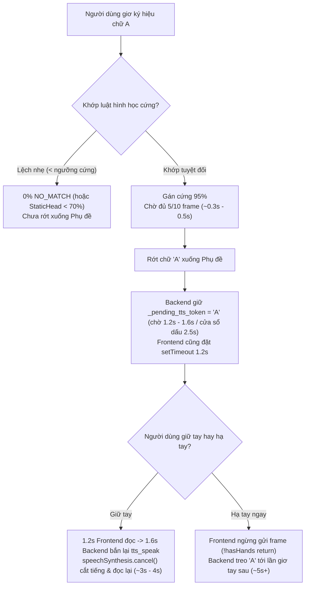
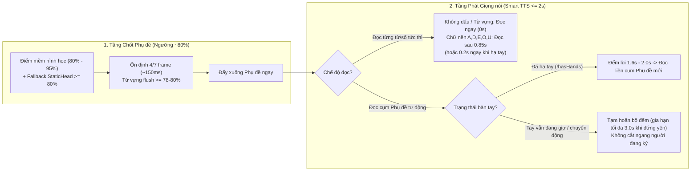

# Báo cáo Phân tích Hiện trạng & Hướng Giải quyết: Ngưỡng Chốt Phụ đề (95% → 80%) và Độ trễ Đọc Giọng nói TTS (5s → 2s)

- **Ngày lập báo cáo:** 26/11/2026
- **Phạm vi khảo sát:** Luồng nhận diện Camera → Phụ đề → Phát giọng nói (TTS) trên toàn bộ Frontend (`src/`) và Backend (`backend/`)
- **Trạng thái mã nguồn:** Chưa chỉnh sửa bất kỳ dòng code nào (chỉ khảo sát, truy vết nguyên nhân và đề xuất kiến trúc giải quyết).

---

## 1. Tổng quan Tình hình Hiện tại (Triệu chứng Thực tế)

Qua kiểm thử thực tế trên giao diện **Camera → Ký hiệu sang Văn bản** (điển hình với ký hiệu chữ **`A`**):

1. **Vấn đề chốt Phụ đề:** Người dùng cảm nhận phải giữ tay thật chuẩn tới khi huy hiệu độ tin cậy hiện **`95%`** thì ký hiệu từ ô *"Đang nhận diện"* mới chịu rớt xuống ô *"Phụ đề"*. Khi tay hơi lệch nhẹ, hệ thống đứng ở trạng thái chờ hoặc nhấp nháy mà không chốt được chữ.
2. **Vấn đề độ trễ đọc giọng nói (TTS):** Từ lúc thực hiện ký hiệu / chữ rớt xuống Phụ đề đến lúc hệ thống phát âm thanh đọc lên mất khoảng **3 – 5 giây** (thậm chí có lúc im lặng, đến khi giơ tay làm ký hiệu tiếp theo mới đọc bù chữ cũ), gây cảm giác phản hồi chậm và đứt mạch giao tiếp.

---

## 2. Truy vết Nguyên nhân Gốc rễ trong Mã nguồn

### 2.1. Vì sao phải hiện `95%` ký hiệu mới rớt xuống Phụ đề?

> **Phát hiện quan trọng:** Trong code hiện tại **không có dòng lệnh nào chặn ngưỡng `>= 95%`**, mà con số **`95%` là điểm số gán cứng (hardcoded `0.95`)** của bộ phân loại hình học nhị phân!

Cụ thể trong mã nguồn đang vận hành theo cơ chế sau:

| Thành phần | Vị trí file & dòng code | Cấu hình hiện tại | Hệ quả thực tế trên UI |
| :--- | :--- | :--- | :--- |
| **Luật hình học Chữ cái (`letters`)** | `backend/vision/alphabet_classifier.py` (dòng `558` → `1144`) | Tất cả 18 quy tắc chữ cái tĩnh (`A, B, C, D, E, G, H, I, K, L, O, P, Q, R, S, T, U, V, X, Y`) đều chấm kiểu **Đạt / Trượt nhị phân**: thỏa hết điều kiện thì gán cứng `0.95` (**95%**), lệch 1 điều kiện nhỏ lập tức trả về `NO_MATCH` (**0%**). | Không tồn tại vùng điểm trung gian `80%–90%` ở tầng hình học. Tay hơi lỏng = `0%`, tay vừa khớp = nhảy thẳng lên **`95%`**. |
| **Mạng phụ Fallback (`StaticHead`)** | `backend/vision/recognizer.py` (dòng `77–95`, `1880–1998`) | Chỉ hỗ trợ fallback mạng nơ-ron cho 4 chữ nền `{A, D, E, O}` (ngưỡng `0.70`) và 10 chữ bổ sung `{G, H, K, M, N, P, Q, R, U, X}` (`0.70–0.75`). **8 chữ cái `{B, C, I, L, S, T, V, Y}` và các chữ số `0–9` không có fallback** — bắt buộc phải đạt luật hình học `95%`. | Với các chữ không có fallback (hoặc khi StaticHead dao động dưới `0.70`), người dùng buộc phải chỉnh tay khớp tuyệt đối luật `95%` mới được ghi nhận. |
| **Bộ lọc làm mượt (`Temporal Smoothing`)** | `backend/vision/recognizer.py` (dòng `127–128`, `2330`, `2353–2355`) | `confidence_threshold = 0.70`, `smoothing_window = 10` frame, yêu cầu tối thiểu **`5/10` frame liên tiếp** đạt ngưỡng mới bật cờ `confirmed = True` để thả xuống Phụ đề. | Cộng với cơ chế gửi request tuần tự (`isInferringRef.current` tại `CameraSignRecognizer.jsx` dòng `1956`), cần giữ tay ổn định ở mức `95%` thêm ~250–400ms mới rớt xuống Phụ đề. |
| **Chế độ Từ vựng Tự do (`words`)** | `src/components/CameraSignRecognizer.jsx` (dòng `438`, `1723–1725`, `1785–1788`) | Mặc định `confidenceThreshold = 0.65`, nhưng pha chốt nhanh / kết thúc cử chỉ SSTCN bị ép cứng `flushThreshold = Math.max(confidenceThreshold, 0.85)` (**85%**) hoặc cần `>= 2 phiếu` + `>= 500ms`. | Các cử chỉ từ vựng đạt `75%–84%` ở pha hạ tay cuối cùng vẫn bị chặn không cho rớt xuống Phụ đề ngay. |

---

### 2.2. Vì sao độ trễ đọc TTS kéo dài tới ~3–5 giây (đặc biệt rõ ở chữ `A`)?

Qua kiểm tra chéo giữa `CameraSignRecognizer.jsx`, `api.js` và `recognizer.py`, độ trễ 3–5 giây đến từ **4 điểm nghẽn chồng lên nhau**:

#### Nguyên nhân #1 (Nghiêm trọng nhất): Lỗi "treo" TTS chờ dấu đối với 5 chữ cái nền `A, D, E, O, U`
Trong VSL, 5 chữ nền `{A, D, E, O, U}` có thể chuyển tiếp thành 7 chữ có dấu `{Ă, Â, Đ, Ê, Ô, Ơ, Ư}`. Khi chữ **`A`** vừa rớt xuống Phụ đề:
1. **Tại Backend (`backend/vision/recognizer.py` dòng `2393`, `2415–2426`, `3054–3066`):**
   - Backend cố tình gán `tts_speak = None` và cất chữ `"A"` vào biến chờ `self._pending_tts_token = "A"` để đợi xem người dùng có làm tiếp dấu mũ/dấu á không (cửa sổ cho phép thay thế token mở tới **`2.5 giây`**, bộ đếm xả TTS chờ **`1.2s – 1.6s`**).
2. **Tại Frontend (`src/components/CameraSignRecognizer.jsx` dòng `1954` & `2198–2205`):**
   - Thấy `tts_speak` rỗng và token thuộc `['A', 'D', 'E', 'O', 'U']`, Frontend tự đặt thêm một `setTimeout(..., 1200)` (**1.2 giây**).
   - **Lỗi đứt gãy luồng khi hạ tay:** Ở dòng `1954` (`if (!hasHands && !pilotMetadataProviderRef.current) return;`), ngay khi người dùng thấy chữ `A` đã xuống Phụ đề và **bỏ tay xuống**, Frontend **ngừng gửi request lên Backend**!
   - Backend không bao giờ nhận được thông báo mất bàn tay (`is_no_hand`), khiến `_pending_tts_token = "A"` bị **treo cứng trong bộ nhớ Backend**. Tới vài giây sau (3–5s), khi người dùng giơ tay lên làm chữ mới, Backend mới phát hiện trạng thái `NEUTRAL` và bắn trả `tts_speak: "A"` của lượt cũ!
   - Mặt khác, nếu người dùng giữ nguyên tay trên màn hình: timer `1.2s` của Frontend vừa bắt đầu gọi đọc thì ở giây `1.6s` Backend trả về `tts_speak: "A"` lần nữa → hàm `speakVietnamese()` gọi `window.speechSynthesis.cancel()` (`src/services/api.js` dòng `513`) **cắt ngang âm thanh vừa chớm phát** và khởi động đọc lại từ đầu, đẩy tổng độ trễ cảm nhận lên **3 – 4.5 giây**!

#### Nguyên nhân #2: Chế độ ghi Từ vựng "Theo nhịp 3 giây" khóa cứng bộ hẹn giờ `5000ms` (5 giây)
- Tại `src/components/CameraSignRecognizer.jsx` dòng `281–409`: hàm `startTimedCapture()` đặt cứng `setTimeout(..., 5000)` gồm **2 giây chuẩn bị + 3 giây ghi hình = trọn 5 giây** rồi mới gửi chuỗi lên server nhận diện, ghi phụ đề và phát âm.

#### Nguyên nhân #3: Chưa có cơ chế "Tự động đọc câu Phụ đề sau khoảng nghỉ" (Auto-Sentence TTS)
- Hiện tại hệ thống chỉ đọc **từng mảnh token rời rạc** lúc chốt (`"A"`, `"N"`, `"H"`), còn muốn đọc liền mạch cả ô **Phụ đề** (`formatSentenceForTTS(sentence)`) thì người dùng phải bấm thủ công nút Loa (`CameraSignRecognizer.jsx` dòng `2612`).

#### Nguyên nhân #4: Độ trễ khởi động Web Speech API (`speechSynthesis`) trên trình duyệt
- Tại `src/services/api.js` dòng `510–528`: danh sách giọng đọc (`getVoices()`) chưa được nạp sẵn (warm-up) khi mở ứng dụng, và lệnh `window.speechSynthesis.cancel()` được gọi vô điều kiện ở mọi lần đọc. Trên Chrome/Edge Windows (đặc biệt với giọng đọc trực tuyến Microsoft HoaiMy/An), thao tác `cancel()` rồi `speak()` ngay lập tức thường gây trễ khởi tạo âm thanh từ **0.4s – 1.2s**.

---

## 3. Phân tích Chuyên sâu: Hạ xuống `80%` và Đọc trong `2 giây` như thế nào cho Hợp lý?

### 3.1. Phân tích việc hạ ngưỡng chốt Phụ đề xuống `~80%`

> [!IMPORTANT]
> Nếu chỉ sửa biến `confidence_threshold` từ `0.70` thành `0.80` trong `recognizer.py` thì hệ thống sẽ **khắt khe hơn** chứ không nhạy hơn, vì gốc rễ nằm ở việc bộ luật hình học đang chấm điểm nhị phân `0%` hoặc `95%`.

Để đạt đúng trải nghiệm **"đạt cỡ 80% là rớt xuống Phụ đề mượt mà"** mà không bị nhảy chữ rác (false positive):

1. **Chuyển chấm điểm hình học từ Nhị phân (`0% / 95%`) sang Điểm mềm có biên dung sai (`80% – 95%`):**
   - Khi bàn tay khớp hoàn hảo tâm ngưỡng: đạt `92% – 95%`.
   - Khi bàn tay đúng cấu trúc ngón mở/nắm cốt lõi nhưng lệch nhẹ **10% – 15%** ở 1 tiêu chí biên (ví dụ góc mở ngón cái chữ `A`, `L`, `V` hoặc độ khum chữ `C`, `O`): chấm điểm mềm trong dải **`80% – 88%`** thay vì đánh rớt về `0%`.
2. **Đặt ngưỡng xác nhận thống nhất quanh mốc `80%` (`0.78 – 0.80`):**
   - **Với Chữ cái & Chữ số:** Ngưỡng `80%` là **rất hợp lý (điểm cân bằng tối ưu)**. Nếu hạ sâu xuống `< 70%`, các dáng tay trung gian lúc đang nắm/mở ngón (như chuyển từ `B` sang `A` sẽ lướt qua `E` hoặc `S`) rất dễ bị nhận nhầm. Ở mức **`80%`**, người dùng không cần gồng cứng khớp tay mà vẫn lọc sạch nhiễu chuyển tiếp.
   - **Với Từ vựng (`words`):** Hạ `flushThreshold` ở `CameraSignRecognizer.jsx` (dòng `1785`) từ `0.85` (85%) xuống **`0.78 – 0.80` (78%–80%)**, giúp các từ thực hiện đúng động tác rớt xuống Phụ đề ngay khi kết thúc cử chỉ.
3. **Giảm nhẹ số frame giữ tĩnh (`smoothing_window`):**
   - Giảm yêu cầu tích lũy từ `5/10` frame xuống **`3/6` hoặc `4/7` frame** (~150ms). Ký hiệu đạt `>= 80%` trong ~0.15s sẽ rớt xuống Phụ đề tức thì, tự nhiên hơn hẳn.

---

### 3.2. Phân tích mốc thời gian `2 giây` cho TTS: **`2 giây` có quá ngắn không?**

Câu trả lời phụ thuộc vào việc chúng ta áp dụng `2 giây` cho **Đọc từng ký hiệu đơn lẻ** hay **Đọc ghép cụm/câu Phụ đề**:

#### A. Nếu đọc từng ký hiệu rời rạc ngay khi chốt (Token-by-Token TTS)
- Với **1 ký hiệu đơn lẻ** đã rớt xuống Phụ đề: chờ tới `2 giây` thực ra là **hơi chậm** đối với các chữ không có dấu hoặc từ vựng độc lập!
  - Chữ cái không có biến thể dấu (`B, C, G, H, I, K, L, M, N, P, Q, R, S, T, V, X, Y`), Chữ số (`0–10`), Từ vựng (`Xin chào`, `Cảm ơn`...): nên đọc **tức thì (`0 – 0.15s`)** hoặc gom vào bộ đọc câu.
  - 5 chữ nền có thể thêm dấu (`A, D, E, O, U`): người dùng thực hiện động tác thêm dấu (`Ă, Â, Đ, Ê, Ô, Ơ, Ư`) trên thực tế chỉ mất **`0.35s – 0.75s`**. Do đó chỉ cần chờ **`0.8s – 0.9s`** (hoặc đọc **ngay lập tức sau `0.2s` nếu phát hiện người dùng hạ tay**), tuyệt đối không cần chờ tới `1.6s – 2.5s` như hiện tại.

#### B. Nếu tự động đọc phần Phụ đề mới sau khi dừng ký (Auto-Read Subtitle Pause = `2.0 giây`)
Giả sử người dùng muốn ghép nhiều chữ/từ vào Phụ đề rồi máy đọc liền mạch sau khi dừng tay **2 giây**:

| Tình huống sử dụng thực tế | Thời gian chuyển tay tự nhiên giữa 2 ký hiệu | Đánh giá mốc `2.0 giây` | Phân tích rủi ro |
| :--- | :---: | :---: | :--- |
| **Người dùng quen tay ký chuỗi từ vựng** (*"Tôi" → "đi" → "học"*) | `0.5s – 1.1s` | **Rất hợp lý** | Không bị ngắt quãng giữa câu; dừng tay 2s là máy phát âm ngay, hội thoại tự nhiên hơn hẳn mức 5s. |
| **Đánh vần chữ cái liên tiếp** (*"N" → "A" → "M"*) | `0.4s – 0.9s` | **Hợp lý** | Đủ thời gian đổi hình dáng ngón tay sang chữ kế tiếp. |
| **Người mới học đang nhớ lại ký hiệu khó** (*chữ K, P, Q, R hoặc từ 2 tay*) | `1.8s – 3.0s` | **Hơi ngắn NẾU đếm giờ "mù"** | Nếu dùng `setTimeout(2000)` cố định kể từ lúc chốt chữ trước trong khi **tay người dùng vẫn đang giơ trước camera để tạo dáng chữ tiếp theo**, máy sẽ đọc cắt ngang giữa chừng! |
| **Chế độ "Theo nhịp 3 giây" (Từ vựng)** | Cố định `2s chờ + 3s ghi = 5s` | **Cần rút gọn đếm ngược** | Nên giảm pha chuẩn bị từ `2s` xuống `1s` và ghi `2s` (tổng `3s`), đọc ngay `0s` sau khi có kết quả. |

> [!TIP]
> **Kết luận về mốc `2 giây`:**
> - **`2 giây` KHÔNG QUÁ NGẮN** đối với giao tiếp thực tế **NẾU** bộ hẹn giờ biết phân biệt trạng thái **"Đã hạ tay nghỉ"** và **"Tay vẫn đang giơ ký tiếp"**.
> - Ngược lại, nếu chỉ đặt `setTimeout(2000)` cứng nhắc bất chấp tay người dùng đang cử động trước ống kính thì sẽ xảy ra hiện tượng cắt ngang câu của người mới tập.

---

## 4. Đề xuất Phương án Giải quyết Tối ưu (Kiến trúc Đề nghị)

### Phương án Đề xuất: **Ngưỡng mềm `80%` + Cơ chế Đọc Thông minh 2 Tầng (Smart 2s TTS)**

### Bảng Tổng hợp các Hạng mục Cần Fix khi Triển khai Code

| STT | Hạng mục cần sửa | File dự kiến tác động | Thay đổi cụ thể đề xuất | Lợi ích mang lại |
| :-: | :--- | :--- | :--- | :--- |
| **1** | **Bổ sung điểm mềm (Soft Margin `0.80–0.95`) cho luật hình học** | `backend/vision/alphabet_classifier.py` `backend/vision/digit_classifier.py` | Thêm dải dung sai biên `10–12%` quanh ngưỡng cứng trả về điểm `0.80 – 0.88` thay vì trả `0.0` (`NO_MATCH`) tức khắc; giữ `0.95` cho tư thế chuẩn tâm. | Người dùng đạt ~80% độ chuẩn dáng tay là vào được Phụ đề, xóa bỏ cảm giác "phải gồng đủ 95%". |
| **2** | **Chuẩn hóa ngưỡng xác nhận & giảm trễ cửa sổ làm mượt** | `backend/vision/recognizer.py` `src/components/CameraSignRecognizer.jsx` | - Đặt ngưỡng chuẩn `0.80` (Chữ cái/Số) và hạ `flushThreshold` Từ vựng từ `0.85` → `0.78–0.80`. - Giảm `smoothing_window` từ `10` (cần 5 phiếu) → `7` (cần 4 phiếu, ~150ms). | Tăng tốc độ rớt chữ xuống Phụ đề nhanh gấp ~1.7 lần mà vẫn chống nhiễu tốt. |
| **3** | **Xóa lỗi đúp/treo TTS ở 5 chữ nền `A, D, E, O, U`** | `src/components/CameraSignRecognizer.jsx` `backend/vision/recognizer.py` | - Quy hoạch **1 nguồn điều phối TTS duy nhất ở Frontend** (không để cả Frontend 1.2s lẫn Backend 1.6s cùng bắn `tts_speak` gây `cancel()` đè nhau). - Khi chữ nền `A, D, E, O, U` chốt: chờ tối đa **`0.85s`** chờ dấu; nếu phát hiện hạ tay (`!hasHands` trong `200ms`) thì **phát âm ngay lập tức** và gửi tín hiệu reset trạng thái chờ dấu. | Chữ `A` đọc cực nhạy trong `< 0.9s` (hoặc `< 0.3s` khi vừa bỏ tay xuống), triệt tiêu hoàn toàn lỗi treo tiếng 5s. |
| **4** | **Bổ sung bộ đọc Phụ đề thông minh `2.0s` (Smart Auto-Read)** | `src/components/CameraSignRecognizer.jsx` | - Theo dõi phần phụ đề chưa đọc (`lastSpokenIndex`). - Khi người dùng **hạ tay**: sau **`1.8s – 2.0s`** tự động đọc phần phụ đề mới ghép (ghép vần chữ cái hoặc đọc cụm từ). - Khi **tay vẫn đang giơ ký tiếp**: tự động reset/hoãn bộ đếm (chỉ đọc nếu tay đứng yên không đổi ký hiệu quá `3.0s`). | Đáp ứng đúng mong muốn đọc liền trong **2 giây** khi dừng ký, đồng thời bảo vệ người mới học không bị máy đọc cắt ngang lúc đang tạo dáng tay. |
| **5** | **Tối ưu hàm `speakVietnamese()` & rút gọn chế độ Ghi theo nhịp** | `src/services/api.js` `src/components/CameraSignRecognizer.jsx` | - Gọi `speechSynthesis.getVoices()` warm-up sẵn khi tải trang; dùng hàng đợi (queue) hoặc chống gọi lặp cùng token thay vì `cancel()` thô bạo. - Chế độ ghi từ vựng theo nhịp (nếu dùng): rút từ `2s chờ + 3s ghi (5s)` xuống tùy chọn `1s chờ + 2s ghi (3s)`. | Triệt tiêu độ trễ khởi tạo âm thanh 0.5–1.2s của trình duyệt Windows/Chrome và bỏ độ trễ cứng 5s. |

---

## 5. Đề xuất Quyết định trước khi Bắt tay vào Sửa Code

Trước khi tiến hành chỉnh sửa code theo báo cáo này, có **2 tùy chọn hành vi đọc TTS** để chốt:

1. **Chế độ đọc mong muốn ở mục Chữ cái (`letters`):**
   - **Phương án A (Khuyên dùng cho học tập & kiểm tra nhanh):** Đọc **ngay từng chữ/từ** vừa rớt xuống Phụ đề (0s cho chữ thường/từ vựng; ~0.85s cho `A, D, E, O, U`, hoặc đọc ngay 0.2s khi hạ tay) **kèm** nếu ghép từ ≥ 2 ký tự rồi dừng tay **2.0s** thì đọc lại cả cụm phụ đề mới.
   - **Phương án B (Thuần giao tiếp câu):** Lúc chữ đang rớt xuống Phụ đề thì giữ yên lặng để người dùng tập trung ký, ngay khi dừng tay **1.8s – 2.0s** mới đọc một mạch toàn bộ cụm/câu vừa ký.
2. **Ngưỡng điểm chốt Phụ đề:** Chốt ở mức **`80%` (`0.80`)** kết hợp biên dung sai mềm hình học và cửa sổ `4/7` frame như phân tích tại Mục 3.1.
