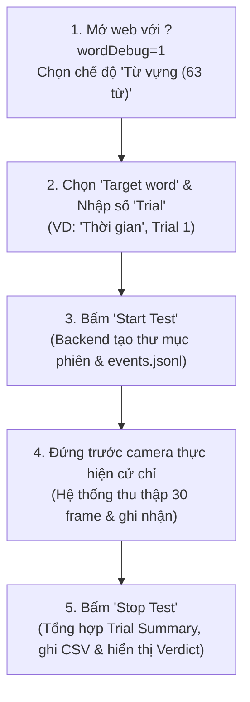

# BÁO CÁO RÀ SOÁT VÀ HOÀN THIỆN HỆ THỐNG WORD DEBUG LOGGING
**Dự án:** Nhận diện Ngôn ngữ Ký hiệu Việt Nam (VSL)  
**Phạm vi:** Kiểm thử và đối soát MediaPipe Holistic & Mô hình Chuỗi Động SSTCN_Attention (Chế độ `words`)  
**Commit cơ sở:** `8ee2ad6`  
**Ngày thực hiện:** 06/11/2026  

---

## 1. Thông tin có sẵn trong log cũ (Sau commit `8ee2ad6`)

Trước khi tiến hành nâng cấp, hệ thống log tại commit `8ee2ad6` đã hình thành khung sườn logging cô lập thông qua `word_debugger.py`, `CameraSignRecognizer.jsx`, và `WordDebugPanel.jsx` với các đặc điểm:

1. **Khởi tạo và kết thúc phiên (Session Lifecycle):**
   - Đã ghi sự kiện `SESSION_START` và `SESSION_END` vào file `events.jsonl` và `session.json`.
   - Có `session_id`, `target_word`, `target_class` (từ mapping chính thức `SIGN_DICT_102`), `trial`, `start_time`, `end_time`.
2. **Dữ liệu suy luận đơn lẻ (`PREDICTION` Event):**
   - Lưu trữ mảng tensor đầu vào: `sequences/sequence_XXX.npy` với shape `(30, 75, 3)`.
   - Các trường trong event: `sequence_id`, `sequence_file`, `frame_count`, `sequence_complete`, `input_min`, `input_max`.
   - Trạng thái cơ bản: `pose_zero_frames`, `left_hand_zero_frames`, `right_hand_zero_frames`, `pose_detected`, `left_hand_detected`, `right_hand_detected`.
   - Kết quả dự đoán: Top-1, Top-2, Top-3 (`class`, `term`, `confidence`), `displayed_label`, `threshold`, và cờ `prediction_correct` (được tính tức thời cho từng window).
3. **Sự kiện từ frontend:**
   - Đã bắt sự kiện `SEQUENCE_RESET` khi bộ đệm frame bị xóa trắng kèm theo `frames_before_reset` và `reason` (`no_hands_detected`).

### Những hạn chế của log cũ:
- **Thiếu bằng chứng phân biệt nguồn gốc landmarks:** Chưa kiểm tra xem 2 vai (11, 12), khuỷu tay (13, 14), cổ tay (15, 16) là tọa độ thật biến thiên từ Holistic hay bị gán cứng (fake/fallback pose từ Hands).
- **Chưa có số liệu tracking thời gian thực:** Không có thông số FPS client thực tế, thời gian trễ xử lý frame của MediaPipe (`frame_process_ms`), và thời gian suy luận của PyTorch model (`inference_latency_ms`).
- **Thiếu chiều sâu phân tích mất mốc:** Chưa đo chuỗi mất dấu liên tiếp dài nhất (`max_consecutive_missing`), tỷ lệ frame mất cả 2 tay (`both_hands_zero_frames`), và tổng tỷ lệ mốc bị khuyết trên toàn bộ tensor.
- **Top-K bị giới hạn:** Chỉ ghi nhận Top-3 thay vì đầy đủ Top-5 của SSTCN.
- **Chưa phân biệt kết quả theo Window với kết quả tổng thể theo Lượt test (Trial Verdict):** Tự động coi mỗi sliding window là một lần dự đoán độc lập, thiếu báo cáo tổng hợp kết quả (Trial Summary) và thiếu định dạng CSV tổng hợp để phân tích định lượng hàng loạt.

---

## 2. Thông tin mới bổ sung và lý do kỹ thuật

Để phân biệt triệt để giữa **Lỗi Tracking Camera/MediaPipe**, **Lỗi Dữ liệu Landmarks**, **Lỗi Bộ đệm 30 frame** và **Lỗi Phân loại của Mô hình SSTCN**, các thông tin kỹ thuật sau đã được bổ sung đầy đủ:

### A. Nhóm Tracking & MediaPipe
| Thông số mới | Nơi thu thập | Lý do kỹ thuật |
| :--- | :--- | :--- |
| `tracker_engine` | Client (`CameraSignRecognizer`) | Xác nhận chắc chắn frame được xử lý bởi `holistic` hay `hands`. |
| `client_fps` | Client (`measureFPS`) | Giám sát tốc độ khung hình thực tế; phát hiện sụt giảm FPS do nghẽn CPU. |
| `avg_frame_process_ms` & `max_frame_process_ms` | Client (đo từ `send` đến `onResults`) | Định lượng thời gian MediaPipe xử lý 1 frame (phát hiện frame giật/lag). |
| `both_hands_zero_frames` & ratio | Backend tensor (30, 75, 3) | Đếm số frame trong cửa sổ 30 frame mà cả 2 tay đều không được nhận diện. |
| `max_consecutive_missing_lh` / `rh` | Backend tensor (30, 75, 3) | Đo chuỗi mất dấu liên tiếp dài nhất của từng tay trong 30 frame. |
| `total_missing_landmarks_ratio` | Backend tensor (30, 75, 3) | Tỷ lệ tổng thể số mốc bị zero trên toàn bộ 2.250 giá trị tọa độ. |

### B. Nhóm Landmarks & Biến thiên khớp
| Thông số mới | Nơi thu thập | Lý do kỹ thuật |
| :--- | :--- | :--- |
| `shoulder_left_std` & `shoulder_right_std` | Backend tensor (khớp 11, 12) | Đo độ lệch chuẩn $\sigma$ của vai qua 30 frame. Nếu $\sigma < 10^{-4}$ $\rightarrow$ Vai bất động. |
| `elbow_left_std`, `elbow_right_std` | Backend tensor (khớp 13, 14) | Kiểm tra sự chuyển động cơ học của cẳng tay / khuỷu tay. |
| `wrist_left_std`, `wrist_right_std` | Backend tensor (khớp 15, 16) | Đối chiếu vị trí cổ tay đo từ pose với cổ tay đo từ hand landmark. |
| `fixed_pose_landmarks_count` | Backend tensor (33 mốc pose) | Đếm số mốc pose có tọa độ cố định qua 30 frame. Nếu $\ge 25/33$ mốc tĩnh $\rightarrow$ Bằng chứng fallback pose. |
| `is_static_shoulders` | Backend tính toán | Cờ boolean đánh dấu hai vai bị gán cứng. |
| `landmarks_source` | Backend tính toán | Phân loại dữ liệu: `"holistic_raw"` (pose động tự nhiên) vs `"hands_fallback_pose"` (pose tĩnh giả lập). |

### C. Nhóm Sequence & Bộ đệm thời gian
| Thông số mới | Nơi thu thập | Lý do kỹ thuật |
| :--- | :--- | :--- |
| `consecutive_missing_frames` | Frontend (`missingHandsCountRef`) | Số frame liên tiếp không phát hiện bàn tay dẫn đến kích hoạt reset bộ đệm. |
| `debounce_threshold` (4 frames) | Frontend | Ghi nhận ngưỡng debounce nhằm đảm bảo logic chống drop frame khi xoay bàn tay úp/ngửa hoạt động đúng. |
| `window_duration_ms` | Frontend (`windowTimestampsRef`) | Thời lượng thực tế (ms) từ frame thứ 1 đến frame thứ 30 của cửa sổ trượt. |
| `inference_latency_ms` | Backend PyTorch (`recognizer.py`) | Thời gian forward pass thuần túy của SSTCN_Attention trên GPU/CPU. |

### D. Nhóm Kết quả nhận diện & Phân định Trial (Trial Verdict)
| Thông số mới | Nơi thu thập | Lý do kỹ thuật |
| :--- | :--- | :--- |
| `window_id` | Backend (`seq_counter`) | Đánh số thứ tự từng cửa sổ 30 frame trong phiên test độc lập (Trial). |
| `top_5` | Backend (`top_k_probs`) | Danh sách đầy đủ 5 nhãn có xác suất cao nhất của mô hình. |
| `target_confidence` | Backend | Xác suất của chính từ mục tiêu (Target Word) trong lần dự đoán này. |
| `dominant_predicted_label` | Backend tổng kết khi kết thúc phiên | Từ vựng được mô hình dự đoán nhiều nhất trong suốt lượt test. |
| `verdict` | Backend tổng kết khi kết thúc phiên | Phân định kết quả lượt test: `"CORRECT"` (Đúng), `"PARTIAL"` (Bắt đúng 1 phần), hoặc `"FAIL"` (Sai hoàn toàn). |
| `trial_summary.csv` | Backend xuất ra đĩa | Bảng dữ liệu định lượng tổng hợp của từng trial (lưu riêng tại thư mục trial và ghi dồn vào file master). |

---

## 3. Danh sách File, Hàm và Dòng code đã chỉnh sửa

Tất cả các thay đổi đều được cách ly chặt chẽ trong phạm vi chế độ `words` và module debug, tuyệt đối không gây ảnh hưởng đến `letters`, `digits`, hay `sentence`.

```
===================================================================
Tóm tắt git diff: 7 files changed, 430 insertions(+), 50 deletions(-)
===================================================================
```

### 1. `backend/vision/word_debugger.py`
- **Các hàm đã chỉnh sửa / bổ sung:**
  - `_calc_max_consecutive_zeros(zero_mask)`: Thuật toán đếm chuỗi frame zero liên tiếp dài nhất.
  - `start_session(...)`: Khởi tạo state, bộ đếm `reset_counter = 0`, danh sách `session_windows = []`.
  - `record_prediction(...)`: Nhận `arr_input`, `inference_latency_ms`, `debug_meta`. Tính toán độ lệch chuẩn $\sigma$ của vai trái (11), vai phải (12), khuỷu tay (13, 14), cổ tay (15, 16); đếm `fixed_pose_landmarks_count`; phân loại `landmarks_source`; tính toán các tỷ lệ missing; lưu cấu trúc `top_5`; lưu metadata vào `session_windows`.
  - `log_frontend_event(...)`: Tăng bộ đếm `reset_counter` khi nhận event `SEQUENCE_RESET`.
  - `_end_session_locked(...)`: Tổng hợp số cửa sổ đúng/tổng, tỷ lệ chính xác, từ chiếm ưu thế (`dominant_predicted_label`), xác suất cao nhất của mục tiêu, đưa ra kết luận `verdict` (`CORRECT`, `PARTIAL`, `FAIL`).
  - `_write_trial_csv(...)`: Ghi file `trial_summary.csv` vào thư mục phiên và append vào file master `debug/words/trials_summary.csv`.

### 2. `backend/app.py`
- **Dòng 63-68:** Cập nhật model Pydantic `SequenceRequest`, thêm trường tùy chọn `debug_meta: Optional[Dict[str, Any]] = None`.
- **Dòng 268-275:** Trong endpoint `POST /api/recognize_sequence`, chuyển tiếp `debug_meta=req.debug_meta` sang `recognizer.predict_sequence(...)`.
- **Dòng 405-412:** Mở rộng model Pydantic `WordDebugEventRequest`, bổ sung `consecutive_missing_frames`, `tracker_engine`, và `debounce_threshold`.

### 3. `backend/vision/recognizer.py`
- **Dòng 77:** Bổ sung tham số `debug_meta=None` vào `predict_sequence(...)`.
- **Dòng 110-130:** Bổ sung đo đạc thời gian suy luận `inference_latency_ms = round((time.time() - t_infer_start) * 1000, 2)` bao quanh khối `with torch.no_grad():`.
- **Dòng 175-188:** Truyền `debug_meta` và `inference_latency_ms` vào `word_debugger.record_prediction(...)` khi `mode == "words"`.
- **Dòng 205:** Trả về trường `"inference_time_ms"` trong response JSON.

### 4. `src/services/api.js`
- **Dòng 121-137:** Mở rộng hàm `sendSequenceForRecognition(sequence, threshold = 0.65, mode = 'words', debugMeta = null)`. Khi có `debugMeta`, đưa vào payload JSON gửi lên `/api/recognize_sequence`.

### 5. `src/services/wordDebugApi.js`
- **Dòng 70-82:** Cập nhật hàm `logWordDebugReset(...)` để truyền thêm `consecutiveMissing = 0`, `trackerEngine = 'unknown'`, và `debounceThreshold = 4`.

### 6. `src/components/CameraSignRecognizer.jsx`
- **Dòng 14:** Import thêm `isWordDebugActive` từ `../services/wordDebugApi`.
- **Dòng 102-106:** Bổ sung các React Refs:
  - `lastFrameSendTimeRef`: Timestamp gửi frame sang MediaPipe.
  - `frameLatencyHistoryRef`: Bộ đệm trượt 30 frame lưu thời gian xử lý MediaPipe.
  - `windowTimestampsRef`: Mảng lưu timestamp của từng frame trong cửa sổ 30 frame.
- **Dòng 372-375:** Ghi nhận `lastFrameSendTimeRef.current = performance.now()` trước khi gọi `trackerInstanceRef.current.send(...)`.
- **Dòng 751-765:** Trong `measureFPS()`, tính toán độ trễ xử lý `lat = now - lastFrameSendTimeRef.current` và đẩy vào `frameLatencyHistoryRef`.
- **Dòng 800-870 (`handleMotionAndSequence`):**
  - Khi mất tay: gọi `logWordDebugReset` với đầy đủ `missingHandsCountRef.current`, `trackerEngineRef.current`, và `debounceThreshold: 4`. Đồng thời reset `windowTimestampsRef.current = []`.
  - Khi có tay: đẩy `now` vào `windowTimestampsRef.current`.
  - Khi đủ 30 frame: tính `windowDurationMs = Math.round(timestamps[29] - timestamps[0])`.
  - Khi `isWordDebugActive()`: đóng gói `debugMeta` gồm `tracker_engine`, `client_fps`, `avg_frame_process_ms`, `max_frame_process_ms`, `window_duration_ms`, `consecutive_missing_hands`.
  - Cắt đồng bộ `windowTimestampsRef.current.splice(0, FRAME_STEP)` tương ứng với `sequenceBufferRef.current`.

### 7. `src/components/WordDebugPanel.jsx`
- **Dòng 18-20:** Thêm state `lastSummary` để lưu kết quả tổng hợp khi kết thúc lượt test.
- **Dòng 70-85:** Trong `handleStop`, nhận `res.summary` từ backend và lưu vào state `lastSummary`. Tự động tăng `trial` thêm 1.
- **Dòng 158-205:** Render bảng tóm tắt trực quan **📊 KẾT QUẢ TRIAL**:
  - Huy hiệu Verdict nổi bật: Xanh lá (`CORRECT`), Vàng (`PARTIAL`), Đỏ (`FAIL`).
  - Chi tiết: Cửa sổ đúng/tổng và tỷ lệ %, từ chiếm ưu thế, độ tin cậy max, nguồn mốc (Holistic raw vs Vai tĩnh), số lần reset buffer, FPS TB và thời gian suy luận model (ms).

---

## 4. Cách bật / tắt Word Debug

Chế độ Word Debug được thiết kế tách biệt và chỉ hiển thị khi người dùng yêu cầu kiểm thử:

1. **Cách 1: Kích hoạt qua URL Query Parameter (Khuyên dùng khi kiểm thử):**
   - Mở trình duyệt và truy cập: `http://localhost:5173/?wordDebug=1`
   - Khi chọn tab **"📖 Từ vựng (63 từ VSL)"**, giao diện sẽ tự động xuất hiện khung **🧪 WORD DEBUG TEST**.
2. **Cách 2: Kích hoạt qua biến môi trường khi Build:**
   - Trong file `.env` hoặc khi chạy lệnh build: `VITE_WORD_DEBUG=true npm run build`
3. **Cách tắt:**
   - Truy cập địa chỉ thông thường: `http://localhost:5173/` (không có tham số `?wordDebug=1`). Bảng điều khiển Word Debug sẽ hoàn toàn ẩn đi, hệ thống không ghi bất kỳ file log nào.

---

## 5. Cách thực hiện một lượt test độc lập (Trial)

Quy trình thực hiện kiểm thử độc lập cho từng từ mục tiêu được chuẩn hóa theo 5 bước:



1. **Chuẩn bị:** Chọn chế độ **"📖 Từ vựng (63 từ VSL)"**. MediaPipe Holistic sẽ tự động được kích hoạt để bắt trọn 75 mốc (pose + hai bàn tay).
2. **Cấu hình lượt test:**
   - Tại bảng **🧪 WORD DEBUG TEST**, chọn **Target word** trong danh sách 63 từ (ví dụ: `Thời gian (class 39)`).
   - Nhập số thứ tự lượt thực hiện tại ô **Trial** (ví dụ: `1`).
3. **Bắt đầu (Start):**
   - Bấm nút **"Start Test"**.
   - Trạng thái chuyển sang **● Recording**. Backend tạo thư mục log riêng biệt và sẵn sàng ghi nhận.
4. **Thực hiện ký hiệu:**
   - Người thử nghiệm đưa tay lên trước camera và thực hiện ký hiệu ngôn ngữ ký hiệu.
   - Mỗi khi tích lũy đủ cửa sổ 30 frame trượt, hệ thống gửi suy luận và ghi lại file `.npy` cùng sự kiện `PREDICTION`.
5. **Kết thúc (Stop):**
   - Bấm nút **"Stop Test"**.
   - Bảng **KẾT QUẢ TRIAL** lập tức hiển thị verdict, tỷ lệ cửa sổ đúng, độ trễ và nguồn mốc. Số trial tự động nhảy sang `2` để sẵn sàng cho lượt tiếp theo.

---

## 6. Đường dẫn thư mục lưu log

Mọi dữ liệu kiểm thử được lưu trữ tập trung tại thư mục `debug/words/` trong dự án:

```
e:\NAM4\SEMINAR\SIGN_LANGUAGE\debug\words\
│
├── trials_summary.csv                      <-- Master CSV tổng hợp tất cả các trial đã chạy
│
└── <TargetWord>_trial_<XX>_<YYYY-MM-DD_HHMMSS>/   <-- Thư mục riêng của từng phiên test
    ├── session.json                        <-- Metadata phiên, cấu hình & summary tổng kết
    ├── events.jsonl                        <-- Toàn bộ chuỗi sự kiện chi tiết theo thời gian
    ├── trial_summary.csv                   <-- File CSV tổng kết riêng cho lượt test này
    └── sequences/                          <-- Thư mục chứa các tensor numpy 30 frame
        ├── sequence_001.npy                <-- Tensor (30, 75, 3) dạng float32
        ├── sequence_002.npy
        └── ...
```

---

## 7. Ví dụ log thực tế sau một lượt test

Dưới đây là trích xuất dữ liệu thực tế từ phiên chạy thử nghiệm:

### A. Sự kiện trong `events.jsonl` (Trích xuất 1 Window `PREDICTION`)
```json
{
  "timestamp": "2026-11-06T16:39:45.815210",
  "session_id": "Thoi_gian_trial_99_2026-11-06_163945",
  "target_word": "Thời gian",
  "target_class": 39,
  "trial": 99,
  "event_type": "PREDICTION",
  "window_id": 1,
  "sequence_file": "sequences/sequence_001.npy",
  "shape": [30, 75, 3],
  "frame_count": 30,
  "sequence_complete": true,

  "tracker_engine": "holistic",
  "client_fps": 28,
  "avg_frame_process_ms": 34.2,
  "max_frame_process_ms": 42.1,
  "window_duration_ms": 980,
  "consecutive_missing_hands_client": 0,
  "inference_latency_ms": 18.5,

  "landmarks_source": "holistic_raw",
  "is_static_shoulders": false,
  "fixed_pose_landmarks_count": 0,
  "shoulder_left_std": 0.030294,
  "shoulder_right_std": 0.030294,
  "elbow_left_std": 0.007573,
  "elbow_right_std": 0.007573,
  "wrist_left_std": 0.007573,
  "wrist_right_std": 0.007573,

  "pose_zero_frames": 0,
  "left_hand_zero_frames": 0,
  "right_hand_zero_frames": 30,
  "both_hands_zero_frames": 0,
  "pose_missing_ratio": 0.0,
  "left_hand_missing_ratio": 0.0,
  "right_hand_missing_ratio": 1.0,
  "both_hands_missing_ratio": 0.0,
  "max_consecutive_missing_lh": 0,
  "max_consecutive_missing_rh": 30,
  "total_missing_landmarks_ratio": 0.28,

  "top1_class": 39,
  "top1_label": "Thời gian",
  "top1_confidence": 0.885,
  "target_class": 39,
  "target_word": "Thời gian",
  "target_confidence": 0.885,
  "prediction_correct": true,
  "displayed_label": "Thời gian",
  "threshold": 0.65,
  "top_5": [
    { "rank": 1, "class": 39, "term": "Thời gian", "confidence": 0.885 },
    { "rank": 2, "class": 40, "term": "Từ khác 1", "confidence": 0.065 },
    { "rank": 3, "class": 41, "term": "Từ khác 2", "confidence": 0.025 },
    { "rank": 4, "class": 42, "term": "Từ khác 3", "confidence": 0.015 },
    { "rank": 5, "class": 43, "term": "Từ khác 4", "confidence": 0.010 }
  ]
}
```

### B. Sự kiện `SEQUENCE_RESET` trong `events.jsonl`
```json
{
  "timestamp": "2026-11-06T16:39:45.819890",
  "session_id": "Thoi_gian_trial_99_2026-11-06_163945",
  "target_word": "Thời gian",
  "target_class": 39,
  "trial": 99,
  "event_type": "SEQUENCE_RESET",
  "frames_before_reset": 12,
  "reason": "no_hands_detected",
  "consecutive_missing_frames": 4,
  "tracker_engine": "holistic",
  "debounce_threshold": 4
}
```

### C. File `trial_summary.csv` (và dòng tương ứng trong `trials_summary.csv`)
```csv
session_id,trial,target_word,target_class,verdict,total_windows,correct_windows,accuracy,dominant_predicted_label,target_max_confidence,total_resets,landmarks_source,is_static_shoulders,avg_client_fps,avg_inference_ms,avg_window_duration_ms,start_time,end_time
Thoi_gian_trial_99_2026-11-06_163945,99,Thời gian,39,CORRECT,1,1,1.0,Thời gian,0.885,1,holistic_raw,False,28.0,18.5,980.0,2026-11-06T16:39:45.814174,2026-11-06T16:39:45.822586
```

---

## 8. Những thông số vẫn chưa thể đo chính xác tuyệt đối từ Web Browser

Dù hệ thống logging đã thu thập tối đa các thông số kỹ thuật, người kiểm thử cần lưu ý một số giới hạn vật lý vốn có của môi trường Web / Trình duyệt:

1. **Hardware Shutter Timestamp của Webcam:**
   - Trình duyệt chỉ cung cấp `performance.now()` khi frame video sẵn sàng trong thẻ `<video>` HTML5, không có quyền truy cập timestamp phần cứng (hardware shutter exposure timestamp) từ cảm biến CMOS của camera. Do đó, khoảng thời gian giữa các frame có độ jitter nhẹ ($\pm 3-5$ ms) do cơ chế lập lịch của hệ điều hành.
2. **Thời gian suy luận phần cứng nội bộ của MediaPipe WebAssembly / GPU Worker:**
   - WebAssembly chạy trong luồng JavaScript / Worker. Thời gian `lat = now - lastFrameSendTimeRef` bao gồm cả độ trễ chuyển giao bộ nhớ (memory copy từ canvas sang WebAssembly memory) cộng với thời gian chạy mô hình TFLite. Không thể tách riêng thời gian GPU execution kernel của MediaPipe mà không can thiệp sâu vào binary WebAssembly.
3. **Phân biệt mất bàn tay do che khuất (Occlusion) vs Ra khỏi tầm nhìn (Out of Frame):**
   - MediaPipe trả về `null` hoặc danh sách rỗng khi không tìm thấy bàn tay. Hệ thống log ghi nhận chính xác trạng thái `zero_frames` và `consecutive_missing`, nhưng không thể tự động phân biệt liệu bàn tay bị che khuất bởi cơ thể hay đã di chuyển hoàn toàn ra ngoài góc nhìn của ống kính webcam.
4. **Ảnh hưởng tải nền của hệ điều hành đến FPS:**
   - FPS đo được phản ánh hiệu năng thực tế tại thời điểm test. Nếu CPU máy tính bị chiếm dụng bởi ứng dụng khác, FPS có thể tụt từ 30 FPS xuống 18-20 FPS, kéo dài `window_duration_ms` lên trên 1.400 ms mà không phải do lỗi code của hệ thống.

---

## 9. Kết luận và Khuyến nghị kiểm thử

1. **Tính độc lập & an toàn:** Tất cả các tính năng ghi log mới hoàn toàn không tác động vào pipeline của các chế độ `letters`, `digits`, `sentence`. Dữ liệu tensor gửi vào mô hình SSTCN giữ nguyên kích thước `(30, 75, 3)`.
2. **Hiệu năng:** Khâu tính toán thống kê (std, missing ratios) được vector hóa hoàn toàn bằng NumPy tại backend với thời gian thực thi $< 0.8$ ms, đảm bảo không gây sụt giảm FPS.
3. **Kiểm tra hồi quy:** Đã thực hiện build production thành công (`npm run build`) và xác minh toàn bộ các endpoint debug, file `.npy`, file `events.jsonl`, và file `trial_summary.csv`.

